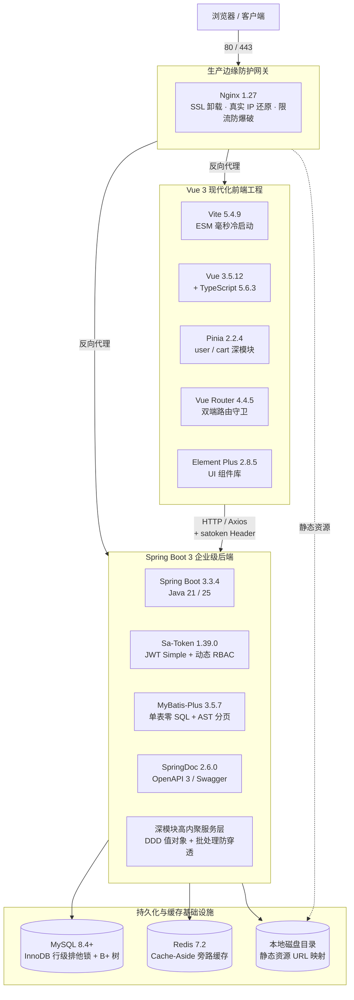

# 🛒 JavaWeb Shop 现代电商平台（课程设计与毕业设计全栈参考实现）

> 本项目为大学课程作业与毕业设计高标准全栈示范项目。严格遵循现代软件工程规范，采用 **Java 21 / Spring Boot 3.3.4** 与 **Vue 3.5.12 + TypeScript 5.6.3 + Vite 5.4.9** 前后端分离单体大仓（Monorepo）架构。
> 项目不仅提供了完整的电商端到端闭环（前台商城橱窗 + 购物车结算 + 订单履约 + 后台一体化管理控制台），更以经典著作《A Philosophy of Software Design》中的 **深模块（Deep Modules）** 与 **代码简化之道（Code Simplifier）** 为核心设计原则，系统性配套了 **1 篇新手导读（00）**、**11 篇底层原理与运维实战讲义（01 - 11）** 及 **答辩 Top 12 核心考问满分速查指南（Cheat Sheet）**。

---

## 🌟 核心技术栈与架构亮点



1. **全新现代化技术栈**：摒弃陈旧的 Java 8 / JSP / SSM 架构，全面采用 **JDK 21** 规范（兼容 JDK 25）与 Jakarta EE 命名空间，依托 **Spring Boot 3.3.4**、**MyBatis-Plus 3.5.7**、**Sa-Token 1.39.0**（JWT Simple 模式）与 **SpringDoc 2.6.0**；前端基于 **Vue 3.5.12**、**TypeScript 5.6.3**、原生 ES 模块驱动的 **Vite 5.4.9**、**Pinia 2.2.4** 及 **Element Plus 2.8.5** 构建。
2. **前后端分离双端统一视窗**：单套前端系统无缝整合面向普通顾客的**商城前台（`/`）**与面向运营人员的**管理控制台（`/admin`）**，配合动态路由守卫与 Axios 请求/响应拦截器全方位拦截越权；JWT 令牌持久化于浏览器 `localStorage`，服务端登录态与权限由 Sa-Token 统一托管（会话数据经 `sa-token-redis-jackson` 落 Redis，支持实时踢下线与禁用即失效）。
3. **单 SQL 状态机原子扣减库存 + 事务提交后缓存二次淘汰**：利用 InnoDB 行级排他锁与单条带状态条件的原子 SQL（`WHERE id = ? AND stock >= ?`）拦截并发穿透；扣减成功后即刻失效商品详情缓存，并通过统一封装的 `TransactionalCacheEvictor`（内部注册 `TransactionSynchronization.afterCommit`）在 MySQL 事务提交后二次淘汰，彻底杜绝高并发脏缓存。配套 10 线程并发压力测试严格断言（1 成功 9 拦截，库存精确归 0）。
4. **Cache-Aside 旁路缓存深模块与分区 Key 策略**：品牌、分类、商品详情与首页橱窗均在服务内部无感封装 Redis 读写与写后主动淘汰，Key 按业务维度精细分区：`catalog:showcase:home`（首页聚合橱窗，15 分钟）、`catalog:product:detail:{id}`（商品详情，30 分钟）、`catalog:category:tree` / `catalog:category:admin:tree`（分类树，24 小时）、`catalog:brand:all` / `catalog:brand:portal:all` / `catalog:brand:list:...` / `catalog:brand:featured:...`（品牌，6 小时），杜绝分页 Key 碰撞；Redis 异常时自动降级直查数据库。
5. **不可变数据快照（Snapshot Pattern）**：下单时深度冻结商品在购买瞬间的标题、价格与图片快照持久化至订单项，彻底隔离商家后续调价或下架对历史订单的篡改风险。
6. **DDD 领域建模与 Fowler 坏味道重构**：
   - 引入 **`DeliveryAddress`（收货信息值对象模式）**，封装收件人、手机号与详细地址，消除多字段数据泥团（Data Clumps）；
   - 提取 **`ProductBatchLookupHelper`** 统一收拢商品批处理防穿透检索；
   - 实体类内聚行为（`ShopCartItem.calculateSubtotal()` / `ShopOrderItem.calculateSubtotal()`），消除特性依恋（Feature Envy）；
   - 确立统一领域通用语言：商业上下文中全面以 **`customerId`（顾客编号）** 统一指代交易主体，数据库物理列名 `user_id` 通过 MyBatis-Plus `@TableField("user_id")` 解耦防腐，消除语义二义性。
7. **品牌产地（`origin`）全链路覆盖**：数据库 `shop_brand` 新增产地字段，后端实体/DTO/SQL 映射无缝贯通，前台首页品牌墙与商品详情页展示产地背书，管理后台支持产地维护与关键字检索。
8. **生产级边缘防护与全栈容器隔离（方案一，非当前线上环境）**：提供生产环境一键编排（`deploy/docker-compose.prod.yml`），Nginx 1.27 实现 80 端口 HTTP 301 强制跳转 443 HTTPS、Cloudflare 真实 IP 还原（`CF-Connecting-IP`）、登录接口 5r/s 限流防爆破，内部数据库与缓存零外部端口暴露。注意：当前线上试用环境（见第 13 条）仅保留 80 端口、由 Cloudflare 终结 TLS，与本方案源站自持证书的 443 形态不同。
9. **完整订单状态机与库存回补闭环**：`UNPAID → PAID → SHIPPED → COMPLETED` 全链路可流转，顾客可确认收货、管理员可标记发货；未发货订单（`UNPAID` / `PAID`）支持顾客或管理员取消并流转为 `CANCELLED`，取消时按订单快照数量原子回补商品库存并同步失效 Redis 详情缓存。
10. **首页聚合橱窗单请求渲染**：`GET /api/portal/home` 一次返回焦点轮播、甄选品牌、分类树、热门推荐与最新上架，避免瀑布流式多次往返；聚合结果缓存于 `catalog:showcase:home`（15 分钟），库存扣减、商品/品牌/分类变更时统一失效。
11. **商品主图/副图职责分离**：主图单张必填，贯穿列表、购物车与订单快照；副图可选多张，仅用于商品详情页图集。`ProductImageHelper` 同时兼容 JSON 数组与逗号分隔的历史数据，副图为空时自动以主图兜底。
12. **现代化视觉与克制动效**：前台商城与后台控制台共用一套玻璃拟态设计语言（`frontend/src/styles/glass.css`），商品卡片抽为可复用组件 `ProductCard.vue`，`v-reveal` 指令基于 `IntersectionObserver` 实现滚动入场，并尊重系统 `prefers-reduced-motion` 设置。
13. **云端试用环境已上线（HTTPS 可访问）**：阿里云 ECS（2 核 4G）以 5 个容器（MySQL 8.4 / Redis 7.2 / Spring Boot / Vue 静态站 / Nginx 网关）单机编排运行，公网仅开放 `80`（供 Cloudflare 回源）；对外唯一入口为 `https://shopnest.dpdns.org`，由 Cloudflare 提供边缘证书与代理，回源走 HTTP 80，绕开大陆节点对未备案域名的 TLS SNI 拦截；原 8080 / 8443 备用端口已下线，源站不再维护 TLS 证书；编排与网关配置维护在 [`deploy/trial/`](file:///D:/JavaWeb/deploy/trial)。

---

## 🚀 极速部署与运行指南（Quickstart & Configuration）

### 🌍 在线体验地址（云端试用环境）

项目已部署至阿里云 ECS（2 核 4G / 40G ESSD），可直接在线访问。**2026-11-18 实测**：以下入口与 `/api/portal/home`、`/api/portal/products` 均返回 HTTP 200（`code=200`），HTTPS 证书校验通过。

| 访问方式 | 地址 | 说明 |
| :--- | :--- | :--- |
| **HTTPS 域名（唯一入口）** | [https://shopnest.dpdns.org](https://shopnest.dpdns.org) | Cloudflare 边缘证书，浏览器显示锁标；回源走 HTTP 80 |
| **IP 直连** | [http://123.57.26.237](http://123.57.26.237) | 80 端口，公网 IP 直接访问，最稳（明文 HTTP，不适合正式对外） |

> 端口收敛后不再提供 `http://shopnest.dpdns.org:8080` 与 `https://shopnest.dpdns.org:8443` 入口，
> 这两条链路连同安全组规则已一并下线。浏览器地址栏出现「不安全」提示，说明当前访问的是
> `http://` 或非 443 端口，改为访问 `https://shopnest.dpdns.org`（不带端口）即可。

- 前台商城：上述地址直接打开即可浏览商品、下单结算
- 管理后台：上述地址后加 `/admin`（生产环境不预置账号，首次部署需按下方「管理员账号初始化」手动创建）
- 试用环境说明：容器化全栈部署（MySQL 8.4 + Redis 7.2 + Spring Boot + Vue + Nginx），源码配置位于 [`deploy/trial/`](file:///D:/JavaWeb/deploy/trial)，完整部署实录与踩坑记录见 [10-cloud-trial-deployment-guide.md](file:///D:/JavaWeb/docs/principles/10-cloud-trial-deployment-guide.md)；实例为短期试用机，到期后自动释放
- 部署包平铺文件：项目根目录的 `docker-compose.yml`、`shop.conf`、`frontend.conf`、`.env.example` 是打包上传时的暂存文件，日常维护与打包前请以 `deploy/trial/` 下的源文件为准

#### 🔐 HTTPS 与 DNS 现状

| 项目 | 现状 |
| :--- | :--- |
| DNS 托管 | Cloudflare（`bowen.ns.cloudflare.com` / `priscilla.ns.cloudflare.com`） |
| 代理状态 | `A @`、`A www` 均为**橙色云代理**，指向源站 `123.57.26.237` |
| SSL 模式 | **灵活 / Flexible**（Cloudflare → 源站为 HTTP 80） |
| 边缘证书 | Cloudflare 通用证书，自动续期 |
| 源站证书 | **已停用**（8443 下线后源站只跑 HTTP 80，不再加载任何证书） |
| 安全组 | 入方向公网仅放行 `80`（Cloudflare 回源 + IP 直连）与 ICMP；SSH `22` 已收敛至仅阿里云 Workbench 内网段 `100.104.0.0/16`，`8080`/`8443` 规则已删除，`3389` 显式拒绝 |

> **为什么不用 443 直连**：阿里云对解析到大陆节点的未备案域名做 TLS SNI 拦截，
> 带域名的 HTTPS 握手会被直接重置（纯 IP 或纯 HTTP 不受影响）。
> `dpdns.org` 属境外免费域名，无法国内备案，因此浏览器侧 TLS 只能交给 Cloudflare。
>
> **关于「不安全」提示**：浏览器只对 `https://` + 有效证书 + 443 端口显示锁标。
> 访问 `http://` 地址或 `xxx:8080` 这类非 443 端口时必然提示不安全，这与服务器配置无关。
> 正式入口固定使用 `https://shopnest.dpdns.org`（不带端口）。
>
> **证书续期已不需要**：源站 Let's Encrypt 证书随 8443 一起停用，acme.sh 已卸载、
> `/root/.acme.sh` 与 `/opt/shop/nginx/ssl` 已删除，cron 续期任务已清空；浏览器侧证书由
> Cloudflare 自动续期。如需恢复全链路加密，应改为 Cloudflare「完全（严格）」模式并把源站
> 改回 443 承载证书，而不是恢复 8443。

### ⚡ 推荐：一键启动与停止脚本（Windows）

项目根目录下已准备好开箱即用的自动化一键启动/停止脚本（支持 CMD 批处理与 PowerShell）：

- **一键启动**：双击运行根目录下的 [`start.bat`](file:///D:/JavaWeb/start.bat)（或在终端执行 `.\start.ps1`）
  1. **Redis 状态自检**：检测 6379 端口是否处于监听状态。若未运行，优先尝试通过 WSL 调用 `Ubuntu-22.04` 的 Redis 服务启动；如无 WSL 环境，则自动拉起或复用独立的无密码开发容器 `shop-dev-redis`（`redis:7.2-alpine`，映射本地 `6379` 端口）；
  2. **MySQL 端口检测**：检测本地 3306 端口连通性，若未就绪输出醒目告警提示；
  3. **后端自动拉起**：自动开启新终端窗口，进入 `backend/` 目录执行 `mvn spring-boot:run`，服务启动于 **8080** 端口；
  4. **前端自动拉起**：自动开启新终端窗口，进入 `frontend/` 目录执行 `npm run dev`，开发服务器启动于 **5173** 端口；
  5. **就绪探测与自动打开浏览器**：轮询探测后端 `http://localhost:8080/api/portal/home`（最长约 180 秒）与前端 `http://localhost:5173`（最长约 120 秒），两者均返回 200 后打印测试账号并自动调用系统默认浏览器打开前台商城页面 `http://localhost:5173`；若超时未就绪则输出告警，需查看对应窗口日志后手动打开。

- **一键停止**：双击运行根目录下的 [`stop.bat`](file:///D:/JavaWeb/stop.bat)（或在终端执行 `.\stop.ps1`）
  - 自动定位并精准终止占用 **8080**（后端 Spring Boot）与 **5173**（前端 Vite）端口的进程 PID；
  - **保留持久化基础服务**：显式保留本地 MySQL (3306) 与 Redis (6379) 数据服务继续运行，避免频繁启停数据容器，便于下次即时无缝重启。

---

### 🌐 端口映射与网络配置全景（Ports Matrix）

| 服务组件 | 运行模式 | 监听端口 | 访问控制 | 默认访问地址 / 端点 | 说明 |
| :--- | :--- | :--- | :--- | :--- | :--- |
| **前端开发服务** | 开发环境 (Vite) | `5173` | 本地宿主网络 | [http://localhost:5173](http://localhost:5173) | Vite Dev Server，通过配置代理反向代理 `/api` 与 `/uploads` 至 8080 |
| **后端应用服务** | 开发/容器 (Spring Boot) | `8080` | 开发对外 / 生产内网 | `http://localhost:8080/api/` | 纯 REST API 服务，统一路由前缀为 `/api/`；根路径 `/` 无页面，直接访问仅返回 404 JSON 提示，页面入口请访问 5173 |
| **交互式 API 文档** | SpringDoc OpenAPI | `8080` | 开发对外 / 生产内网 | [http://localhost:8080/swagger-ui/index.html](http://localhost:8080/swagger-ui/index.html) | 规范元数据位于 `/v3/api-docs` |
| **MySQL 关系数据库** | 本地/容器 (MySQL 8.4) | `3306` | 本地对外 / 生产内网 | `localhost:3306` | 数据库名 `shop_db`，默认用户 `root`，默认密码 `ghtnby666` |
| **Redis 内存缓存** | 本地/容器 (Redis 7.2) | `6379` | 本地对外 / 生产内网 | `localhost:6379` | Cache-Aside 旁路缓存与精细化分区 Key 存储 |
| **Nginx 边缘网关 (HTTP)** | 生产环境 (Nginx) | `80` | 外部公网开放 | `http://<域名或服务器IP>` | 强制执行 HTTP 301 永久重定向至 443 HTTPS |
| **Nginx 边缘网关 (HTTPS)** | 生产环境 (Nginx) | `443` | 外部公网开放 (唯一入口) | `https://<域名或服务器IP>` | SSL 卸载、Cloudflare 真实 IP 还原、限流、静态文件零拷贝 alias 托管 |
| **Nginx 边缘网关（试用）** | 试用环境 (`deploy/trial`) | `80` | 外部公网开放 | [https://shopnest.dpdns.org](https://shopnest.dpdns.org)（经 Cloudflare）/ `http://<IP>` | Cloudflare 边缘 HTTPS 终结，回源明文 HTTP 80；源站不监听 8080/8443，也不加载证书 |
| **内部基础服务（试用）** | 容器内网 | `3306` / `6379` / `8080` | 仅 Docker 内部网络 | `shop-mysql` / `shop-redis` / `shop-backend` | MySQL、Redis、后端均不映射宿主机端口，仅 Nginx 对外暴露 |

---

### ⚙️ 环境变量与生产配置规范（Environment Settings）

系统支持完备的开发配置与生产容器化环境变量分层注入：

- **开发环境配置**：位于 `backend/src/main/resources/application.yml`，默认直连本地 `localhost:3306` 与 `localhost:6379`。
- **生产环境配置模板**：位于 `deploy/.env.example`，部署时复制为 `deploy/.env` 并填入强密码（真正被编排读取生效的仅下列 3 项，容器主机名与端口等已在 `deploy/docker-compose.prod.yml` 中固定注入）：
  ```bash
  # 1. 数据库安全配置（root 口令同时用于 MySQL 初始化与应用连接）
  DB_ROOT_PASSWORD=Shop_Prod_Root_Secret_2026!
  DB_NAME=shop_db

  # 2. Redis 缓存鉴权配置
  REDIS_PASSWORD=Shop_Prod_Redis_Token_2026!
  ```
  > 模板中保留的 `DB_PASSWORD`、`DB_USER`、`DOMAIN_NAME` 当前不被编排读取（后端固定以 `root` + `DB_ROOT_PASSWORD` 连接数据库），仅供外部备忘或按需清理。
- **容器内环境变量注入**：`shop-mysql` / `shop-redis` / `shop-backend` 的主机名（`shop-mysql`、`shop-redis`）、端口（`3306`、`6379`）与 `SPRING_PROFILES_ACTIVE=prod` 由 `deploy/docker-compose.prod.yml` 的 `environment` 段直接声明，无需在 `.env` 中重复配置。
- **生产容器隔离编排**：`deploy/docker-compose.prod.yml` 将所有 5 个容器（`shop-mysql`, `shop-redis`, `shop-backend`, `shop-frontend`, `shop-nginx`）收敛入独立的内部网桥 `shop-internal-network`，外部仅暴露出边缘 Nginx 的 `80` 与 `443` 端口，实现数据库与后端零外部端口暴露。
- **试用环境变量模板**：位于 [`deploy/trial/.env.example`](file:///D:/JavaWeb/deploy/trial/.env.example)（根目录 [`.env.example`](file:///D:/JavaWeb/.env.example) 为打包副本），仅 3 项，未填写时使用 `deploy/trial/docker-compose.yml` 中的默认值：
  ```bash
  DB_ROOT_PASSWORD=Shop_Trial_2026!
  REDIS_PASSWORD=Shop_Trial_Redis_2026!
  DB_NAME=shop_db
  ```
- **试用容器编排**：`deploy/trial/docker-compose.yml` 采用「本地构建产物 + 官方镜像」模式，5 个容器接入 `shop-trial-network`，仅 `shop-nginx` 映射 `80`（不再映射 `8080` / `8443`，也不再挂载 `./nginx/ssl` 证书目录）；`shop-backend` 必须保留 `command: ["java", "-jar", "/app/app.jar"]`，否则官方 JRE 镜像会立即退出并反复重启。
- **试用编排前置步骤**：该编排的 MySQL 挂载源是 `./sql/schema.sql`，仓库内不存放 SQL 副本。若要在 `deploy/trial` 目录直接执行 `docker compose up`，请先把 `docs/sql/schema.sql` 复制到 `deploy/trial/sql/`；否则 Docker 会把缺失的挂载源建成空目录，导致 MySQL 初始化失败并循环重启。按 `docs/principles/10-cloud-trial-deployment-guide.md` 打包时已包含该复制步骤。
- **前端环境变量**：支持可选的 `VITE_API_BASE_URL`，缺省为空字符串 `''`，自动无缝适配 Vite 开发反向代理与生产 Nginx 反向代理。

---

### 🛠️ 分步手动启动指南

若需在 Linux/macOS 或不使用一键脚本的环境下手动作业，请遵循以下标准流程：

#### 1. 环境准备要求
- **JDK**：21 或 25（已验证兼容并提供平滑运行保障）
- **Node.js**：18.0+ 或 20.0+，包管理工具 `npm`
- **MySQL**：8.0+ 或 8.4+（推荐字符集 `utf8mb4`）
- **Redis**：7.0+ 或 7.2+（默认端口 `6379`）
- **Docker**：（可选，用于启动独立 Redis 容器，或运行生产/试用全栈编排）

#### 2. 启动 Redis 缓存
本地开发配置（`application.yml`）默认连接**无密码**的 `localhost:6379`，推荐直接运行一个独立的 Redis 容器：

```bash
docker run -d --name shop-dev-redis -p 6379:6379 redis:7.2-alpine
```

*如已安装本地 Redis 或 WSL Redis，确保其在 `localhost:6379` 正常运行且未设置密码即可。*

> 注意：根目录 `docker-compose.yml` 是**试用环境的全栈编排**（挂载 `app/app.jar`、`dist/`、`sql/` 等构建产物），不是本地开发用的 Redis 单服务编排，请勿在本地直接对它执行 `docker compose up -d`。

#### 3. 初始化 MySQL 数据库
1. 登录本地 MySQL，创建并核对数据库：
   - 数据库名称：`shop_db`
   - 本地开发默认密码：`ghtnby666`（若本地密码不同，请在 `backend/src/main/resources/application.yml` 中相应修改 `spring.datasource.password`）。
2. 按顺序执行位于 `docs/sql/` 目录下的初始化 SQL 脚本：
   - **创建表结构**：执行 [docs/sql/schema.sql](file:///D:/JavaWeb/docs/sql/schema.sql)
   - **导入初始种子数据**：执行 [docs/sql/data.sql](file:///D:/JavaWeb/docs/sql/data.sql)

#### 4. 启动后端工程（Spring Boot）
进入后端目录，使用 Maven 运行：
```bash
cd backend
mvn spring-boot:run
```
- 后端服务接口地址：`http://localhost:8080`
- **交互式 Swagger API 文档**：[http://localhost:8080/swagger-ui/index.html](http://localhost:8080/swagger-ui/index.html)

#### 5. 启动前端工程（Vue 3 + Vite）
另起一个终端窗口，进入前端目录：
```bash
cd frontend
npm install
npm run dev
```
- 前端商城访问入口：[http://localhost:5173](http://localhost:5173)

---

## 🔑 预设测试账号与权限矩阵

本地开发环境由 `data.sql` 预置下列演示账号（密码采用 BCrypt 哈希，明文见种子文件，仅限本机使用）：

| 角色身份 | 用户名 | 权限范围与演示路径 |
| :--- | :--- | :--- |
| **系统管理员** | `admin` | **管理后台权限**（`/admin`）：商品管理、品牌管理、分类管理、用户管理、订单发货履约 |
| **演示顾客** | `customer` | **商城前台权限**（`/`）：前台商品浏览、查看详情、购物车增减勾选、下单结算、个人订单流转 |

> **生产环境不写入任何种子账号**：`deploy/docker-compose.prod.yml` 已刻意不挂载 `data.sql`，
> 首次部署后数据库只有表结构。切勿沿用默认凭据对外提供服务。

### 管理员账号初始化

生产环境首次部署后没有任何账号，按以下任一方式创建管理员：

1. 前台正常注册一个账号（自动获得 `ROLE_CUSTOMER`），再在服务器上提权：

```sql
update sys_user set role = 'ROLE_ADMIN' where username = '你的账号';
```

2. 或直接插入一条管理员记录，`password` 填 BCrypt 哈希（可借前台注册接口生成后复制）：

```sql
insert into sys_user (username, password, nickname, avatar, role, status)
values ('admin', '$2a$10$你的BCrypt哈希', '系统管理员', '/uploads/avatar-admin.jpg', 'ROLE_ADMIN', 1);
```

---

## 🧪 全栈自动化工程与高并发集成测试（Testing）

本项目构建了端到端前后端双重自动化测试套件，全面保障代码重构稳健性与高并发安全：

### 1. 后端单元测试与秒杀高并发压测（JUnit 5 + Spring Boot Test）
```bash
cd backend
# 运行全套后端测试（67 个测试用例全部通过）
mvn test

# 专项运行 10 线程并发防超卖压测
mvn test -Dtest=OrderConcurrencyTest
```
- **测试覆盖范围**：共计 15 个测试类、**67 个测试用例 100% 通过**，覆盖用户认证（`AuthControllerTest`、`AuthServiceTest`）、目录与商品（`BrandServiceTest`、`CategoryServiceTest`、`CategoryTreeBuilderTest`、`ProductCatalogServiceTest`、`ProductAdminServiceTest`、`ProductControllerTest`、`CatalogControllerTest`）、购物车结算与订单全状态流转（`CartServiceTest`、`CommerceControllerTest`、`OrderCheckoutServiceTest`、`OrderAdminFilterAndPaginationTest`），以及本地存储与全局异常（`LocalStorageAndExceptionTest`）、并发防超卖（`OrderConcurrencyTest`）。
- **秒杀并发断言验证**：`OrderConcurrencyTest` 模拟 10 个线程利用 `CountDownLatch` 门闩在同一纳秒并发争抢仅 1 件库存，严格断言 **1 笔成功、9 笔被原子拦截**，最终数据库物理库存**精确归 0，绝对杜绝负库存或超卖**。

### 2. 前端现代化工程测试（Vitest 2.1 + happy-dom）
```bash
cd frontend
# 运行全套前端测试套件（19 个测试用例全部秒级通过）
npm test
```
- **测试覆盖范围**：涵盖 4 个核心测试模块，共计 **19 个测试断言用例 100% 毫秒级通过**：
  1. `router.spec.ts` (7 个测试)：测试 Vue Router 全局导航守卫、未登录访问受保护路由自动重定向至 `/login?redirect=...`、普通顾客访问 `/admin` 阻断并重定向至首页、管理员合法放行后台控制台；
  2. `request.spec.ts` (4 个测试)：测试 Axios 请求拦截器自动从 `localStorage` 获取 Token 并注入 `satoken` 请求头、网络响应 401 自动清除会话并阻断错误传递；
  3. `cart.spec.ts` (6 个测试)：测试 Pinia `useCartStore` 响应式状态流转、已勾选商品件数（`checkedCount`）与结算总额（`totalAmount`）响应式计算、本地持久化缓存（`shop_cart_cache`）与乐观更新；
  4. `user-cart-sync.spec.ts` (2 个测试)：测试登录/登出时顾客身份切换与购物车本地缓存的联动同步，避免不同账号间购物车数据串号。

### 3. 前端状态管理与认证机制（Pinia Stores & Auth）
- **Stores 模块划分**：前端采用 Pinia 进行模块化状态管理，主要包含：
  - `useUserStore` (`frontend/src/stores/user.ts`)：响应式维护当前用户资料（`user`）与登录态，提供 `isLoggedIn`、`isAdmin` 等计算属性，处理登录、登出与个人资料更新。
  - `useCartStore` (`frontend/src/stores/cart.ts`)：响应式维护购物车快照与条目列表，内聚商品勾选、数量变更、小计与总额计算，并通过 `shop_cart_cache` 键自动持久化至本地缓存。
- **Token 存储机制**：认证 Token 统一直接持久化存储于浏览器的 `localStorage` 中（Key 为 `'token'`）。Axios 请求拦截器（`frontend/src/api/request.ts`）在发送请求时直接调用 `localStorage.getItem('token')`，将令牌无缝挂载至 `satoken` 请求头；当接收到 401 Unauthorized 响应时，拦截器直接清除 `localStorage` 中的 `token`、`user` 与 `shop_cart_cache` 缓存，并通过 `auth:expired` 事件通知 Pinia 同步退出，与后端 Sa-Token（JWT 令牌 + Redis 会话状态）认证机制深度契合。

---

## 📚 课程答辩与核心原理系列讲义（Principles Lectures）

为满足高校课程作业与毕业设计答辩对“讲清楚所用技术和原理”的严苛要求，本项目在 `docs/principles/` 目录下精心编撰了 **1 篇新手导读与 11 篇全景深度技术与运维讲义**：

| 讲义编号 | 文档链接与核心主题 | 核心涵盖考点 |
| :--- | :--- | :--- |
| **00** | [新手导读与代码地图（阅读前必读）](file:///D:/JavaWeb/docs/principles/00-beginner-guide.md) | 前置基础清单、项目目录与功能地图、首页/登录/加购/结算/后台保存的完整请求链路、日志与常见报错排查、术语速查、推荐阅读顺序 |
| **01** | [Spring Boot 3 核心底层原理与深模块架构设计](file:///D:/JavaWeb/docs/principles/01-springboot3-internals-and-architecture.md) | 自动装配演进（`AutoConfiguration.imports`）、Bean 完整生命周期、构造器注入、深模块（Deep Modules）设计原则 |
| **02** | [无状态认证与 Sa-Token 权限鉴权原理](file:///D:/JavaWeb/docs/principles/02-auth-and-satoken.md) | JWT 令牌结构、数字签名防伪算法、Sa-Token 拦截链路、ThreadLocal 上下文绑定、BCrypt 动态盐哈希 |
| **03** | [ORM 演进、AST 语法树重写与 MySQL 索引事务原理](file:///D:/JavaWeb/docs/principles/03-orm-and-mybatis-plus.md) | JDBC 到 MyBatis-Plus 演进、JSqlParser AST 动态 SQL 改写分页、InnoDB B+ 树物理结构、ACID 与 Undo/Redo Log |
| **04** | [Redis 缓存设计模式与经典高并发攻防](file:///D:/JavaWeb/docs/principles/04-redis-caching-patterns.md) | Cache-Aside 旁路缓存模式、写操作淘汰缓存一致性保障、缓存穿透/击穿/雪崩防御、Redis 单线程 epoll 多路复用 |
| **05** | [高并发库存防超卖原理与极简原子化设计](file:///D:/JavaWeb/docs/principles/05-concurrency-and-inventory-safety.md) | 电商四大扣减方案优劣对比、单 SQL 条件原子更新（Code Simplifier 哲学）、CountDownLatch 并发集成测试 |
| **06** | [Vue 3 响应式原理、Vite ESM 极速构建与现代前端架构](file:///D:/JavaWeb/docs/principles/06-vue3-and-vite-modern-frontend.md) | ES6 Proxy vs. Object.defineProperty、WeakMap 依赖收集、Vite 原生 ESM 毫秒冷启动、Pinia 客户端响应式深模块 |
| **07** | [课程答辩高频核心考问与满分应答秘籍](file:///D:/JavaWeb/docs/principles/07-course-defense-qa.md) | **Top 12 答辩高频核心考问全景解答**（含考官意图剖析、满分话术、源码类名行数引用） |
| **08** | [项目安全防护体系与网络传输防御（答辩知识全景）](file:///D:/JavaWeb/docs/principles/08-defense-knowledge.md) | **8 维纵深防御体系**、BCrypt/IDOR 越权/单 SQL 原子防超卖、**HTTP 本地权衡 vs. HTTPS 生产级 SSL 卸载**、答辩安全考问话术 |
| **09** | [方案一生产环境安全部署与 Cloudflare 边缘防护实战](file:///D:/JavaWeb/docs/principles/09-scheme1-production-deployment-guide.md) | **Cloudflare 小黄云隐藏源站 IP**、15年 Origin CA 证书、**Nginx 访客真实 IP 还原与登录限流防爆破**、全栈容器隔离一键部署 |
| **10** | [云端试用环境部署实战教程（阿里云 ECS 单机容器化）](file:///D:/JavaWeb/docs/principles/10-cloud-trial-deployment-guide.md) | **本地构建 + 服务器运行** 的轻量部署思路、Docker/Compose 安装与镜像加速、**Let's Encrypt DNS-01 证书签发（历史）**、**阿里云 SNI 拦截定位与 Cloudflare 接入**、**端口收敛到仅 80 的最小暴露面**、**19 个真实踩坑与解决方案**、日常运维与版本更新流程 |
| **11** | [远程运维接入与默认凭据加固实战](file:///D:/JavaWeb/docs/principles/11-remote-ops-and-credential-hardening.md) | **Workbench CLI 免密运维通道**、RAM 最小权限策略与 `Forbidden.RAM` 排查、**默认管理员口令的发现与处置**、Sa-Token 存量会话失效、**生产种子数据切断**、**公网 SSH 收敛到内网网段**、8 个实操踩坑 |

---

## 🎯 答辩 Top 12 核心问题快速索引（Cheat Sheet）

在答辩现场若遇到考官提问，可快速检索下列标准答案（详见 [07-course-defense-qa.md](file:///D:/JavaWeb/docs/principles/07-course-defense-qa.md)）：

1. **Q1: 为什么不用 Spring Security，而选 Sa-Token？**
   - *答*：Spring Security 6 过滤器链繁琐且黑盒较多，基于传统 Session 架构适配无状态 JWT 成本高；Sa-Token 属于基于 MVC 拦截器的现代化轻量级鉴权框架，天然适配无状态 Token 架构，支持声明式路由匹配 `SaRouter` 与原生 Redis 扩展。
2. **Q2: 高并发下如何防止库存超卖？**
   - *答*：采用单条带状态条件的原子 SQL：`UPDATE shop_product SET stock = stock - #{quantity} WHERE id = #{id} AND stock >= #{quantity}`，利用 InnoDB 行级排他锁由内核串行化执行；判断受影响行数 `affectedRows == 0` 时立即抛出业务异常触发 Spring 事务回滚，杜绝超卖与负库存。
3. **Q3: 什么是“深模块”？在项目里体现在哪里？**
   - *答*：接口极简、实现极深。例如 `OrderCheckoutService.checkout()` 仅暴露一个方法，内部高度内聚了购物车勾选过滤、并发原子扣减、不可变快照生成、事务一致性、购物车物理清理 5 大复杂逻辑，对外隐藏复杂细节。
4. **Q4: 密码是如何加密的？为什么不用 MD5？**
   - *答*：采用 BCrypt 算法。MD5 属于快速哈希算法，极易被预计算彩虹表碰撞破解；BCrypt 自带 128 位动态随机盐（相同明文每次生成完全不同密文），并采用 CPU/内存密集型的工作因子，强力抵御离线暴力破解。
5. **Q5: MyBatis-Plus 分页插件的底层原理是什么？**
   - *答*：基于 MyBatis 拦截器拦截 `Executor.query()`，使用 `JSqlParser` 将原始 SQL 语法解析为 AST 抽象语法树，自动生成 `COUNT(*)` 优化查询，并在末尾动态拼接当前数据库方言的 `LIMIT` 物理分页子句。
6. **Q6: Redis 缓存一致性如何保证？为什么淘汰缓存优于更新缓存？**
   - *答*：采用 Cache-Aside 旁路缓存模式。写操作时遵循“先更新数据库，再淘汰缓存”，避免多线程并发更新缓存时造成的乱序脏数据覆盖，并消除无读请求时的无效计算开销。
7. **Q7: 什么是缓存穿透、击穿、雪崩？如何防御？**
   - *答*：穿透（查数据库不存在的数据）采用参数强校验与缓存空对象（短 TTL）；击穿（单热点 Key 过期瞬间被并发穿透）采用互斥锁或逻辑过期；雪崩（大批量 Key 同时到期）通过在基础 TTL 上增加随机抖动打散过期时间窗口。
8. **Q8: Vue 3 响应式相比 Vue 2 有何质的飞跃？**
   - *答*：Vue 2 的 `Object.defineProperty` 必须递归遍历所有属性，且无法原生监听属性新增/删除及数组下标修改；Vue 3 基于 ES6 `Proxy` 全方位代理整个对象，配合 `WeakMap` 实现细粒度惰性依赖收集，性能与扩展性大幅提升。
9. **Q9: 为什么使用 Vite 而不是 Webpack？**
   - *答*：Webpack 启动前必须抓取全量依赖打包生成 Bundle（$O(N)$ 复杂度）；Vite 基于浏览器原生 ESM，开发服务器毫秒级冷启动，按需转译当前请求的组件单文件，极大提升开发与调试效率。
10. **Q10: 商家修改商品标题或价格，历史订单数据会不会被篡改？**
    - *答*：绝对不会。采用不可变快照模式（Snapshot Pattern），在下单结算瞬间将商品标题、价格、主图深拷贝持久化至 `shop_order_item` 表中，与原商品表数据完全解耦。
11. **Q11: 数据库表列名是 user_id，为什么 Java 实体和 Service 统一使用 customerId？**
    - *答*：遵循 DDD 领域驱动设计通用语言（Ubiquitous Language）与 ORM 防腐层设计。在电商交易闭环中，买家主体是明确的**顾客（Customer）**，维护主体是**管理员（Administrator）**，消除泛化 `userId` 的二义性；通过 MyBatis-Plus `@TableField("user_id")` 注解解耦数据库物理表列名与 Java 领域模型，同时将收货信息高内聚封装为 `DeliveryAddress` 值对象，既保证物理向后兼容又实现代码的深模块清晰表达。
12. **Q12: 前端如何防止普通顾客越权访问后台管理控制台？如何通过自动化测试证明安全性？**
    - *答*：构建“前端路由守卫拦截 + 后端 Sa-Token 强校验兜底 + Vitest 自动化测试断言”三重立体防护。前端全局导航守卫（`router.beforeEach`）严格检查路由元信息 `requiresAuth` 与 `requiresAdmin`，配合 `userStore.isAdmin` 阻断非管理员访问；后端配置 `SaRouter.match("/api/admin/**", r -> StpUtil.checkRole("ROLE_ADMIN"))` 强制熔断未授权调用；编写 `frontend/test/router.spec.ts` 自动化测试套件（前端全套 19 个测试之一部），在轻量 DOM 仿真环境下验证未登录拦截重定向至 `/login`、顾客拦截重定向至首页 `/`、管理员放行，执行 `npm test` 毫秒级断言安全闭环。

---

## 📁 项目目录结构全景

```
D:\JavaWeb
├── backend/                       # Spring Boot 3.3.4 后端工程
│   ├── src/main/java/com/shop/
│   │   ├── ShopApplication.java   # 后端引导启动入口类
│   │   ├── common/                # 通用基础能力 (全局异常处理器、统一响应 Result/PageResult、本地存储、通用上传、缓存淘汰执行器 cache/TransactionalCacheEvictor)
│   │   ├── config/                # 核心配置 (WebMvcConfig, SaTokenConfig, MyBatisPlusConfig, OpenApiConfig, StpInterfaceImpl)
│   │   └── modules/
│   │       ├── auth/              # 用户认证模块 (登录、注册、个人资料查询与修改)
│   │       ├── catalog/           # 目录与商品模块 (品牌产地、分类树、商品管理、首页聚合橱窗、service/util 检索与图片工具)
│   │       ├── commerce/          # 商业闭环模块 (购物车、高并发原子订单结算、订单状态机、DeliveryAddress 值对象、商品批处理防穿透)
│   │       └── system/            # 系统基础模块 (用户账号查询、启用/禁用与角色数据)
│   ├── src/main/resources/
│   │   ├── application.yml        # 开发环境配置 (端口 8080、MySQL 3306、Redis 6379、JWT 密钥)
│   │   └── application-prod.yml   # 生产环境容器化配置 (环境变量动态注入、日志落盘)
│   ├── src/test/java/com/shop/    # 单元测试与高并发压测套件 (15 个测试类 / 67 个测试用例，含 OrderConcurrencyTest)
│   ├── uploads/                   # 本地开发静态资源与图片上传存储目录
│   ├── pom.xml                    # Maven 依赖清单 (Spring Boot 3.3.4, Sa-Token 1.39.0, MyBatis-Plus 3.5.7)
│   └── Dockerfile                 # 多阶段构建后端镜像 (Maven 3.9 编译 -> Temurin-21-JRE 运行，非 root 用户)
├── frontend/                      # Vue 3 + Vite 现代化前端工程
│   ├── src/
│   │   ├── api/                   # 统一 Axios 客户端封装 (request.ts, auth, brand, cart, category, order, product, user)
│   │   ├── components/            # 可复用业务组件 (ProductCard.vue 商品卡片)
│   │   ├── directives/            # 自定义指令 (reveal.ts 滚动入场，尊重 reduced-motion)
│   │   ├── layouts/               # 双端布局组件 (商城前台 PortalLayout, 管理后台 AdminLayout)
│   │   ├── router/                # 路由定义与全局前置导航权限守卫 (requiresAuth, requiresAdmin)
│   │   ├── stores/                # Pinia 响应式状态管理 (user.ts, cart.ts, index.ts)
│   │   ├── styles/                # 全局视觉体系 (glass.css 玻璃拟态设计语言)
│   │   ├── utils/                 # 前端工具函数 (format.ts, image.ts, order.ts)
│   │   └── views/
│   │       ├── admin/             # 后台管理视图 (仪表盘、商品、品牌产地、分类、订单履约、用户管理)
│   │       ├── auth/              # 登录与注册一体化视图 (LoginView.vue)
│   │       └── portal/            # 商城前台视图 (首页橱窗、商品组合检索、商品详情、购物车结算、订单历史)
│   ├── test/                      # Vitest 自动化测试套件 (4 个 spec / 19 个测试)
│   ├── package.json               # 前端依赖配置 (Vue 3.5.12, TypeScript 5.6.3, Vite 5.4.9, Pinia 2.2.4, Element Plus 2.8.5)
│   ├── vite.config.ts             # Vite 构建与开发代理配置 (端口 5173，代理 /api 与 /uploads 至 8080)
│   ├── nginx.conf                 # 前端容器内部静态托管 Nginx 配置 (SPA history 回退与 Gzip 压缩)
│   └── Dockerfile                 # 多阶段构建前端镜像 (Node 20 编译 -> Nginx 1.27 托管)
├── deploy/                        # 部署资源
│   ├── docker-compose.prod.yml    # 生产全栈 5 容器安全编排 (单网络隔离，仅暴露 80/443)
│   ├── .env.example               # 生产环境变量模板 (数据库强密码、Redis 鉴权、生产域名)
│   ├── nginx/                     # 生产边缘网关配置 (真实 IP 还原、限流、SSL 卸载、站点配置、证书指南)
│   ├── scripts/                   # 生产部署脚本 (deploy.sh / deploy.bat)
│   └── trial/                     # 云端试用环境编排 (docker-compose.yml、setup.sh、nginx/shop.conf、nginx/frontend.conf、.env.example)
├── docs/                          # 设计与技术文档体系
│   ├── adr/                       # 架构决策记录 (ADR 0001 技术选型, ADR 0002 领域边界, ADR 0003 基础设施与教学资料)
│   ├── sql/                       # 数据库 DDL (schema.sql 7 张核心表)、种子数据 (data.sql) 与数据字典 (README.md)
│   ├── principles/                # 新手导读与核心底层原理讲义 (00 导读 + 01 - 11 讲全景矩阵)
│   ├── agents/                    # AI 协作与工单管理规范 (issue-tracker.md)
│   └── 团队四人详细分工与AI协作答辩指南.md # 团队四人职责边界、AI 协作流程与答辩速成手册
├── CONTEXT.md                     # 领域驱动设计统一语言 (Ubiquitous Language) 与实体词汇表
├── PROJECT.md                     # 项目当前交付状态、功能清单、接口契约与验证结果
├── docker-compose.yml             # 云端试用环境全栈编排 (打包平铺副本，源文件见 deploy/trial/)
├── shop.conf / frontend.conf      # 试用环境 Nginx 网关与静态站配置 (打包平铺副本)
├── .env.example                   # 试用环境变量模板 (打包平铺副本)
├── start.bat / start.ps1          # 本地一键极速启动脚本 (自检 Redis/MySQL，拉起前后端并自动打开浏览器)
├── stop.bat / stop.ps1            # 本地一键安全停止脚本 (精准终止 8080 与 5173 端口进程，保留数据服务)
├── nginx/ shop-trial/             # 空目录 (历史打包残留，可安全删除)
└── README.md                      # 综合部署、技术架构与答辩总览指南 (本文档)
```
