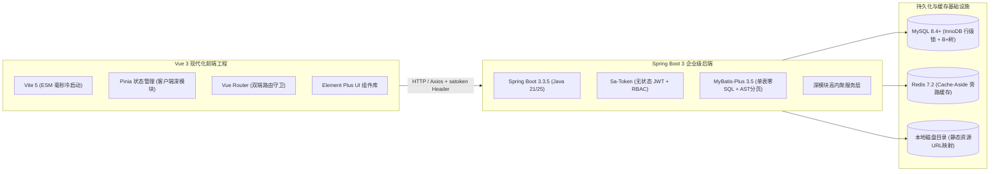

# 🛒 JavaWeb Shop 现代电商平台（课程设计与毕业设计全栈参考实现）

> 本项目为大学课程作业与毕业设计高标准全栈示范项目。严格遵循现代软件工程规范，采用 **Spring Boot 3.3+ (Java 21/25)** 与 **Vue 3 + Vite** 前后端分离单体大仓（Monorepo）架构。
> 项目不仅提供了完整的电商端到端闭环（前台商城橱窗 + 购物车结算 + 订单履约 + 后台一体化管理控制台），更以经典著作《A Philosophy of Software Design》中的 **深模块（Deep Modules）** 与 **代码简化之道（Code Simplifier）** 为核心原则，系统性配套了 6 篇高水准底层原理技术讲义及答辩满分指南。

---

## 🌟 核心技术栈与架构亮点



1. **全新现代化技术栈**：摒弃陈旧的 Java 8 / JSP / SSM 架构，全面采用 JDK 21+ 规范与 Jakarta EE 命名空间，前端采用原生 ES 模块驱动的 Vite + Vue 3 Composition API。
2. **前后端分离双端统一视窗**：单套前端系统无缝整合面向普通顾客的**商城前台（`/`）**与面向运营人员的**管理控制台（`/admin`）**，配合动态路由守卫拦截越权。
3. **单 SQL 状态机原子扣减库存（零超卖保证）**：坚决摒弃容易产生竞态条件的查后更新反模式，利用 InnoDB 行级排他锁与单条带状态条件的原子 SQL 拦截并发穿透，配套严谨的 10 线程并发压力测试断言。
4. **Cache-Aside 旁路缓存深模块封装**：在品牌与分类服务内部无感封装 Redis 缓存读取与写后主动淘汰，外部调用方完全无感底层缓存细节。
5. **不可变数据快照（Snapshot Pattern）**：下单时深度冻结商品在购买瞬间的标题、价格与图片快照，彻底隔离商家后续调价对历史订单的篡改风险。

---

## 🚀 极速部署与运行指南（Quickstart）

只需按照以下 4 个步骤操作，任何评审人员或助教均可在本地零障碍运行本项目：

### 1. 环境准备要求
- **JDK**：21 或 25（已验证兼容）
- **Node.js**：18.0+ 或 20.0+，包管理工具 `npm`
- **MySQL**：8.0+ 或 8.4+（推荐字符集 `utf8mb4`）
- **Docker**：（可选，用于一键启动 Redis）

---

### 2. 启动 Redis 缓存（Docker 一键启动）
在项目根目录下执行以下命令，即可拉起预配置好的 Redis 7.2 容器：
```bash
docker-compose up -d
```
*如已有本地安装的 Redis，只需确保在 `localhost:6379` 运行即可。*

---

### 3. 初始化 MySQL 数据库
1. 登录本地 MySQL，创建并初始化数据库：
   - 数据库名称：`shop_db`
   - 默认密码配置：`ghtnby666`（如本地密码不同，请在 `backend/src/main/resources/application.yml` 中修改 `spring.datasource.password`）。
2. 按顺序执行位于 `docs/sql/` 目录下的初始化 SQL 脚本：
   - **创建表结构**：执行 [docs/sql/schema.sql](file:///D:/JavaWeb/docs/sql/schema.sql)
   - **导入初始种子数据**：执行 [docs/sql/data.sql](file:///D:/JavaWeb/docs/sql/data.sql)

---

### 4. 启动后端工程（Spring Boot）
进入后端目录并使用 Maven 启动：
```bash
cd backend
mvn spring-boot:run
```
- 后端服务端口：`http://localhost:8080`
- **交互式 Swagger API 文档**：[http://localhost:8080/swagger-ui/index.html](http://localhost:8080/swagger-ui/index.html)

---

### 5. 启动前端工程（Vue 3 + Vite）
另起一个终端窗口，进入前端目录：
```bash
cd frontend
npm install
npm run dev
```
- 前端访问入口：[http://localhost:5173](http://localhost:5173)

---

## 🔑 预设测试账号与权限矩阵

系统已在 `data.sql` 中预置了不同角色的演示账号（密码采用 BCrypt 安全哈希）：

| 角色身份 | 用户名 | 登录密码 | 权限范围与演示路径 |
| :--- | :--- | :--- | :--- |
| **平台超级管理员** | `admin` | `admin123` | **管理后台权限**（`/admin`）：商品管理、品牌管理、分类管理、用户管理、订单发货履约 |
| **演示顾客** | `customer` | `123456` | **商城前台权限**（`/`）：前台商品浏览、查看详情、购物车增减勾选、下单结算、个人订单流转 |

---

## 🧪 高并发防超卖集成测试

系统配套了高并发多线程测试用例，真实模拟 10 个线程利用 `CountDownLatch` 在同一瞬间争抢仅 1 件库存的秒杀场景：

```bash
cd backend
mvn test -Dtest=OrderConcurrencyTest
```
**断言验证结果**：
- 严格断言：**1 笔订单成功，9 笔被原子拦截**；
- 最终数据库物理库存：**精确归 0，绝对杜绝负库存或超卖**。

---

## 📚 课程答辩与核心原理系列讲义（Principles Lectures）

为满足高校课程作业与毕业设计答辩对“讲清楚所用技术和原理”的严苛要求，本项目在 `docs/principles/` 目录下精心编撰了 7 篇全景深度技术讲义：

| 讲义编号 | 文档链接与核心主题 | 核心涵盖考点 |
| :--- | :--- | :--- |
| **01** | [Spring Boot 3 核心底层原理与深模块架构设计](file:///D:/JavaWeb/docs/principles/01-springboot3-internals-and-architecture.md) | 自动装配演进（`AutoConfiguration.imports`）、Bean 完整生命周期、构造器注入、深模块（Deep Modules）设计原则 |
| **02** | [无状态认证与 Sa-Token 权限鉴权原理](file:///D:/JavaWeb/docs/principles/02-auth-and-satoken.md) | JWT 令牌结构、数字签名防伪算法、Sa-Token 拦截链路、ThreadLocal 上下文绑定、BCrypt 动态盐哈希 |
| **03** | [ORM 演进、AST 语法树重写与 MySQL 索引事务原理](file:///D:/JavaWeb/docs/principles/03-orm-and-mybatis-plus.md) | JDBC 到 MyBatis-Plus 演进、JSqlParser AST 动态 SQL 改写分页、InnoDB B+ 树物理结构、ACID 与 Undo/Redo Log |
| **04** | [Redis 缓存设计模式与经典高并发攻防](file:///D:/JavaWeb/docs/principles/04-redis-caching-patterns.md) | Cache-Aside 旁路缓存模式、写操作淘汰缓存一致性保障、缓存穿透/击穿/雪崩防御、Redis 单线程 epoll 多路复用 |
| **05** | [高并发库存防超卖原理与极简原子化设计](file:///D:/JavaWeb/docs/principles/05-concurrency-and-inventory-safety.md) | 电商四大扣减方案优劣对比、单 SQL 条件原子更新（Code Simplifier 哲学）、CountDownLatch 并发集成测试 |
| **06** | [Vue 3 响应式原理、Vite ESM 极速构建与现代前端架构](file:///D:/JavaWeb/docs/principles/06-vue3-and-vite-modern-frontend.md) | ES6 Proxy vs. Object.defineProperty、WeakMap 依赖收集、Vite 原生 ESM 毫秒冷启动、Pinia 客户端响应式深模块 |
| **07** | [课程答辩高频核心考问与满分应答秘籍](file:///D:/JavaWeb/docs/principles/07-course-defense-qa.md) | **Top 10 答辩高频核心考问全景解答**（含考官意图剖析、满分话术、源码类名行数引用） |

---

## 🎯 答辩 Top 10 核心问题快速索引（Cheat Sheet）

在答辩现场若遇到考官提问，可快速检索下列标准答案（详见 [07-course-defense-qa.md](file:///D:/JavaWeb/docs/principles/07-course-defense-qa.md)）：

1. **Q1: 为什么不用 Spring Security，而选 Sa-Token？**
   - *答*：Spring Security 6 过滤器链繁琐且黑盒多，基于 Session 适配 Token 成本高；Sa-Token 属于基于 MVC 拦截器的轻量级方案，支持声明式路由匹配 `SaRouter` 与原生 Redis 扩展。
2. **Q2: 高并发下如何防止库存超卖？**
   - *答*：单条带状态条件的原子 SQL：`UPDATE shop_product SET stock = stock - #{quantity} WHERE id = #{id} AND stock >= #{quantity}`，利用 InnoDB 行级排他锁由内核串行化执行；判断受影响行数 `affectedRows == 0` 时立即抛异常触发事务回滚。
3. **Q3: 什么是“深模块”？在项目里体现在哪里？**
   - *答*：接口极简、实现极深。例如 `OrderCheckoutService.checkout()` 仅暴露一个方法，内部原子封装了购物车勾选过滤、并发原子扣减、不可变快照生成、事务一致性、购物车物理清理 5 大复杂逻辑。
4. **Q4: 密码是如何加密的？为什么不用 MD5？**
   - *答*：采用 BCrypt 算法。MD5 易被彩虹表碰撞破解；BCrypt 自带 128 位动态随机盐（相同明文产生完全不同密文），并采用 CPU 密集型工作因子抵御离线暴力破解。
5. **Q5: MyBatis-Plus 分页插件的底层原理是什么？**
   - *答*：基于 MyBatis 拦截器拦截 `Executor.query()`，使用 `JSqlParser` 将 SQL 解析为 AST 抽象语法树，自动生成 `COUNT(*)` 优化查询，并在末尾拼接当前方言的 `LIMIT` 物理分页。
6. **Q6: Redis 缓存一致性如何保证？为什么淘汰缓存优于更新缓存？**
   - *答*：采用 Cache-Aside 模式。写操作时“先更新数据库，再淘汰缓存”，避免多线程并发更新缓存造成的乱序脏数据覆盖，并消除无读请求时的无效计算。
7. **Q7: 什么是缓存穿透、击穿、雪崩？如何防御？**
   - *答*：穿透（查不存在的数据）用参数强校验+缓存空对象；击穿（单热点 Key 过期）用互斥锁或逻辑过期；雪崩（大批量 Key 同时到期）用随机 TTL 抖动打散时间窗口。
8. **Q8: Vue 3 响应式相比 Vue 2 有何质的飞跃？**
   - *答*：Vue 2 的 `Object.defineProperty` 无法原生监听属性新增/删除及数组下标；Vue 3 基于 ES6 `Proxy` 全方位代理对象，支持原生数组操作与惰性响应式加载。
9. **Q9: 为什么使用 Vite 而不是 Webpack？**
   - *答*：Webpack 启动前必须抓取全量依赖打包生成 Bundle（$O(N)$ 复杂度）；Vite 基于浏览器原生 ESM，开发服务器秒级启动，按需转译当前请求的组件文件，开发体验极速。
10. **Q10: 商家修改商品标题或价格，历史订单数据会不会被篡改？**
    - *答*：绝对不会。采用不可变快照模式（Snapshot Pattern），下单瞬间将商品标题、价格、主图深拷贝持久化至 `shop_order_item` 表中，与原商品表完全解耦。

---

## 📁 项目目录结构全景

```
D:\JavaWeb
├── backend/                       # Spring Boot 3.3.5 后端工程
│   ├── src/main/java/com/shop/
│   │   ├── ShopApplication.java   # 引导启动类
│   │   ├── common/                # 通用基础能力 (全局异常、统一结果、本地存储深模块)
│   │   ├── config/                # 核心配置 (WebMvc、Sa-Token、MyBatis-Plus、OpenApi)
│   │   └── modules/
│   │       ├── auth/              # 用户认证模块 (登录、注册、个人资料)
│   │       ├── catalog/           # 目录与商品模块 (品牌、分类、商品管理与橱窗)
│   │       ├── commerce/          # 商业闭环模块 (购物车、高并发安全订单结算)
│   │       └── system/            # 系统基础模块 (用户账号管理)
│   └── src/test/java/com/shop/    # 单元测试与高并发压测 (OrderConcurrencyTest 等)
├── frontend/                      # Vue 3 + Vite 现代化前端工程
│   ├── src/
│   │   ├── api/                   # 统一 Axios API 客户端封装
│   │   ├── layouts/               # 商城前台与管理后台双端布局组件
│   │   ├── router/                # 路由定义与角色权限守卫
│   │   ├── stores/                # Pinia 响应式状态管理深模块 (auth, cart)
│   │   └── views/
│   │       ├── admin/             # 后台管理视图 (商品、品牌、分类、订单、用户管理)
│   │       ├── auth/              # 登录认证视图
│   │       └── portal/            # 商城前台视图 (首页橱窗、商品详情、购物车、订单历史)
├── docs/                          # 设计与技术文档体系
│   ├── adr/                       # 架构决策记录 (ADR 0001 - 0003)
│   ├── sql/                       # 数据库 DDL 结构脚本与初始化种子数据
│   └── principles/                # 核心底层原理深度讲义与答辩指南 (01 - 07)
├── docker-compose.yml             # Redis 容器化编排文件
└── README.md                      # 综合部署与答辩总览指南
```
