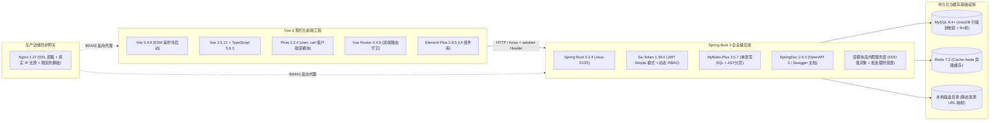

# 🛒 JavaWeb Shop 现代电商平台（课程设计与毕业设计全栈参考实现）

> 本项目为大学课程作业与毕业设计高标准全栈示范项目。严格遵循现代软件工程规范，采用 **Java 21 / Spring Boot 3.3.4** 与 **Vue 3.5.12 + TypeScript 5.6.3 + Vite 5.4.9** 前后端分离单体大仓（Monorepo）架构。
> 项目不仅提供了完整的电商端到端闭环（前台商城橱窗 + 购物车结算 + 订单履约 + 后台一体化管理控制台），更以经典著作《A Philosophy of Software Design》中的 **深模块（Deep Modules）** 与 **代码简化之道（Code Simplifier）** 为核心设计原则，系统性配套了 **9 篇高水准底层原理深度讲义（01 - 09）** 及 **答辩 Top 12 核心考问满分速查指南（Cheat Sheet）**。

---

## 🌟 核心技术栈与架构亮点



1. **全新现代化技术栈**：摒弃陈旧的 Java 8 / JSP / SSM 架构，全面采用 **JDK 21** 规范（兼容 JDK 25）与 Jakarta EE 命名空间，依托 **Spring Boot 3.3.4**、**MyBatis-Plus 3.5.7**、**Sa-Token 1.39.0**（JWT Simple 模式）与 **SpringDoc 2.6.0**；前端基于 **Vue 3.5.12**、**TypeScript 5.6.3**、原生 ES 模块驱动的 **Vite 5.4.9**、**Pinia 2.2.4** 及 **Element Plus 2.8.5** 构建。
2. **前后端分离双端统一视窗**：单套前端系统无缝整合面向普通顾客的**商城前台（`/`）**与面向运营人员的**管理控制台（`/admin`）**，配合动态路由守卫与 Axios 请求/响应拦截器全方位拦截越权；JWT 令牌持久化于 `localStorage`，无状态跨域交互。
3. **单 SQL 状态机原子扣减库存 + 事务提交后缓存二次淘汰**：利用 InnoDB 行级排他锁与单条带状态条件的原子 SQL（`WHERE id = ? AND stock >= ?`）拦截并发穿透；扣减成功后即刻失效商品详情缓存，并通过 `TransactionSynchronization.afterCommit` 钩子在 MySQL 事务提交后二次淘汰，彻底杜绝高并发脏缓存。配套 10 线程并发压力测试严格断言（1 成功 9 拦截，库存精确归 0）。
4. **Cache-Aside 旁路缓存深模块与分区 Key 策略**：在品牌与分类服务内部无感封装 Redis 缓存读取与写后主动淘汰；品牌全量与分页列表按查询参数精细化分区缓存（`catalog:brand:all` 与 `catalog:brand:list:...`），杜绝分页 Key 碰撞。
5. **不可变数据快照（Snapshot Pattern）**：下单时深度冻结商品在购买瞬间的标题、价格与图片快照持久化至订单项，彻底隔离商家后续调价或下架对历史订单的篡改风险。
6. **DDD 领域建模与 Fowler 坏味道重构**：
   - 引入 **`DeliveryAddress`（收货信息值对象模式）**，封装收件人、手机号与详细地址，消除多字段数据泥团（Data Clumps）；
   - 提取 **`ProductBatchLookupHelper`** 统一收拢商品批处理防穿透检索；
   - 实体类内聚行为（`ShopCartItem.calculateSubtotal()` / `ShopOrderItem.calculateSubtotal()`），消除特性依恋（Feature Envy）；
   - 确立统一领域通用语言：商业上下文中全面以 **`customerId`（顾客编号）** 统一指代交易主体，数据库物理列名 `user_id` 通过 MyBatis-Plus `@TableField("user_id")` 解耦防腐，消除语义二义性。
7. **品牌产地（`origin`）全链路覆盖**：数据库 `shop_brand` 新增产地字段，后端实体/DTO/SQL 映射无缝贯通，前台商城橱窗与管理后台支持产地即时展示与条件过滤。
8. **生产级边缘防护与全栈容器隔离**：提供生产环境一键编排（`deploy/docker-compose.prod.yml`），Nginx 1.27 实现 80 端口 HTTP 301 强制跳转 443 HTTPS、Cloudflare 真实 IP 还原（`CF-Connecting-IP`）、登录接口 5r/s 限流防爆破，内部数据库与缓存零外部端口暴露。

---

## 🚀 极速部署与运行指南（Quickstart & Configuration）

### ⚡ 推荐：一键启动与停止脚本（Windows）

项目根目录下已准备好开箱即用的自动化一键启动/停止脚本（支持 CMD 批处理与 PowerShell）：

- **一键启动**：双击运行根目录下的 [`start.bat`](file:///D:/JavaWeb/start.bat)（或在终端执行 `.\start.ps1`）
  1. **Redis 状态自检**：检测 6379 端口是否处于监听状态。若未运行，优先尝试通过 WSL 调用 `Ubuntu-22.04` 的 Redis 服务启动，如无 WSL 环境则自动通过 `docker compose up -d redis` 容器化兜底启动；
  2. **MySQL 端口检测**：检测本地 3306 端口连通性，若未就绪输出醒目告警提示；
  3. **后端自动拉起**：自动开启新终端窗口，进入 `backend/` 目录执行 `mvn spring-boot:run`，服务启动于 **8080** 端口；
  4. **前端自动拉起**：自动开启新终端窗口，进入 `frontend/` 目录执行 `npm run dev`，开发服务器启动于 **5173** 端口；
  5. **自动打开浏览器**：倒计时等待 6 秒（待底层与前端初始化就绪）并打印测试账号后，自动调用系统默认浏览器打开前台商城页面 `http://localhost:5173`。

- **一键停止**：双击运行根目录下的 [`stop.bat`](file:///D:/JavaWeb/stop.bat)（或在终端执行 `.\stop.ps1`）
  - 自动定位并精准终止占用 **8080**（后端 Spring Boot）与 **5173**（前端 Vite）端口的进程 PID；
  - **保留持久化基础服务**：显式保留本地 MySQL (3306) 与 Redis (6379) 数据服务继续运行，避免频繁启停数据容器，便于下次即时无缝重启。

---

### 🌐 端口映射与网络配置全景（Ports Matrix）

| 服务组件 | 运行模式 | 监听端口 | 访问控制 | 默认访问地址 / 端点 | 说明 |
| :--- | :--- | :--- | :--- | :--- | :--- |
| **前端开发服务** | 开发环境 (Vite) | `5173` | 本地宿主网络 | [http://localhost:5173](http://localhost:5173) | Vite Dev Server，通过配置代理反向代理 `/api` 与 `/uploads` 至 8080 |
| **后端应用服务** | 开发/容器 (Spring Boot) | `8080` | 开发对外 / 生产内网 | [http://localhost:8080](http://localhost:8080) | 核心 REST API 统一路由前缀为 `/api/` |
| **交互式 API 文档** | SpringDoc OpenAPI | `8080` | 开发对外 / 生产内网 | [http://localhost:8080/swagger-ui/index.html](http://localhost:8080/swagger-ui/index.html) | 规范元数据位于 `/v3/api-docs` |
| **MySQL 关系数据库** | 本地/容器 (MySQL 8.4) | `3306` | 本地对外 / 生产内网 | `localhost:3306` | 数据库名 `shop_db`，默认用户 `root`，默认密码 `ghtnby666` |
| **Redis 内存缓存** | 本地/容器 (Redis 7.2) | `6379` | 本地对外 / 生产内网 | `localhost:6379` | Cache-Aside 旁路缓存与精细化分区 Key 存储 |
| **Nginx 边缘网关 (HTTP)** | 生产环境 (Nginx) | `80` | 外部公网开放 | `http://<域名或服务器IP>` | 强制执行 HTTP 301 永久重定向至 443 HTTPS |
| **Nginx 边缘网关 (HTTPS)** | 生产环境 (Nginx) | `443` | 外部公网开放 (唯一入口) | `https://<域名或服务器IP>` | SSL 卸载、Cloudflare 真实 IP 还原、限流、静态文件零拷贝 alias 托管 |

---

### ⚙️ 环境变量与生产配置规范（Environment Settings）

系统支持完备的开发配置与生产容器化环境变量分层注入：

- **开发环境配置**：位于 `backend/src/main/resources/application.yml`，默认直连本地 `localhost:3306` 与 `localhost:6379`。
- **生产环境配置模板**：位于 `deploy/.env.example`，部署时复制为 `deploy/.env` 并填入强密码：
  ```bash
  # 1. 数据库安全配置
  DB_ROOT_PASSWORD=Shop_Prod_Root_Secret_2026!
  DB_PASSWORD=Shop_Prod_User_Secret_2026!
  DB_NAME=shop_db
  DB_USER=root
  DB_HOST=shop-mysql
  DB_PORT=3306

  # 2. Redis 缓存鉴权配置
  REDIS_PASSWORD=Shop_Prod_Redis_Token_2026!
  REDIS_HOST=shop-redis
  REDIS_PORT=6379

  # 3. 生产域名与运行时参数
  DOMAIN_NAME=shop.example.com
  SPRING_PROFILES_ACTIVE=prod
  ```
- **生产容器隔离编排**：`deploy/docker-compose.prod.yml` 将所有 5 个容器（`shop-mysql`, `shop-redis`, `shop-backend`, `shop-frontend`, `shop-nginx`）收敛入独立的内部网桥 `shop-internal-network`，外部仅暴露出边缘 Nginx 的 `80` 与 `443` 端口，实现数据库与后端零外部端口暴露。
- **前端环境变量**：支持可选的 `VITE_API_BASE_URL`，缺省为空字符串 `''`，自动无缝适配 Vite 开发反向代理与生产 Nginx 反向代理。

---

### 🛠️ 分步手动启动指南

若需在 Linux/macOS 或不使用一键脚本的环境下手动作业，请遵循以下标准流程：

#### 1. 环境准备要求
- **JDK**：21 或 25（已验证兼容并提供平滑运行保障）
- **Node.js**：18.0+ 或 20.0+，包管理工具 `npm`
- **MySQL**：8.0+ 或 8.4+（推荐字符集 `utf8mb4`）
- **Redis**：7.0+ 或 7.2+（默认端口 `6379`）
- **Docker**：（可选，用于一键启动 Redis 或生产容器集群）

#### 2. 启动 Redis 缓存
在项目根目录下通过 Docker 快速启动 Redis 7.2 实例：
```bash
docker compose up -d
```
*如已安装本地 Redis 或 WSL Redis，确保其在 `localhost:6379` 正常运行即可。*

#### 3. 初始化 MySQL 数据库
1. 登录本地 MySQL，创建并核对数据库：
   - 数据库名称：`shop_db`
   - 本地开发默认密码：`ghtnby666`（若本地密码不同，请在 `backend/src/main/resources/application.yml` 中相应修改 `spring.datasource.password`）。
2. 按顺序执行位于 `docs/sql/` 目录下的初始化 SQL 脚本：
   - **创建表结构**：执行 [docs/sql/schema.sql](file:///D:/JavaWeb/docs/sql/schema.sql)
   - **导入初始种子数据**：执行 [docs/sql/data.sql](file:///D:/JavaWeb/docs/sql/data.sql)

#### 4. 启动后端工程（Spring Boot）
进入后端目录，使用 Maven 运行：
```bash
cd backend
mvn spring-boot:run
```
- 后端服务接口地址：`http://localhost:8080`
- **交互式 Swagger API 文档**：[http://localhost:8080/swagger-ui/index.html](http://localhost:8080/swagger-ui/index.html)

#### 5. 启动前端工程（Vue 3 + Vite）
另起一个终端窗口，进入前端目录：
```bash
cd frontend
npm install
npm run dev
```
- 前端商城访问入口：[http://localhost:5173](http://localhost:5173)

---

## 🔑 预设测试账号与权限矩阵

系统已在 `data.sql` 中预置了不同角色的演示账号（密码采用 BCrypt 安全哈希）：

| 角色身份 | 用户名 | 登录密码 | 权限范围与演示路径 |
| :--- | :--- | :--- | :--- |
| **系统管理员** | `admin` | `admin123` | **管理后台权限**（`/admin`）：商品管理、品牌管理、分类管理、用户管理、订单发货履约 |
| **演示顾客** | `customer` | `123456` | **商城前台权限**（`/`）：前台商品浏览、查看详情、购物车增减勾选、下单结算、个人订单流转 |

---

## 🧪 全栈自动化工程与高并发集成测试（Testing）

本项目构建了端到端前后端双重自动化测试套件，全面保障代码重构稳健性与高并发安全：

### 1. 后端单元测试与秒杀高并发压测（JUnit 5 + Spring Boot Test）
```bash
cd backend
# 运行全套后端测试（44 个测试用例全部通过）
mvn test

# 专项运行 10 线程并发防超卖压测
mvn test -Dtest=OrderConcurrencyTest
```
- **测试覆盖范围**：共计 13 个测试类、**44 个测试用例 100% 通过**，覆盖用户认证（`AuthControllerTest`）、目录与商品（`BrandServiceTest`, `CategoryServiceTest`, `ProductServiceTest`）、购物车结算与订单流转（`CartServiceTest`, `OrderServiceTest`）、值对象与批处理助手单元测试等。
- **秒杀并发断言验证**：`OrderConcurrencyTest` 模拟 10 个线程利用 `CountDownLatch` 门闩在同一纳秒并发争抢仅 1 件库存，严格断言 **1 笔成功、9 笔被原子拦截**，最终数据库物理库存**精确归 0，绝对杜绝负库存或超卖**。

### 2. 前端现代化工程测试（Vitest 2.1 + happy-dom）
```bash
cd frontend
# 运行全套前端测试套件（15 个测试用例全部秒级通过）
npm test
```
- **测试覆盖范围**：涵盖 3 个核心测试模块，共计 **15 个测试断言用例 100% 毫秒级通过**：
  1. `router.spec.ts` (7 个测试)：测试 Vue Router 全局导航守卫、未登录访问受保护路由自动重定向至 `/login?redirect=...`、普通顾客访问 `/admin` 阻断并重定向至首页、管理员合法放行后台控制台；
  2. `request.spec.ts` (4 个测试)：测试 Axios 请求拦截器自动从 `localStorage` 获取 Token 并注入 `satoken` 请求头、网络响应 401 自动清除会话并阻断错误传递；
  3. `cart.spec.ts` (4 个测试)：测试 Pinia `useCartStore` 响应式状态流转、已勾选商品件数（`checkedCount`）与结算总额（`totalAmount`）响应式计算、本地持久化缓存（`shop_cart_cache`）与乐观更新。

### 3. 前端状态管理与无状态认证架构（Pinia Stores & Auth）
- **Stores 模块划分**：前端采用 Pinia 进行模块化状态管理，主要包含：
  - `useUserStore` (`frontend/src/stores/user.ts`)：响应式维护当前用户资料（`user`）与登录态，提供 `isLoggedIn`、`isAdmin` 等计算属性，处理登录、登出与个人资料更新。
  - `useCartStore` (`frontend/src/stores/cart.ts`)：响应式维护购物车快照与条目列表，内聚商品勾选、数量变更、小计与总额计算，并通过 `shop_cart_cache` 键自动持久化至本地缓存。
- **Token 存储机制**：认证 Token 统一直接持久化存储于浏览器的 `localStorage` 中（Key 为 `'token'`）。Axios 请求拦截器（`frontend/src/api/request.ts`）在发送请求时直接调用 `localStorage.getItem('token')`，将令牌无缝挂载至 `satoken` 请求头；当接收到 401 Unauthorized 响应时，拦截器直接清除 `localStorage` 中的 `token` 与 `user` 缓存，实现与后端 Sa-Token 无状态认证机制的深度契合。

---

## 📚 课程答辩与核心原理系列讲义（Principles Lectures）

为满足高校课程作业与毕业设计答辩对“讲清楚所用技术和原理”的严苛要求，本项目在 `docs/principles/` 目录下精心编撰了 **9 篇全景深度技术讲义**：

| 讲义编号 | 文档链接与核心主题 | 核心涵盖考点 |
| :--- | :--- | :--- |
| **01** | [Spring Boot 3 核心底层原理与深模块架构设计](file:///D:/JavaWeb/docs/principles/01-springboot3-internals-and-architecture.md) | 自动装配演进（`AutoConfiguration.imports`）、Bean 完整生命周期、构造器注入、深模块（Deep Modules）设计原则 |
| **02** | [无状态认证与 Sa-Token 权限鉴权原理](file:///D:/JavaWeb/docs/principles/02-auth-and-satoken.md) | JWT 令牌结构、数字签名防伪算法、Sa-Token 拦截链路、ThreadLocal 上下文绑定、BCrypt 动态盐哈希 |
| **03** | [ORM 演进、AST 语法树重写与 MySQL 索引事务原理](file:///D:/JavaWeb/docs/principles/03-orm-and-mybatis-plus.md) | JDBC 到 MyBatis-Plus 演进、JSqlParser AST 动态 SQL 改写分页、InnoDB B+ 树物理结构、ACID 与 Undo/Redo Log |
| **04** | [Redis 缓存设计模式与经典高并发攻防](file:///D:/JavaWeb/docs/principles/04-redis-caching-patterns.md) | Cache-Aside 旁路缓存模式、写操作淘汰缓存一致性保障、缓存穿透/击穿/雪崩防御、Redis 单线程 epoll 多路复用 |
| **05** | [高并发库存防超卖原理与极简原子化设计](file:///D:/JavaWeb/docs/principles/05-concurrency-and-inventory-safety.md) | 电商四大扣减方案优劣对比、单 SQL 条件原子更新（Code Simplifier 哲学）、CountDownLatch 并发集成测试 |
| **06** | [Vue 3 响应式原理、Vite ESM 极速构建与现代前端架构](file:///D:/JavaWeb/docs/principles/06-vue3-and-vite-modern-frontend.md) | ES6 Proxy vs. Object.defineProperty、WeakMap 依赖收集、Vite 原生 ESM 毫秒冷启动、Pinia 客户端响应式深模块 |
| **07** | [课程答辩高频核心考问与满分应答秘籍](file:///D:/JavaWeb/docs/principles/07-course-defense-qa.md) | **Top 12 答辩高频核心考问全景解答**（含考官意图剖析、满分话术、源码类名行数引用） |
| **08** | [项目安全防护体系与网络传输防御（答辩知识全景）](file:///D:/JavaWeb/docs/principles/08-defense-knowledge.md) | **8 维纵深防御体系**、BCrypt/IDOR 越权/单 SQL 原子防超卖、**HTTP 本地权衡 vs. HTTPS 生产级 SSL 卸载**、答辩安全考问话术 |
| **09** | [方案一生产环境安全部署与 Cloudflare 边缘防护实战](file:///D:/JavaWeb/docs/principles/09-scheme1-production-deployment-guide.md) | **Cloudflare 小黄云隐藏源站 IP**、15年 Origin CA 证书、**Nginx 访客真实 IP 还原与登录限流防爆破**、全栈容器隔离一键部署 |

---

## 🎯 答辩 Top 12 核心问题快速索引（Cheat Sheet）

在答辩现场若遇到考官提问，可快速检索下列标准答案（详见 [07-course-defense-qa.md](file:///D:/JavaWeb/docs/principles/07-course-defense-qa.md)）：

1. **Q1: 为什么不用 Spring Security，而选 Sa-Token？**
   - *答*：Spring Security 6 过滤器链繁琐且黑盒较多，基于传统 Session 架构适配无状态 JWT 成本高；Sa-Token 属于基于 MVC 拦截器的现代化轻量级鉴权框架，天然适配无状态 Token 架构，支持声明式路由匹配 `SaRouter` 与原生 Redis 扩展。
2. **Q2: 高并发下如何防止库存超卖？**
   - *答*：采用单条带状态条件的原子 SQL：`UPDATE shop_product SET stock = stock - #{quantity} WHERE id = #{id} AND stock >= #{quantity}`，利用 InnoDB 行级排他锁由内核串行化执行；判断受影响行数 `affectedRows == 0` 时立即抛出业务异常触发 Spring 事务回滚，杜绝超卖与负库存。
3. **Q3: 什么是“深模块”？在项目里体现在哪里？**
   - *答*：接口极简、实现极深。例如 `OrderCheckoutService.checkout()` 仅暴露一个方法，内部高度内聚了购物车勾选过滤、并发原子扣减、不可变快照生成、事务一致性、购物车物理清理 5 大复杂逻辑，对外隐藏复杂细节。
4. **Q4: 密码是如何加密的？为什么不用 MD5？**
   - *答*：采用 BCrypt 算法。MD5 属于快速哈希算法，极易被预计算彩虹表碰撞破解；BCrypt 自带 128 位动态随机盐（相同明文每次生成完全不同密文），并采用 CPU/内存密集型的工作因子，强力抵御离线暴力破解。
5. **Q5: MyBatis-Plus 分页插件的底层原理是什么？**
   - *答*：基于 MyBatis 拦截器拦截 `Executor.query()`，使用 `JSqlParser` 将原始 SQL 语法解析为 AST 抽象语法树，自动生成 `COUNT(*)` 优化查询，并在末尾动态拼接当前数据库方言的 `LIMIT` 物理分页子句。
6. **Q6: Redis 缓存一致性如何保证？为什么淘汰缓存优于更新缓存？**
   - *答*：采用 Cache-Aside 旁路缓存模式。写操作时遵循“先更新数据库，再淘汰缓存”，避免多线程并发更新缓存时造成的乱序脏数据覆盖，并消除无读请求时的无效计算开销。
7. **Q7: 什么是缓存穿透、击穿、雪崩？如何防御？**
   - *答*：穿透（查数据库不存在的数据）采用参数强校验与缓存空对象（短 TTL）；击穿（单热点 Key 过期瞬间被并发穿透）采用互斥锁或逻辑过期；雪崩（大批量 Key 同时到期）通过在基础 TTL 上增加随机抖动打散过期时间窗口。
8. **Q8: Vue 3 响应式相比 Vue 2 有何质的飞跃？**
   - *答*：Vue 2 的 `Object.defineProperty` 必须递归遍历所有属性，且无法原生监听属性新增/删除及数组下标修改；Vue 3 基于 ES6 `Proxy` 全方位代理整个对象，配合 `WeakMap` 实现细粒度惰性依赖收集，性能与扩展性大幅提升。
9. **Q9: 为什么使用 Vite 而不是 Webpack？**
   - *答*：Webpack 启动前必须抓取全量依赖打包生成 Bundle（$O(N)$ 复杂度）；Vite 基于浏览器原生 ESM，开发服务器毫秒级冷启动，按需转译当前请求的组件单文件，极大提升开发与调试效率。
10. **Q10: 商家修改商品标题或价格，历史订单数据会不会被篡改？**
    - *答*：绝对不会。采用不可变快照模式（Snapshot Pattern），在下单结算瞬间将商品标题、价格、主图深拷贝持久化至 `shop_order_item` 表中，与原商品表数据完全解耦。
11. **Q11: 数据库表列名是 user_id，为什么 Java 实体和 Service 统一使用 customerId？**
    - *答*：遵循 DDD 领域驱动设计通用语言（Ubiquitous Language）与 ORM 防腐层设计。在电商交易闭环中，买家主体是明确的**顾客（Customer）**，维护主体是**管理员（Administrator）**，消除泛化 `userId` 的二义性；通过 MyBatis-Plus `@TableField("user_id")` 注解解耦数据库物理表列名与 Java 领域模型，同时将收货信息高内聚封装为 `DeliveryAddress` 值对象，既保证物理向后兼容又实现代码的深模块清晰表达。
12. **Q12: 前端如何防止普通顾客越权访问后台管理控制台？如何通过自动化测试证明安全性？**
    - *答*：构建“前端路由守卫拦截 + 后端 Sa-Token 强校验兜底 + Vitest 自动化测试断言”三重立体防护。前端全局导航守卫（`router.beforeEach`）严格检查路由元信息 `requiresAuth` 与 `requiresAdmin`，配合 `userStore.isAdmin` 阻断非管理员访问；后端配置 `SaRouter.match("/api/admin/**", r -> StpUtil.checkRole("ROLE_ADMIN"))` 强制熔断未授权调用；编写 `frontend/test/router.spec.ts` 自动化测试套件（全套 15 个测试之一部），在轻量 DOM 仿真环境下验证未登录拦截重定向至 `/login`、顾客拦截重定向至首页 `/`、管理员放行，执行 `npm test` 毫秒级断言安全闭环。

---

## 📁 项目目录结构全景

```
D:\JavaWeb
├── backend/                       # Spring Boot 3.3.4 后端工程
│   ├── src/main/java/com/shop/
│   │   ├── ShopApplication.java   # 后端引导启动入口类
│   │   ├── common/                # 通用基础能力 (全局异常处理器、统一结果封装 ApiResponse、本地存储 LocalStorageService)
│   │   ├── config/                # 核心配置 (WebMvcConfig, SaTokenConfig, MyBatisPlusConfig, OpenApiConfig)
│   │   └── modules/
│   │       ├── auth/              # 用户认证模块 (登录、注册、个人资料查询与修改)
│   │       ├── catalog/           # 目录与商品模块 (品牌产地支持、分类树、商品管理与首页橱窗)
│   │       ├── commerce/          # 商业闭环模块 (购物车、高并发原子订单结算、DeliveryAddress 值对象、商品批处理防穿透)
│   │       └── system/            # 系统基础模块 (用户账号管理与角色分配)
│   ├── src/main/resources/
│   │   ├── application.yml        # 开发环境核心配置文件 (本地端口 8080, MySQL 3306, Redis 6379)
│   │   └── application-prod.yml   # 生产环境容器化配置文件 (环境变量动态注入)
│   ├── src/test/java/com/shop/    # 单元测试与高并发压测套件 (OrderConcurrencyTest 等 44 个测试用例)
│   ├── uploads/                   # 本地开发静态资源与图片上传存储目录
│   ├── pom.xml                    # Maven 项目依赖构建清单 (Spring Boot 3.3.4, Sa-Token 1.39.0, MP 3.5.7)
│   └── Dockerfile                 # 多阶段构建后端镜像 (Maven 3.9 编译 -> Temurin-21-JRE 运行，非 root 用户)
├── frontend/                      # Vue 3 + Vite 现代化前端工程
│   ├── src/
│   │   ├── api/                   # 统一 Axios API 客户端封装 (request.ts, auth, brand, cart, category, order, product, user)
│   │   ├── layouts/               # 双端布局组件 (商城前台 PortalLayout, 管理后台 AdminLayout)
│   │   ├── router/                # 路由定义与全局前置导航权限守卫 (requiresAuth, requiresAdmin)
│   │   ├── stores/                # Pinia 响应式状态管理深模块 (user.ts, cart.ts, index.ts)
│   │   └── views/
│   │       ├── admin/             # 后台管理视图 (商品管理、品牌产地、分类管理、订单履约、用户管理)
│   │       ├── auth/              # 登录与注册一体化视图 (LoginView.vue)
│   │       └── portal/            # 商城前台视图 (首页橱窗、商品组合检索、商品详情、购物车结算、订单历史)
│   ├── test/                      # Vitest 自动化测试套件 (cart.spec.ts, request.spec.ts, router.spec.ts 共 15 个测试)
│   ├── package.json               # 前端依赖配置 (Vue 3.5.12, TypeScript 5.6.3, Vite 5.4.9, Pinia 2.2.4, Element Plus 2.8.5)
│   ├── vite.config.ts             # Vite 构建与开发代理配置 (端口 5173，代理 /api 与 /uploads 至 8080)
│   ├── nginx.conf                 # 前端容器内部静态托管 Nginx 配置 (SPA history 模式路由回退与 Gzip 压缩)
│   └── Dockerfile                 # 多阶段构建前端镜像 (Node 20 编译 -> Nginx 1.27 托管)
├── deploy/                        # 方案一生产环境部署资源与 Nginx/Docker 配置
│   ├── docker-compose.prod.yml    # 生产全栈 5 容器安全编排文件 (单网络隔离，仅暴露 80/443 端口)
│   ├── .env.example               # 生产环境变量模板 (数据库强密码、Redis 鉴权、生产域名)
│   ├── nginx/
│   │   ├── nginx.conf             # 边缘网关主配置 (Cloudflare 真实 IP 还原、限流池定义 limit_req)
│   │   ├── conf.d/shop.conf       # 站点配置 (HTTP 301 强制跳转、SSL 卸载、静态资源零拷贝 alias、API 代理)
│   │   └── ssl/README.md          # 生产 SSL 证书配置指南 (Cloudflare 15 年 Origin CA 证书与自签名备用)
│   └── scripts/
│       ├── deploy.sh              # Linux 生产环境自动化一键部署与更新脚本
│       └── deploy.bat             # Windows 生产环境模拟部署批处理脚本
├── docs/                          # 设计与技术文档体系
│   ├── adr/                       # 架构决策记录 (ADR 0001 技术选型, ADR 0002 领域边界, ADR 0003 教学讲义)
│   ├── sql/                       # 数据库 DDL 结构脚本 (schema.sql 7张核心表) 与种子数据 (data.sql)
│   ├── principles/                # 核心底层原理深度讲义与答辩指南 (01 - 09 讲全景矩阵)
│   └── agents/                    # AI 协作与工单管理规范 (issue-tracker.md)
├── CONTEXT.md                     # 领域驱动设计统一语言 (Ubiquitous Language) 与实体词汇表
├── docker-compose.yml             # 本地开发 Redis 7.2 容器化便捷拉起文件
├── start.bat / start.ps1          # 本地一键极速启动脚本 (自动自检 Redis/MySQL，拉起前后端并自动打开浏览器)
├── stop.bat / stop.ps1            # 本地一键安全停止脚本 (精准终止 8080 与 5173 端口进程，保留数据服务)
└── README.md                      # 综合部署、技术架构与答辩总览指南 (本文档)
```
