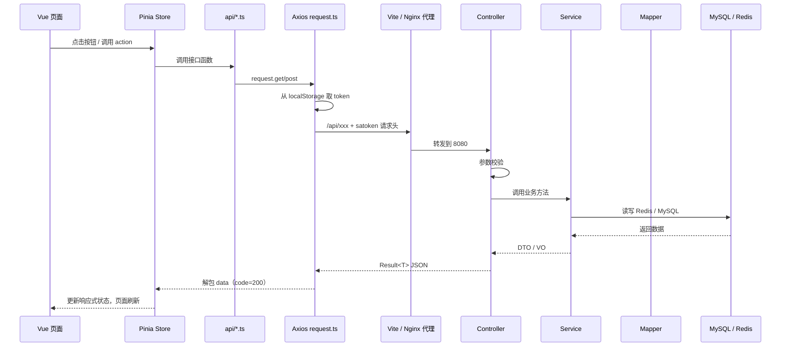

# 00 - 新手导读与代码地图（阅读前必读）

> 本篇是 `docs/principles/` 的入口，不重复讲原理，只解决三个问题：
>
> 1. **看 01-11 之前需要什么基础？**
> 2. **一个功能从页面到数据库，代码到底在哪？**
> 3. **启动失败、接口报错、页面空白时，应该从哪里查？**
>
> 建议先按 [README](file:///D:/JavaWeb/README.md) 把项目跑起来，再读本篇，最后按第 8 节的顺序进入 01-11。

---

## 1. 先建立三个认知

看懂这个项目，先记住三件事。

### 1.1 前后端是两个独立进程

- 前端：Vue 3 + Vite，开发时运行在 `5173`，只负责页面、交互和调用接口。
- 后端：Spring Boot，运行在 `8080`，只负责业务逻辑、数据库和 Redis。
- 前端通过 Axios 发 HTTP 请求，Vite 把 `/api` 和 `/uploads` 代理到 `8080`。

所以出现问题时，第一步永远是判断：**是前端没发对请求，还是后端没处理好？**

### 1.2 所有接口都返回统一结构 `Result<T>`

后端不会直接返回裸对象，而是统一包装成：

```json
{
  "code": 200,
  "message": "操作成功",
  "data": { },
  "timestamp": 1730625600000
}
```

关键点：**业务失败时 HTTP 状态码可能仍是 200，真正的结果要看响应体里的 `code`。**

前端拦截器 [request.ts](file:///D:/JavaWeb/frontend/src/api/request.ts) 正是按 `res.code === 200` 判断成功的。所以排查时不要只看浏览器 Network 里的状态码 200，还要看返回 JSON 的 `code` 和 `message`。

### 1.3 代码是分层的

后端一条请求的固定路线：

```
Controller（接请求、校验参数）
   ↓
Service（业务规则、事务）
   ↓
Mapper（MyBatis-Plus 访问数据库）
   ↓
MySQL / Redis
```

前端一条交互的固定路线：

```
View 页面（点击、表单）
   ↓
Pinia Store（共享状态、缓存）
   ↓
api/*.ts（接口函数）
   ↓
request.ts（Axios、Token、统一错误处理）
   ↓
后端 Controller
```

记住这两条线，后面找代码就不会迷路。

---

## 2. 前置基础：看到不懂时回来补

不需要先把下面全部学完，**知道每个词大概是什么、用在哪里**即可，遇到再补。

| 主题 | 最低需要懂什么 | 在本项目哪里用到 | 补课关键词 |
| :--- | :--- | :--- | :--- |
| Java 语法 | 类、接口、泛型、集合、Lambda、Stream、异常、注解 | 整个 `backend/` | `List/Map`、`stream().map()`、`@Override` |
| HTTP / REST | GET/POST/PUT/PATCH/DELETE、状态码、JSON、请求头 | 前后端所有接口 | RESTful、Header、JSON |
| Spring Boot | 启动类、`@RestController`、`@Service`、依赖注入、`@Transactional` | 后端所有模块 | IoC、DI、Bean、事务 |
| Spring MVC | URL 如何映射到方法、参数如何绑定 | `*/controller/*.java` | `@RequestMapping`、`@RequestBody` |
| SQL / MySQL | 增删改查、`WHERE`、`JOIN`、索引、事务 | `docs/sql/`、`*/mapper/` | 主键、索引、事务 |
| MyBatis-Plus | 实体与表对应、`BaseMapper` 的 CRUD | `*/entity/`、`*/mapper/` | ORM、`@TableName` |
| Redis | Key-Value、过期时间、缓存读写 | 品牌/分类/商品/首页缓存 | Cache-Aside、TTL |
| Vue 3 | `ref`、`computed`、`onMounted`、模板语法 | `frontend/src/views/` | Composition API |
| TypeScript | 接口类型、泛型、可选属性 `?` | `frontend/src/api/` | interface、type |
| Vue Router | 路由表、导航守卫 | `frontend/src/router/index.ts` | `beforeEach` |
| Pinia | `defineStore`、state、computed、action | `frontend/src/stores/` | 状态管理 |
| Axios | 发请求、请求/响应拦截器 | `frontend/src/api/request.ts` | interceptor |
| Maven | `pom.xml`、`mvn spring-boot:run` | `backend/` | 依赖、插件 |
| npm | `package.json`、`npm run dev` | `frontend/` | 依赖、脚本 |
| Docker | 镜像、容器、端口映射、数据卷 | `deploy/`、`docker-compose.yml` | `docker compose` |

**零基础策略**：先补 Java 基础语法、SQL 增删改查、Vue 的 `ref/computed` 三块，其余边看项目边查。

---

## 3. 项目地图

### 3.1 目录职责

```
D:\JavaWeb
├── backend/                  Spring Boot 后端
│   ├── src/main/java/com/shop/
│   │   ├── common/           统一响应、异常、上传、缓存淘汰工具
│   │   ├── config/           MVC、Sa-Token、MyBatis-Plus、OpenAPI 配置
│   │   └── modules/
│   │       ├── auth/         注册、登录、个人资料
│   │       ├── catalog/      品牌、分类、商品、首页橱窗
│   │       ├── commerce/     购物车、结算、订单
│   │       └── system/       用户账号管理
│   ├── src/main/resources/   application.yml / application-prod.yml
│   ├── src/test/java/        67 个测试用例
│   └── uploads/              本地上传图片
├── frontend/                 Vue 3 前端
│   ├── src/
│   │   ├── api/              每个模块的接口函数
│   │   ├── components/       可复用组件（ProductCard）
│   │   ├── directives/       自定义指令（v-reveal 滚动入场）
│   │   ├── layouts/          前台 / 后台布局
│   │   ├── router/           路由与权限守卫
│   │   ├── stores/           user / cart 状态
│   │   ├── styles/           全局样式（glass.css）
│   │   ├── utils/            格式化、图片、订单工具
│   │   └── views/            页面（portal / admin / auth）
│   └── test/                 19 个前端测试
├── docs/                     讲义、ADR、SQL、工单规范
├── deploy/                   生产编排 + 试用编排
├── start.bat / start.ps1     本地一键启动
└── stop.bat / stop.ps1       本地一键停止
```

### 3.2 按功能找代码

| 想看的业务 | 前端入口 | 后端 Controller | 核心实现 | 数据表 |
| :--- | :--- | :--- | :--- | :--- |
| 登录 / 注册 | [LoginView.vue](file:///D:/JavaWeb/frontend/src/views/auth/LoginView.vue) | [AuthController.java](file:///D:/JavaWeb/backend/src/main/java/com/shop/modules/auth/controller/AuthController.java) | [AuthServiceImpl.java](file:///D:/JavaWeb/backend/src/main/java/com/shop/modules/auth/service/impl/AuthServiceImpl.java) | `sys_user` |
| 首页橱窗 | [HomeView.vue](file:///D:/JavaWeb/frontend/src/views/portal/HomeView.vue) | [PortalProductController.java](file:///D:/JavaWeb/backend/src/main/java/com/shop/modules/catalog/controller/PortalProductController.java) | [ProductCatalogServiceImpl.java](file:///D:/JavaWeb/backend/src/main/java/com/shop/modules/catalog/service/impl/ProductCatalogServiceImpl.java) | `shop_product` 等 |
| 商品列表 / 详情 | [ProductListView.vue](file:///D:/JavaWeb/frontend/src/views/portal/ProductListView.vue)、[ProductDetailView.vue](file:///D:/JavaWeb/frontend/src/views/portal/ProductDetailView.vue) | 同上 | 同上 | `shop_product` |
| 购物车 | [CartView.vue](file:///D:/JavaWeb/frontend/src/views/portal/CartView.vue) | [CartController.java](file:///D:/JavaWeb/backend/src/main/java/com/shop/modules/commerce/controller/CartController.java) | [CartServiceImpl.java](file:///D:/JavaWeb/backend/src/main/java/com/shop/modules/commerce/service/impl/CartServiceImpl.java) | `shop_cart_item` |
| 结算 / 订单 | CartView、[OrderHistoryView.vue](file:///D:/JavaWeb/frontend/src/views/portal/OrderHistoryView.vue) | [OrderController.java](file:///D:/JavaWeb/backend/src/main/java/com/shop/modules/commerce/controller/OrderController.java) | [OrderCheckoutServiceImpl.java](file:///D:/JavaWeb/backend/src/main/java/com/shop/modules/commerce/service/impl/OrderCheckoutServiceImpl.java) | `shop_order`、`shop_order_item` |
| 后台数据看板 | [DashboardView.vue](file:///D:/JavaWeb/frontend/src/views/admin/DashboardView.vue) | 复用后台订单/商品/用户分页接口 | 客户端 `Promise.allSettled` 聚合 + 原生 CSS 图表 | `shop_order`、`shop_product`、`sys_user` |
| 后台订单管理 | [OrderManagementView.vue](file:///D:/JavaWeb/frontend/src/views/admin/OrderManagementView.vue) | [AdminOrderController.java](file:///D:/JavaWeb/backend/src/main/java/com/shop/modules/commerce/controller/AdminOrderController.java) | [OrderCheckoutServiceImpl.java](file:///D:/JavaWeb/backend/src/main/java/com/shop/modules/commerce/service/impl/OrderCheckoutServiceImpl.java) | `shop_order`、`shop_order_item` |
| 后台商品 | [ProductManagementView.vue](file:///D:/JavaWeb/frontend/src/views/admin/ProductManagementView.vue) | [AdminProductController.java](file:///D:/JavaWeb/backend/src/main/java/com/shop/modules/catalog/controller/AdminProductController.java) | [ProductAdminServiceImpl.java](file:///D:/JavaWeb/backend/src/main/java/com/shop/modules/catalog/service/impl/ProductAdminServiceImpl.java) | `shop_product` |
| 品牌管理 | [BrandManagementView.vue](file:///D:/JavaWeb/frontend/src/views/admin/BrandManagementView.vue) | [AdminBrandController.java](file:///D:/JavaWeb/backend/src/main/java/com/shop/modules/catalog/controller/AdminBrandController.java) | [BrandServiceImpl.java](file:///D:/JavaWeb/backend/src/main/java/com/shop/modules/catalog/service/impl/BrandServiceImpl.java) | `shop_brand` |
| 分类管理 | [CategoryManagementView.vue](file:///D:/JavaWeb/frontend/src/views/admin/CategoryManagementView.vue) | [AdminCategoryController.java](file:///D:/JavaWeb/backend/src/main/java/com/shop/modules/catalog/controller/AdminCategoryController.java) | [CategoryServiceImpl.java](file:///D:/JavaWeb/backend/src/main/java/com/shop/modules/catalog/service/impl/CategoryServiceImpl.java) | `shop_category` |
| 用户管理 | [UserManagementView.vue](file:///D:/JavaWeb/frontend/src/views/admin/UserManagementView.vue) | [AdminUserController.java](file:///D:/JavaWeb/backend/src/main/java/com/shop/modules/system/controller/AdminUserController.java) | [UserServiceImpl.java](file:///D:/JavaWeb/backend/src/main/java/com/shop/modules/system/service/impl/UserServiceImpl.java) | `sys_user` |
| 图片上传 | 商品/品牌管理页的 `el-upload` | [CommonUploadController.java](file:///D:/JavaWeb/backend/src/main/java/com/shop/common/controller/CommonUploadController.java) | [LocalStorageService.java](file:///D:/JavaWeb/backend/src/main/java/com/shop/common/storage/LocalStorageService.java) | 本地 `uploads/` |
| 权限拦截 | [router/index.ts](file:///D:/JavaWeb/frontend/src/router/index.ts) | [WebMvcConfig.java](file:///D:/JavaWeb/backend/src/main/java/com/shop/config/WebMvcConfig.java) | [StpInterfaceImpl.java](file:///D:/JavaWeb/backend/src/main/java/com/shop/config/StpInterfaceImpl.java) | `sys_user` |

---

## 4. 一条请求的完整链路

### 4.1 总览



### 4.2 示例一：打开首页

1. 路由进入 `/`，加载 [HomeView.vue](file:///D:/JavaWeb/frontend/src/views/portal/HomeView.vue)。
2. `onMounted` 调用 `loadHomeShowcase()`。
3. 它调用 [api/product.ts](file:///D:/JavaWeb/frontend/src/api/product.ts) 的 `getHomeShowcaseApi()`，请求 `GET /api/portal/home`。
4. [request.ts](file:///D:/JavaWeb/frontend/src/api/request.ts) 给请求加上 `satoken` 头（如果有登录态）。
5. Vite 开发代理把 `/api` 转发到 `http://localhost:8080`。
6. 进入 [PortalProductController.java](file:///D:/JavaWeb/backend/src/main/java/com/shop/modules/catalog/controller/PortalProductController.java) 的 `getHomeShowcase()`。
7. 调用 [ProductCatalogServiceImpl.java](file:///D:/JavaWeb/backend/src/main/java/com/shop/modules/catalog/service/impl/ProductCatalogServiceImpl.java) 的 `getHomeShowcase()`：
   - 先查 Redis `catalog:showcase:home`，命中直接返回；
   - 未命中则聚合分类树、品牌、热销商品、新品、轮播；
   - 热销/新品各取 8 条，轮播由热销商品封面生成；
   - 写回 Redis，TTL 15 分钟。
8. 返回 `HomeShowcaseVO`，被包装成 `Result.success(...)`。
9. 前端拦截器解包 `data`，`HomeView` 把 `carousels / categories / featuredBrands / hotProducts / newProducts` 赋给响应式变量，页面渲染。

### 4.3 示例二：登录

1. [LoginView.vue](file:///D:/JavaWeb/frontend/src/views/auth/LoginView.vue) 提交表单，调用 `userStore.login()`。
2. [stores/user.ts](file:///D:/JavaWeb/frontend/src/stores/user.ts) 调用 [api/auth.ts](file:///D:/JavaWeb/frontend/src/api/auth.ts) 的 `loginApi()`，请求 `POST /api/auth/login`。
3. 后端 [AuthController.java](file:///D:/JavaWeb/backend/src/main/java/com/shop/modules/auth/controller/AuthController.java) → [AuthServiceImpl.java](file:///D:/JavaWeb/backend/src/main/java/com/shop/modules/auth/service/impl/AuthServiceImpl.java)：
   - 按用户名查 `sys_user`；
   - `BCrypt.checkpw()` 校验密码；
   - 校验账号是否被禁用；
   - `StpUtil.login(userId)` 签发 Token（JWT Simple 模式，会话信息落 Redis）。
4. 返回 `AuthTokenVO`，前端保存 `localStorage.token` 和 `localStorage.user`。
5. `LoginView.vue` 根据重定向参数与角色执行跳转：若携带 `redirect` 参数优先跳回目标页，否则管理员去 `/admin`、顾客回 `/`（已登录状态下再次访问 `/login` 时则由路由守卫直接重定向）。

> `/api/auth/login` 和 `/api/auth/register` 在 [WebMvcConfig.java](file:///D:/JavaWeb/backend/src/main/java/com/shop/config/WebMvcConfig.java) 中被排除，不需要登录即可访问；`/api/cart/**`、`/api/orders/**`、`/api/admin/**` 等都会校验登录态和账号状态。

### 4.4 示例三：加入购物车

1. [ProductDetailView.vue](file:///D:/JavaWeb/frontend/src/views/portal/ProductDetailView.vue) 点击“加入购物车”，调用 `cartStore.addToCart(productId, quantity)`。
2. [stores/cart.ts](file:///D:/JavaWeb/frontend/src/stores/cart.ts) 调用 `POST /api/cart/items`。
3. 请求先经过 Sa-Token 拦截器：`/api/cart/**` 会执行 `checkActiveUser()`，校验登录态和账号是否启用。
4. [CartController.java](file:///D:/JavaWeb/backend/src/main/java/com/shop/modules/commerce/controller/CartController.java) → [CartServiceImpl.java](file:///D:/JavaWeb/backend/src/main/java/com/shop/modules/commerce/service/impl/CartServiceImpl.java) 的 `addItem()`：
   - 校验商品存在、未删除、已上架；
   - 查询该顾客是否已加购同一商品；
   - 已存在则累加数量，否则新增一行；
   - 校验加购后的数量不超过库存。
5. 成功后前端再调用 `GET /api/cart` 刷新购物车，并把结果缓存到 `localStorage.shop_cart_cache`。

### 4.5 示例四：结算下单（最重要）

1. [CartView.vue](file:///D:/JavaWeb/frontend/src/views/portal/CartView.vue) 填写收货信息，调用 `cartStore.checkout(cmd)`。
2. 请求 `POST /api/orders/checkout`，进入 [OrderController.java](file:///D:/JavaWeb/backend/src/main/java/com/shop/modules/commerce/controller/OrderController.java)。
3. [OrderCheckoutServiceImpl.java](file:///D:/JavaWeb/backend/src/main/java/com/shop/modules/commerce/service/impl/OrderCheckoutServiceImpl.java) 在 `@Transactional` 中依次执行：
   1. 查询当前顾客**已勾选**的购物车项；
   2. 批量查询商品，校验是否下架、库存是否足够；
   3. 调用 [ShopProductMapper.java](file:///D:/JavaWeb/backend/src/main/java/com/shop/modules/catalog/mapper/ShopProductMapper.java) 的 `decrementStock()`，用单条 SQL 原子扣减：`WHERE id = ? AND stock >= ? AND is_deleted = 0`，并注册商品详情与首页橱窗缓存的即时淘汰与事务提交后二次淘汰；
   4. 写入 `shop_order` 主订单；
   5. 写入 `shop_order_item`，冻结商品名称、图片、单价快照；
   6. 删除已结算的购物车项。
4. 任意一步抛出业务异常，整个事务回滚，库存不会被扣掉。
5. 返回 `OrderCheckoutResult`（含订单号与应付总额），前端调用 `fetchCart()` 刷新剩余未勾选购物车项，并弹出收银台支付对话框（完成模拟支付或点击“稍后支付”后跳转 `/orders`）。

> 这就是项目“防超卖”的核心：不是先查再减，而是**把判断和扣减放进同一条 SQL**，由数据库行锁保证原子性。详见讲义 05。

### 4.6 示例五：后台保存商品

1. [ProductManagementView.vue](file:///D:/JavaWeb/frontend/src/views/admin/ProductManagementView.vue) 提交表单，调用新建或修改接口。
2. 进入 [AdminProductController.java](file:///D:/JavaWeb/backend/src/main/java/com/shop/modules/catalog/controller/AdminProductController.java)。
3. [ProductAdminServiceImpl.java](file:///D:/JavaWeb/backend/src/main/java/com/shop/modules/catalog/service/impl/ProductAdminServiceImpl.java) 的 `saveProduct()`：
   - 校验品牌、分类、主图等字段；
   - 副图列表通过 `ProductImageHelper.formatSubImages()` 转成逗号分隔字符串；
   - 新增或更新 `shop_product`；
   - 清除该商品详情缓存和首页橱窗缓存。
4. 前台下次访问会重新查库并回填缓存。

---

## 5. 30 分钟速通路线

如果时间有限，按下面顺序走一遍，比从 01 硬读更快建立感觉。

1. **启动项目**：运行 `start.bat`，浏览器打开 `http://localhost:5173`。
2. **看一眼接口**：打开 `http://localhost:8080/swagger-ui/index.html`，找到 `GET /api/portal/home` 并执行，观察返回 JSON。
3. **对照前端**：在 [HomeView.vue](file:///D:/JavaWeb/frontend/src/views/portal/HomeView.vue) 搜索 `getHomeShowcaseApi`，看返回值如何被赋值。
4. **对照后端**：在 [PortalProductController.java](file:///D:/JavaWeb/backend/src/main/java/com/shop/modules/catalog/controller/PortalProductController.java) 找到 `/home` 方法，再跟进 `ProductCatalogServiceImpl`。
5. **走一遍购物流程**：登录 `customer / 123456` → 商品详情加购 → 购物车结算 → 我的订单。
6. **走一遍后台流程**：登录 `admin / admin123` → 商品管理编辑库存 → 回前台确认库存变化。
7. **制造一个错误**：停掉 Redis 再登录，观察报错信息和后端日志，再启动 Redis 恢复。

---

## 6. 报错怎么查（排错手册）

### 6.1 先看三处日志

| 位置 | 能看到什么 | 怎么打开 |
| :--- | :--- | :--- |
| 后端开发窗口 | 启动日志、异常堆栈、MyBatis 打印的 SQL | 标题为 `[后端] Spring Boot 8080` 的终端 |
| 前端开发窗口 | Vite 编译错误、代理错误 | 标题为 `[前端] Vite Vue3 5173` 的终端 |
| 浏览器开发者工具 | 请求 URL、状态码、响应体、JS 报错、localStorage | F12 → Console / Network / Application |

生产或试用环境：

```bash
docker compose ps                          # 看容器是否 Up / Restarting
docker compose logs -f shop-backend        # 实时后端日志
docker compose logs --tail 100 shop-mysql  # MySQL 日志
tail -f /opt/shop/logs/shop-backend.log    # 后端文件日志
```

> 开发环境 `application.yml` 开启了 MyBatis 的 `StdOutImpl`，控制台会打印 SQL；生产环境已关闭 SQL 打印，避免日志刷屏。

### 6.2 报错时先收集 5 个信息

1. **请求 URL**：是 `/api/...` 吗？路径和方法对不对？
2. **HTTP 状态码**：200、401、403、404、500？
3. **响应体**：`code` 和 `message` 分别是什么？
4. **浏览器 Console**：有没有 JS 异常或 CORS 报错？
5. **后端日志**：同一时间点有没有异常堆栈？

### 6.3 常见问题对照表

| 现象 | 常见原因 | 怎么确认 | 怎么解决 |
| :--- | :--- | :--- | :--- |
| 后端启动失败，日志有 `Communications link failure` | MySQL 未启动或密码不对 | `Get-NetTCPConnection -LocalPort 3306` | 启动 MySQL，核对 `application.yml` 密码 |
| 登录提示“缓存服务（Redis）未启动” | Redis 未启动 | `Get-NetTCPConnection -LocalPort 6379` | 启动 Redis（见 README 手动启动章节） |
| 登录后很快又变未登录 / 一直 401 | Token 过期、账号被禁用、Redis 会话丢失 | F12 → Application → Local Storage 看 `token` | 重新登录；管理员检查账号状态 |
| 顾客访问 `/admin` 被弹回首页 | 角色不是管理员，属正常拦截 | 看当前登录账号 | 用 `admin / admin123` 登录 |
| 页面能打开但列表为空 / 500 | 数据库没建表或没导数据 | `use shop_db; show tables;` 应看到 7 张表 | 执行 `docs/sql/schema.sql`、`data.sql` |
| 8080 或 5173 启动失败，提示端口占用 | 上次进程未退出 | `Get-NetTCPConnection -LocalPort 8080` | 运行 `stop.bat`，或结束占用进程 |
| 前端请求 404 | 接口少了 `/api` 前缀，或方法不对 | F12 Network 看请求 URL | 对照 `frontend/src/api/*.ts` 和后端 `@RequestMapping` |
| 前端请求 502 / 连接被拒绝 | 后端没启动，或 Vite 代理目标不对 | 直接打开 Swagger 是否可访问 | 启动后端，检查 `vite.config.ts` 的 8080 |
| 图片 404 | 文件不在 `uploads/`，或 URL 不是 `/uploads/...` | 看图片 URL 与 `backend/uploads/` | 重新上传；Docker 部署确认 uploads 目录已挂载 |
| 修改商品后前台仍是旧数据 | Redis 缓存尚未失效或请求打到旧实例 | `redis-cli keys 'catalog:*'` | 等待 TTL，或检查缓存失效日志 |
| 上传失败，提示文件过大 | 前端校验拦截 `>= 5MB`，或后端请求超过 `10MB/20MB` | 看浏览器提示与文件大小 | 压缩至 5MB 内，或同步调整 `frontend/src/utils/image.ts` 与 `spring.servlet.multipart` |
| 试用环境 `shop-backend` 反复 Restarting | compose 缺少启动命令 | `docker compose logs shop-backend` | 确认 `command: ["java", "-jar", "/app/app.jar"]` |
| `mvn`/`npm` 下载依赖失败 | 网络或镜像源问题 | 看具体报错域名 | 换镜像源或检查网络代理 |
| 编译报 `release 21` / class 版本错误 | 当前生效 JDK 版本低于 21（如 JDK 8/17） | `java -version`、`mvn -v` | 切换到 JDK 21+（21 或 25 均可）并重新编译 |

### 6.4 两个排查套路

**套路一：先判断前后端**

1. F12 → Network，找到失败请求。
2. 如果请求没发出去 → 看前端 Console / 按钮逻辑。
3. 如果请求发出但 4xx/5xx → 看响应体和后端日志。
4. 如果响应 `code != 200` → 按 `message` 定位业务规则，而不是网络问题。

**套路二：从 URL 反查代码**

1. 拿到 `/api/orders/checkout`，全局搜索 `"/api/orders"` 找到 `OrderController`。
2. 找到方法 `checkout()`，再跟到 `OrderCheckoutServiceImpl.checkout()`。
3. 在 Service 的关键分支打断点：查询购物车、库存判断、订单插入、删除购物车。
4. 同时打开 MySQL 客户端，核对 `shop_product.stock` 和 `shop_order` 数据是否变化。
5. 如果涉及缓存，再看 Redis 对应 Key 是否存在、值是否更新。

---

## 7. 术语速查

| 术语 | 一句话解释 | 本项目位置 |
| :--- | :--- | :--- |
| IoC / DI | 对象由 Spring 创建和注入，不用自己 `new` | 各 `ServiceImpl` 构造器注入 |
| Bean | 被 Spring 管理的对象 | `@Service`、`@RestController`、`@Configuration` |
| DTO / VO | 接收请求的数据对象 / 返回给前端的数据对象 | `modules/*/dto/` |
| ORM | 用对象操作数据库表 | MyBatis-Plus |
| Mapper | 数据访问接口 | `modules/*/mapper/` |
| 事务 | 一组操作要么全成功，要么全回滚 | `@Transactional` |
| JWT | 带签名的令牌，前端保存并在请求头携带 | Sa-Token JWT Simple |
| RBAC | 按角色控制权限 | `ROLE_ADMIN` / `ROLE_CUSTOMER` |
| 拦截器 | 请求进入 Controller 前统一检查 | `SaInterceptor` |
| 缓存穿透 / 击穿 / 雪崩 | 三类缓存失效导致数据库压力激增的问题 | 讲义 04 |
| Cache-Aside | 读缓存、未命中查库回填；写库后删缓存 | `BrandServiceImpl` 等 |
| 快照 | 下单时冻结商品名称、价格、图片 | `shop_order_item` |
| 状态机 | 订单只能按规定状态流转 | `UNPAID → PAID → SHIPPED → COMPLETED` |
| 深模块 | 接口简单、内部实现复杂且高内聚 | 讲义 01 |
| 原子扣减 | 判断和扣减在同一条 SQL 中完成 | `decrementStock()` |
| 响应式 | 数据变化自动驱动视图更新 | Vue `ref` / `computed` |
| 导航守卫 | 路由跳转前检查登录和角色 | `router.beforeEach` |

---

## 8. 推荐阅读顺序

| 阶段 | 读什么 | 前置要求 | 目标 |
| :--- | :--- | :--- | :--- |
| 第 0 阶段 | 本篇 + README | 无 | 能启动、能登录、知道代码在哪 |
| 第 1 阶段 | [01 Spring Boot 原理](file:///D:/JavaWeb/docs/principles/01-springboot3-internals-and-architecture.md) | Java 基础 | 理解后端如何组织、什么是深模块 |
| 第 2 阶段 | [03 ORM 与 MySQL](file:///D:/JavaWeb/docs/principles/03-orm-and-mybatis-plus.md) | SQL 基础 | 理解实体、Mapper、分页、事务 |
| 第 3 阶段 | [02 认证与 Sa-Token](file:///D:/JavaWeb/docs/principles/02-auth-and-satoken.md) | HTTP 基础 | 理解登录、Token、权限拦截 |
| 第 4 阶段 | [04 Redis 缓存](file:///D:/JavaWeb/docs/principles/04-redis-caching-patterns.md) | 01-03 | 理解缓存读写与一致性 |
| 第 5 阶段 | [05 并发与防超卖](file:///D:/JavaWeb/docs/principles/05-concurrency-and-inventory-safety.md) | 03-04 | 理解单 SQL 原子扣减与并发测试 |
| 第 6 阶段 | [06 Vue 3 与 Vite](file:///D:/JavaWeb/docs/principles/06-vue3-and-vite-modern-frontend.md) | JS/TS 基础 | 理解响应式、构建、Pinia、前端测试 |
| 第 7 阶段 | [08 安全防护](file:///D:/JavaWeb/docs/principles/08-defense-knowledge.md) | 02 + 05 | 理解越权、注入、上传、HTTPS |
| 第 8 阶段 | [09 生产部署](file:///D:/JavaWeb/docs/principles/09-scheme1-production-deployment-guide.md)、[10 云端试用部署](file:///D:/JavaWeb/docs/principles/10-cloud-trial-deployment-guide.md)、[11 远程运维与凭据加固](file:///D:/JavaWeb/docs/principles/11-remote-ops-and-credential-hardening.md) | 01-08 | 能把项目安全部署到公网并完成加固 |
| 答辩前 | [07 Top 12 问答](file:///D:/JavaWeb/docs/principles/07-course-defense-qa.md) | 01-08 | 用标准话术复盘重点 |

---

## 9. 读不懂时的策略

1. **先看结论，再看原理**：可以先翻 [07 答辩问答](file:///D:/JavaWeb/docs/principles/07-course-defense-qa.md)，知道“这个项目要讲清楚哪 12 件事”，再回头读细节。
2. **一次只跟一个功能**：不要同时看登录、购物车、缓存。选“加购”或“结算”，从页面点到数据库走通一条线。
3. **用 Swagger 代替猜**：`http://localhost:8080/swagger-ui/index.html` 可以直接调接口，比读代码更快确认参数和返回结构。
4. **用断点代替通读**：在 Controller 入参、Service 关键分支、Mapper 调用处打断点，观察变量，比从头读几百行有效。
5. **先跳过底层细节**：第一次读 03/04 时，B+ 树、epoll、Undo Log 可以略读，先掌握“项目为什么这么写”。
6. **记一张自己的链路图**：每看完一个功能，用 5 行写下“页面 → 接口 → Service → 表 → 缓存”，比抄笔记有用。
7. **看不懂某个注解就查一个**：`@Transactional`、`@TableField`、`@RestControllerAdvice` 这类注解，查清楚一个就能看懂一片。
