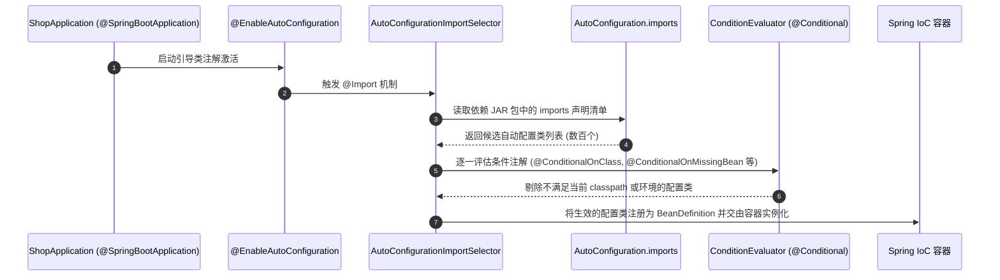
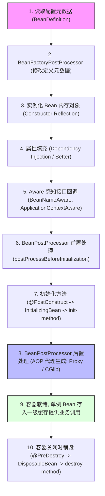

# 01 - Spring Boot 3 核心底层原理与深模块架构设计

> 本文是电商平台课程作业核心技术讲义第一篇。深入剖析 **Spring Boot 3.3+ 自动装配底层机制**、**Bean 完整生命周期**、以及基于经典软件工程著作《A Philosophy of Software Design》的 **深模块（Deep Modules）架构实践**。

---

## 1. Spring Boot 3 自动装配原理（Auto-Configuration）

Spring Boot 之所以能实现“开箱即用（Out of the Box）”与“约定优于配置（Convention Over Configuration）”，其核心基石在于 **自动装配机制**。

### 1.1 从 Spring Boot 2.x 到 3.x 的关键架构演进

在 Spring Boot 2.x 时代，自动装配的核心扫描入口为 `META-INF/spring.factories`。Spring 启动时会通过 `SpringFactoriesLoader` 反射加载该文件中声明的所有配置类。

但在 **Spring Boot 3.0+** 中，这一机制发生了里程碑式的重构：
- **废弃**：`org.springframework.boot.autoconfigure.EnableAutoConfiguration` 不再从 `spring.factories` 读取。
- **重定向**：迁移至新规范路径：
  ```
  META-INF/spring/org.springframework.boot.autoconfigure.AutoConfiguration.imports
  ```
- **核心动机**：
  1. **按需清晰拆分**：将不同功能扩展点的配置解耦为独立的文件（如 `org.springframework.context.ApplicationContextInitializer.imports`、`org.springframework.boot.autoconfigure.AutoConfiguration.imports`），避免几十个组件共同挤在单一庞大的 `spring.factories` 中。
  2. **GraalVM 原生镜像（AOT, Ahead-Of-Time）全面适配**：Spring Boot 3 强推原生 Native Image 构建，新的 imports 机制天然便于 AOT 编译器在静态编译期快速确定需要加载的配置元数据，大幅消除运行时反射开销。

### 1.2 自动装配核心执行链路



### 1.3 条件注解驱动的装配逻辑

在本项目启动阶段，下列核心配置类被条件注解精确加载：
- `DataSourceAutoConfiguration`：探测到 classpath 存在 `com.zaxxer.hikari.HikariDataSource` 且配置了 `spring.datasource.url` 时生效。
- `RedisAutoConfiguration`：探测到 `LettuceConnectionFactory` 与 `StringRedisTemplate` 相关依赖时自动加载连接池。
- `MybatisPlusAutoConfiguration`：根据本项目 `com.baomidou.mybatisplus` 依赖，自动装载 `SqlSessionFactory` 与 Mapper 扫描器。

> [!NOTE]
> 条件注解的精髓在于：**只要引入对应的 starter 依赖并在 `application.yml` 中声明最小化连接属性，底层复杂的连接池、执行器、序列化模板便由框架无感织入，开发者无需手写任何冗余 XML 或 Bean 工厂代码。**

---

## 2. Spring IoC 容器与 Bean 完整生命周期

理解 Bean 的生命周期是掌握 Spring 依赖注入（DI）、AOP 切面代理及事务增强的关键。

### 2.1 Bean 生命周期时序全景



### 2.2 为什么本项目推崇“构造器注入”而非“@Autowired 字段注入”？

在本项目所有 Controller 和 Service 实现中（如 `OrderCheckoutServiceImpl`、`BrandServiceImpl`），全面采用了 **显式构造器注入（Constructor Injection）**，坚决摒弃 `@Autowired` 字段注入：

```java
@Service
public class OrderCheckoutServiceImpl implements OrderCheckoutService {
    private final ShopCartItemMapper cartItemMapper;
    private final ShopProductMapper productMapper;
    private final ShopOrderMapper orderMapper;
    private final ShopOrderItemMapper orderItemMapper;

    // 显式构造函数注入：依赖清晰、编译期保证不可变性
    public OrderCheckoutServiceImpl(ShopCartItemMapper cartItemMapper,
                                    ShopProductMapper productMapper,
                                    ShopOrderMapper orderMapper,
                                    ShopOrderItemMapper orderItemMapper) {
        this.cartItemMapper = cartItemMapper;
        this.productMapper = productMapper;
        this.orderMapper = orderMapper;
        this.orderItemMapper = orderItemMapper;
    }
    // ...
}
```

#### 对比分析矩阵

| 维度 | 构造器注入（Constructor Injection） | 字段注入（`@Autowired private ...`） |
| :--- | :--- | :--- |
| **不变性（Immutability）** | 字段全部可修饰为 `final`，初始化后不可篡改 | 无法使用 `final`，运行期可能被反射篡改 |
| **单元测试友好度** | **极高**。无需启动 Spring 容器或借助 Mockito 反射注入，直接 `new Xxx(m1, m2)` 即可极速测试 | **极差**。必须依赖 Spring 容器启动或 ReflectionTestUtils 强行注入私有字段 |
| **循环依赖阻断** | 启动期直接抛出 `BeanCurrentlyInCreationException`，倒逼架构拆解不良设计 | 依赖三级缓存容忍掩盖不良设计，导致隐蔽 Bug |
| **空指针风险** | 编译期强制赋值，对象只要实例化成功，依赖必定非空 | 容易在反射未完成时因脱离容器调用产生 NPE |

---

## 3. 深模块（Deep Modules）架构实践：重构浅层贫血式堆叠

在经典课程作业或初学者项目中，最常见的反模式（Anti-Pattern）就是**浅层贫血式堆叠（Shallow Layering）**。

### 3.1 什么是深模块 vs. 浅模块？

斯坦福大学计算机教授 John Ousterhout 在其著名著作《A Philosophy of Software Design》（软件设计哲学）中提出了衡量代码质量的核心尺度：
- **深模块（Deep Module）**：**接口极简，实现极深**。对外暴露的调用契约小巧紧凑，而在接口背后隐藏了大量的业务规则、并发控制、异常兜底和复杂状态流转。
- **浅模块（Shallow Module）**：**接口繁琐，实现肤浅**。对外暴露了过多的细节参数，接口本身只是一层微不足道的包装（Pass-through Layer），调用者依然需要自己处理复杂协调。

```
【浅模块 (Shallow Module)】          【深模块 (Deep Module)】
+--------------------------+          +--------------------------+
|  臃肿暴露的接口 (大表面积) |          |   极简高内聚接口 (小表面积)  |
+--------------------------+          +--------------------------+
|   极薄且无意义的透传逻辑   |          |                          |
+--------------------------+          |                          |
                                      |    深邃厚重的信息隐藏实现    |
                                      | (并发、事务、快照、缓存、状态) |
                                      |                          |
                                      +--------------------------+
```

### 3.2 浅层反模式与本项目的重构对照

#### 反模式示例：Controller 充当流水账协调器（Shallow Service）
```java
// 典型反模式：Controller 变成流水账，Service 只是透传
@PostMapping("/checkout")
public Result checkout(@RequestBody CheckoutDTO dto) {
    cartService.checkItems(...);             // 步骤 1
    inventoryService.lockStock(...);         // 步骤 2
    orderService.createOrder(...);           // 步骤 3
    orderItemService.insertItems(...);       // 步骤 4
    cartService.deleteCartItems(...);        // 步骤 5
    return Result.success();
}
```
*这种设计的致命缺陷：一旦出现并发竞争、异常回滚或状态不一致，所有风险全部暴露在表现层，Service 毫无深度可言，任何新调用方都必须重新写一遍这 5 步协调代码。*

#### 本项目深模块实践：`OrderCheckoutService`

在本项目中，`OrderCheckoutService` 接口仅定义了极简的方法契约：
```java
public interface OrderCheckoutService {
    OrderCheckoutResult checkout(Long userId, CheckoutCommand cmd);
    void pay(Long userId, String orderNo);
    PageResult<OrderSummaryVO> listCustomerOrders(Long userId, PageQuery query);
    OrderDetailVO getOrderDetail(Long userId, Long orderId);
    void markShipped(Long orderId);
}
```

在单一的 `checkout()` 调用背后，深模块对调用方完全封装并原子处理了 **5 重核心复杂性**：
1. **自动过滤筛选**：根据 `userId` 提取购物车内用户勾选的商品项；
2. **原子条件防超卖扣减**：单条带状态条件的 SQL 扣减库存，拦截零库存并发穿透；
3. **不可变快照生成**：订单项（`shop_order_item`）直接冻结当时的商品名、价格、图片，隔离商家后续调价风险；
4. **事务强一致性**：`@Transactional` 确保订单主表、明细表、库存扣减、购物车清理处于同一原子事务内；
5. **购物车物理清理**：结算成功后精准删除已下单的购物车条目。

### 3.3 架构深度自测：Deletion Test（删除测试）
> [!TIP]
> **衡量一个模块是否有价值的黄金法则 —— 删除测试**：
> 假设你删掉该 Service，如果整个系统的并发扣减、不可变快照、事务一致性瞬间四散在各个 Controller 里变得支离破碎，那么这个 Service 就是具有极高技术杠杆的**真深模块**。
> 本项目的 `OrderCheckoutService`、`BrandServiceImpl`（封装 Redis 读穿透与主动淘汰）、`LocalStorageService`（封装路径校验与文件安全落地）均完美通过此测试。
