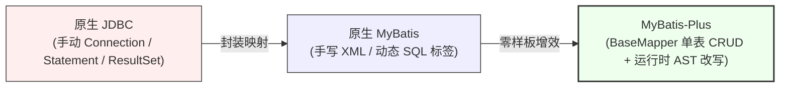
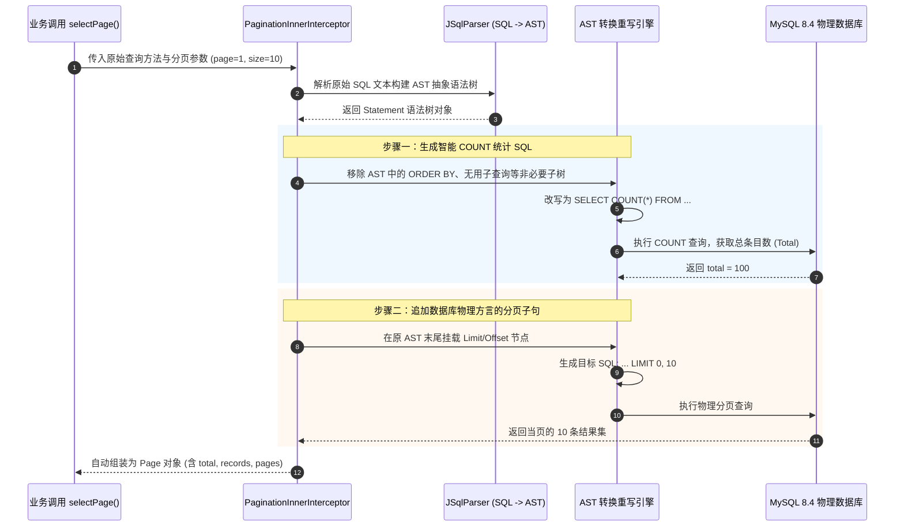

# 03 - ORM 演进、AST 语法树重写与 MySQL 索引事务原理

> 本文是电商平台课程作业核心技术讲义第三篇。系统阐述 **从原生 JDBC 到 MyBatis-Plus 的技术演进**、**MyBatis 拦截器插件体系与 AST（抽象语法树）SQL 自动重写**、**MySQL InnoDB 存储引擎 B+ 树物理存储结构**、以及 **ACID 事务底层的 Undo/Redo Log 与 MVCC 机制**。

---

## 1. 持久层技术演进：JDBC $\to$ MyBatis $\to$ MyBatis-Plus

Java 应用程序访问关系型数据库的演进历程，本质是一部**不断降低低价值重复样板代码、提升数据访问抽象层次**的工程史。



### 1.1 三代技术全维度对比

| 技术形态 | 核心操作模式 | 优势 | 痛点 / 局限性 |
| :--- | :--- | :--- | :--- |
| **原生 JDBC** | 手动加载驱动，管理 `Connection`、拼接 `PreparedStatement`、遍历 `ResultSet` 游标手动 `rs.getString()` 赋值 | 性能损耗极低，直面物理数据库 | 样板代码极其臃肿；无对象映射；SQL 散落各处难以重构维护；连接未池化极易泄露 |
| **原生 MyBatis** | 半自动 ORM。通过 XML 映射文件配置 SQL，自动实现 POJO 实体与结果集反序列化 | SQL 与 Java 代码彻底解耦；支持 `<if>`、`<foreach>` 动态标签拼接复杂业务查询 | 即使是最基础的“按主键增删改查”，也必须为每个表重复编写 XML 模板和 Mapper 接口 |
| **MyBatis-Plus** | 现代增强型持久层框架。通用 `BaseMapper<T>` 内置数十种常用 CRUD 操作；Lambda 链式安全查询 | **单表零 SQL**；Lambda 表达式在编译期规避字段拼写错误；内置分页、审计、逻辑删除等强大插件机制 | 复杂的跨多表统计、行级锁原子 SQL 仍需手写注解或 XML，与手写 SQL 互为补充 |

---

## 2. MyBatis 拦截器与 JSqlParser 驱动的 AST 语法树改写

MyBatis-Plus 能够在不改变业务代码的前提下无缝实现“物理分页”、“租户隔离”、“数据权限过滤”，其底层核心武器是 **MyBatis Plugin 插件机制** 与 **JSqlParser AST（抽象语法树）动态 SQL 重写**。

### 2.1 MyBatis 核心执行对象与拦截切入点

MyBatis 底层定义了四大核心工作接口，所有 SQL 执行均需按序经过这四大组件：
1. **Executor**：SQL 执行调度中枢，维护一级缓存、二级缓存及事务生命周期。
2. **StatementHandler**：专门负责创建、预编译 JDBC `Statement` 并执行具体的数据库交互。
3. **ParameterHandler**：负责将 Java 参数对象安全绑定到 SQL 的 `?` 占位符上（防 SQL 注入）。
4. **ResultSetHandler**：负责将 JDBC 返回的 `ResultSet` 数据流映射反序列化为 Java 实体对象。

MyBatis-Plus 的 `MybatisPlusInterceptor`（在 `com.shop.config.MybatisPlusConfig` 中注册）以动态代理（JDK Dynamic Proxy）的形式环绕拦截了 `Executor` 和 `StatementHandler`。

### 2.2 分页拦截器（PaginationInnerInterceptor）的 AST 改写内幕

当在业务中调用分页查询时，例如：
```java
Page<ShopProduct> pageParam = new Page<>(1, 10);
LambdaQueryWrapper<ShopProduct> wrapper = new LambdaQueryWrapper<ShopProduct>()
    .eq(ShopProduct::getStatus, 1);
productMapper.selectPage(pageParam, wrapper);
```

底层并没有执行两次全量查询，而是由拦截器完成了精密的 AST 转换：



> [!NOTE]
> **抽象语法树（AST, Abstract Syntax Tree）重写的优势**：
> 传统的粗暴做法是用字符串正则匹配去截取并拼接 SQL，但极易因为用户查询中包含 `ORDER BY`、复杂子查询或 `GROUP BY` 导致语法错误。
> MyBatis-Plus 借助 `JSqlParser` 将整条 SQL 编译为内存中的节点树（如 `SelectBody`、`PlainSelect`、`OrderByElement`），从而可以像操作 DOM 树一样安全地删除、替换或挂载节点，保证生成的 SQL 在任何复杂场景下均具备 100% 语法正确性。

---

## 3. 自动时间戳审计（MetaObjectHandler）机制

在 `MybatisPlusConfig` 中，我们注入了自动审计填充元对象处理器：

```java
@Bean
public MetaObjectHandler metaObjectHandler() {
    return new MetaObjectHandler() {
        @Override
        public void insertFill(MetaObject metaObject) {
            this.strictInsertFill(metaObject, "createdAt", LocalDateTime.class, LocalDateTime.now());
            this.strictInsertFill(metaObject, "updatedAt", LocalDateTime.class, LocalDateTime.now());
        }

        @Override
        public void updateFill(MetaObject metaObject) {
            this.strictUpdateFill(metaObject, "updatedAt", LocalDateTime.class, LocalDateTime.now());
        }
    };
}
```

配合实体类属性上的 `@TableField(fill = FieldFill.INSERT)` 与 `@TableField(fill = FieldFill.INSERT_UPDATE)` 注解，MyBatis-Plus 在反射生成更新参数时，自动从底层反射上下文无感写入当前系统时间，彻底消除了在业务代码中反复手动写 `setCreatedAt(LocalDateTime.now())` 的样板冗余。

---

## 4. MySQL InnoDB 底层存储引擎与 B+ 树索引设计

数据库性能的上限由物理存储引擎的磁盘 I/O 模型决定。MySQL 8.4 默认采用 **InnoDB 存储引擎**，其索引组织形式为经典的 **B+ Tree（平衡多路查找树）**。

### 4.1 B+ 树核心物理结构

```
                          [ 根节点 Page (仅存储索引键与指针) ]
                                /                     \
           [ 内部节点 Page 1 (键值+指针) ]          [ 内部节点 Page 2 (键值+指针) ]
               /                 \                      /                 \
  [ 叶子 Page 1 ] <---> [ 叶子 Page 2 ] <---> [ 叶子 Page 3 ] <---> [ 叶子 Page 4 ]
  (存储完整数据行)        (存储完整数据行)        (存储完整数据行)        (存储完整数据行)
  \_______________________________________________________________________________/
                         双向链表 (全叶子节点，支持极速范围扫描)
```

#### 为什么关系型数据库选择 B+ 树，而非二叉平衡树（AVL / 红黑树）或 B 树？
1. **多路平衡大幅降低树高（I/O 次数）**：
   - 数据库操作的性能瓶颈在于磁盘磁头寻道与 I/O 读取。
   - InnoDB 默认页（Page）大小为 16KB。一个非叶子节点通常能容纳上千个键值与指针，这意味着一棵高度仅为 3 层的 B+ 树，就能索引上千万行数据。查找任意一条数据仅需 2~3 次磁盘 I/O。
2. **非叶子节点不存数据，单页容量极大**：
   - 相比于普通 B 树（每个节点都存数据），B+ 树非叶子节点仅存键值和下一层指针，单个 16KB 页能容纳更多分支，使得树更加“矮胖”。
3. **全叶子节点双向链表，范围查询极致优化**：
   - 所有叶子节点按键值顺序排列，并通过双向链表串联。当执行 `BETWEEN` 或分页 `LIMIT` 时，只需定位到起始叶子节点，顺着链表顺序遍历即可，完全避免在树中来回回溯。

### 4.2 聚簇索引 vs. 二级索引与“回表”成本

- **聚簇索引（Clustered Index）**：以主键（`PRIMARY KEY id`）构建的 B+ 树，叶子节点直接存放整行物理记录（Row Data）。每张表有且仅能有一个聚簇索引。
- **二级索引 / 辅助索引（Secondary Index）**：如我们在 `shop_product` 表中建立的 `idx_category (category_id)`，其叶子节点不存放行数据，而是存放**主键 ID**。
- **回表（Index Lookaside / Bookmarking Lookup）**：
  - 当通过二级索引查询时：首先在二级索引 B+ 树中查找到对应的 `id`，再带着 `id` 去聚簇索引树重新检索整行数据（此过程称为回表）。
  - 若查询语句为 `SELECT id FROM shop_product WHERE category_id = 5`，由于二级索引叶子节点本身就包含了 `id`，无需回表即可直接返回，这被称为**覆盖索引（Covering Index）**。

---

## 5. MySQL ACID 事务特性与底层实现基石

在电商订单结算闭环中（`OrderCheckoutServiceImpl.checkout()`），必须确保“生成订单、扣减库存、创建快照、清理购物车”作为一个不可分割的整体执行。这由数据库的 **ACID 特性** 全权保障：

```
                    +------------------------------------+
                    |        ACID 事务特性与支撑机制       |
                    +------------------------------------+
                     |                 |                |
             [ 原子性 (A) ]      [ 持久性 (D) ]   [ 隔离性 (I) ]
                     |                 |                |
             Undo Log (回滚日志)  Redo Log (WAL)   锁 + MVCC (多版本并发)
                     \                 /                |
                      +---------------+-----------------+
                                      |
                                [ 一致性 (C) ] (最终目标)
```

### 5.1 原子性（Atomicity）与 Undo Log
- **实现手段**：`Undo Log`（回滚日志）。
- **机理**：每当事务执行 `INSERT` 时，Undo Log 记录对应的 `DELETE`；执行 `UPDATE` 时，Undo Log 记录变更前的数据旧版本。
- **回滚保障**：如果结算过程中发生库存不足（`affectedRows == 0`）并抛出 `BusinessException`，Spring `@Transactional` 触发回滚指令，InnoDB 逆向执行 Undo Log 中的相反操作，将所有修改过的数据无痕还原至事务开始前的状态。

### 5.2 持久性（Durability）与 Redo Log（WAL 预写日志策略）
- **实现手段**：`Redo Log`（重做日志）与 **WAL（Write-Ahead Logging）策略**。
- **机理**：如果事务每次提交都必须将磁盘上对应的 16KB 数据页进行随机 I/O 落盘，数据库吞吐量将遭受灾难性暴跌。
- **解决方案**：事务提交时，仅需将数据变更以追加写（Sequential Append）的形式记录到顺序写入的 `Redo Log Buffer` 并立即刷盘，而内存中的脏页（Buffer Pool）后续由后台线程异步刷新到磁盘数据文件中。即便在刷盘前机器意外断电，重启时 MySQL 依然能通过 Redo Log 重新执行重做操作，确保已提交事务的数据永不丢失。

### 5.3 隔离性（Isolation）与 MVCC（多版本并发控制）
- **实现手段**：**MVCC（Multi-Version Concurrency Control）+ 记录锁/间隙锁**。
- MySQL 默认隔离级别为 `REPEATABLE READ`（可重复读）。
- **快照读与当前读解耦**：
  - 普通查询（`SELECT`）属于**快照读**：事务在第一次读时生成一致性读视图（ReadView），根据数据行头部的隐藏列（`DB_TRX_ID` 事务版本号与 `DB_ROLL_PTR` 回滚指针），沿着 Undo Log 链条追溯读取当前事务可见的历史快照，读写操作互不阻塞。
  - 更新操作（`UPDATE ... WHERE ...`）属于**当前读**：读取记录的最新版本，并通过行级排他锁（X 锁）串行化执行，杜绝了并发丢弃更新问题。
