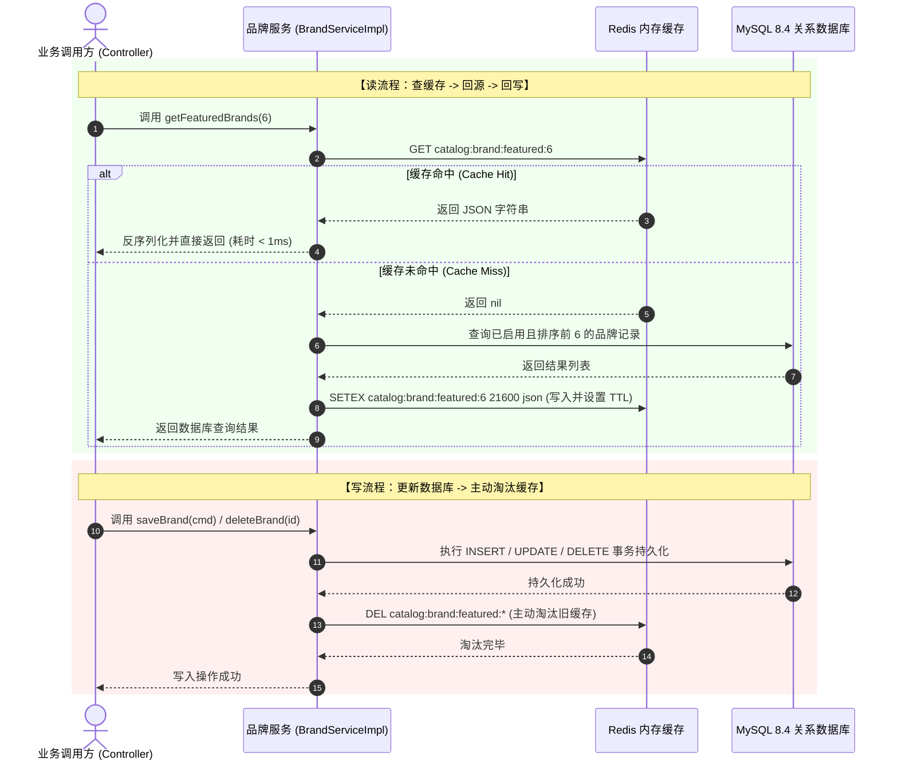
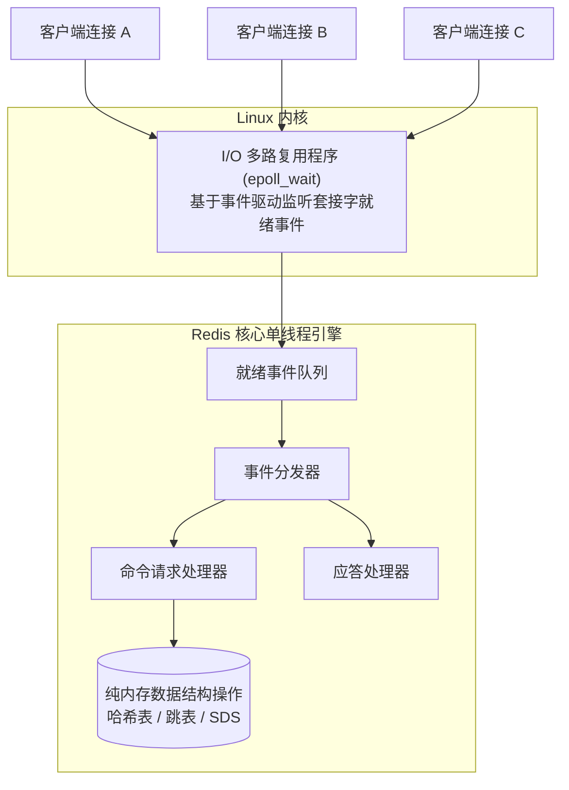

# 04 - Redis 缓存设计模式与经典高并发攻防

> 本文是电商平台课程作业核心技术讲义第四篇。系统阐述 **Cache-Aside（旁路缓存）设计模式在深模块中的封装实践**、**缓存与数据库最终一致性保障策略**、**高并发缓存三大经典难题（穿透、击穿、雪崩）的系统性防御**、以及 **Redis 极速单线程 I/O 多路复用底层原理**。

---

## 1. Cache-Aside（旁路缓存）模式在深模块中的封装实践

在电商商品陈列与分类展示场景中（如首页热门品牌 `getFeaturedBrands`、全局多级类目树 `getCategoryTree`），读请求频次远高于写请求（读写比通常可达 $100:1$ 以上）。为了保护底层 MySQL 避免被瞬时高并发读压垮，引入 **Redis 作为高速缓存层** 是业界的标准架构范式。

### 1.1 Cache-Aside 模式的读写契约



### 1.2 缓存逻辑内聚于深模块：调用方完全无感

在本项目中，Controller 层（如 `CatalogController`）只需要注入 `BrandService`，调用 `brandService.getFeaturedBrands(limit)` 即可。
- **信息隐藏（Information Hiding）**：Controller 根本不需要知道系统是否存在 Redis，不需要关心 key 的构造规则，更不需要处理 Redis 序列化与反序列化。
- **容灾降级（Graceful Degradation）**：如果 Redis 中间件宕机或网络中断，深模块内部会捕获异常并记录 Warn 日志，自动平滑降级为直查 MySQL，绝不会让底层缓存异常导致前端接口直接报错 500。

```java
// BrandServiceImpl.java 中的防击穿与容灾降级封装
@Override
public List<BrandVO> getFeaturedBrands(int limit) {
    int safeLimit = limit <= 0 ? 6 : Math.min(limit, 50);
    String cacheKey = BRAND_FEATURED_CACHE_PREFIX + safeLimit;

    // 1. 优先读取 Redis
    try {
        String cachedJson = redisTemplate.opsForValue().get(cacheKey);
        if (StringUtils.hasText(cachedJson)) {
            return objectMapper.readValue(cachedJson, new TypeReference<List<BrandVO>>() {});
        }
    } catch (Exception e) {
        log.warn("Redis 读取推荐品牌缓存异常，降级直查数据库: {}", e.getMessage());
    }

    // 2. 缓存未命中，回源 MySQL
    Page<ShopBrand> pageParam = new Page<>(1, safeLimit);
    LambdaQueryWrapper<ShopBrand> wrapper = new LambdaQueryWrapper<>();
    wrapper.eq(ShopBrand::getStatus, 1).orderByAsc(ShopBrand::getSort).orderByAsc(ShopBrand::getId);
    Page<ShopBrand> brandPage = brandMapper.selectPage(pageParam, wrapper);
    List<BrandVO> result = brandPage.getRecords().stream().map(this::toVO).toList();

    // 3. 回写 Redis 并赋予生存周期 TTL
    try {
        String json = objectMapper.writeValueAsString(result);
        redisTemplate.opsForValue().set(cacheKey, json, CACHE_TTL);
    } catch (Exception e) {
        log.warn("Redis 写入推荐品牌缓存异常: {}", e.getMessage());
    }

    return result;
}
```

---

## 2. 缓存一致性深度剖析：为什么“淘汰缓存”优于“更新缓存”？

数据发生变更时，通常有两种维护缓存策略：
- **方案 A（更新缓存）**：更新数据库后，立刻构造新对象并执行 `redis.set(key, newValue)`。
- **方案 B（淘汰缓存，本项目采用）**：更新数据库后，直接执行 `redis.del(key)`，后续由下一次读请求触发懒加载（Lazy Load）。

### 2.1 为什么坚决不能在写操作时“更新缓存”？

假设两个并发写请求线程 A 和线程 B 同时修改同一条数据：
1. 线程 A 更新数据库为 `值 1`；
2. 线程 B 更新数据库为 `值 2`；
3. 由于网络抖动或线程调度延迟，线程 B 先更新了 Redis 缓存为 `值 2`；
4. 线程 A 紧接着更新了 Redis 缓存为 `值 1`。

**最终结果**：MySQL 数据库中的最新记录是 `值 2`，但 Redis 缓存中的值却被线程 A 的陈旧数据覆盖变成了 `值 1`！此后只要没有新的写操作，缓存与数据库将发生**永久性脏数据不一致**。

> [!IMPORTANT]
> **采用“淘汰缓存（Cache Invalidation）”的无可替代优势**：
> 1. **消除并发覆盖竞争**：写操作只管执行 `DEL`，清空后不会产生乱序覆写；
> 2. **避免无谓的无效计算**：如果某条数据连续被更新了 100 次，但期间没有任何用户来读，方案 A 徒劳无功地序列化和更新了 100 次缓存，而方案 B 仅做一次简单的标记清除，节省宝贵的服务端计算资源。

---

## 3. 高并发缓存三大经典难题及系统化防御体系

在高并发与大流量场景下，缓存架构必须直面三大经典灾难：**缓存穿透**、**缓存击穿**与**缓存雪崩**。

```
+-----------------------------------------------------------------------------------------+
|                                  高并发缓存三大难题对比                                  |
+---------------------+-----------------------------------+-------------------------------+
| 问题类型            | 发生诱因                          | 产生后果                      |
+---------------------+-----------------------------------+-------------------------------+
| 缓存穿透 (Penetration)| 恶意请求查询【压根不存在】的数据   | 缓存完全无法阻拦，请求直冲DB    |
+---------------------+-----------------------------------+-------------------------------+
| 缓存击穿 (Breakdown)  | 【单一高热度 Key】突发到期失效     | 瞬时海量并发集中砸向DB这一条记录|
+---------------------+-----------------------------------+-------------------------------+
| 缓存雪崩 (Avalanche)  | 【海量 Key】同一时间集中批量到期失效| 整个数据库承受瞬时全量洪水暴击  |
+---------------------+-----------------------------------+-------------------------------+
```

### 3.1 缓存穿透（Cache Penetration）与防御

- **现象**：攻击者故意伪造海量数据库中根本不存在的 ID（如 `id = -9999` 或随机 UUID）反复调用接口。缓存没有该记录，每次都必须回源查 MySQL，造成数据库 CPU 飙升甚至被打挂。
- **防御架构方案**：
  1. **参数前端与网关强校验**：接口入参处直接阻断不合法格式（如 ID 小于等于 0、UUID 校验不合法），在最外层直接拦截；
  2. **缓存空对象（Cache Null Object）**：回源 MySQL 查无此记录时，仍然往 Redis 写入一个空值（如 `""` 或 `{}`），并设置较短的过期时间（如 60 秒）。当下一次相同恶意请求到达时直接从缓存返回空，保护数据库；
  3. **布隆过滤器（Bloom Filter）**：在访问缓存与数据库前先经过由 Bitmap 和哈希函数构成的布隆过滤器，如果布隆过滤器判定该 Key 不存在，则 100% 确定不存在，直接阻断访问。

### 3.2 缓存击穿（Cache Breakdown / Hotspot Invalidation）与防御

- **现象**：某个单点爆款商品（例如“iPhone 16 抢购活动”的主图配置），平时访问量每秒数万次，缓存一直稳健命中。然而在秒杀开始的前一秒，该 Key 的 TTL 恰好自然过期。一瞬间数万个并发线程发现缓存失效，同时涌入 MySQL 尝试执行查询和回写，数据库瞬间连接池耗尽死锁。
- **防御架构方案**：
  1. **互斥锁（Mutex Lock / 分布式锁）**：当发现缓存失效时，不是每一个线程都直接冲向 MySQL，而是必须先争抢一把互斥锁（如 `SET lock:item NX EX 10`）。只有抢到锁的唯一个线程负责查询数据库并重建缓存，其余线程原地自旋重试等待读取新缓存；
  2. **逻辑过期（Logical Expiration）**：Key 在 Redis 中物理上永不过期，但在 Value 的 JSON 结构中记录一个业务字段 `expireTime`。业务线程读取时判断是否逻辑过期，若过期则派发一个异步后台线程去刷新缓存，当前线程依然返回旧数据（以软一致性换取极致可用性）。

### 3.3 缓存雪崩（Cache Avalanche）与防御

- **现象**：在电商促销大促前夕，运营系统在凌晨 0 点将全站 10 万件热销商品批量预热载入 Redis，且设置了统一的过期时间（如正好 2 小时后失效）。凌晨 2 点整，这 10 万个 Key 瞬间集中在同一秒全部失效，全网庞大的读流量毫无缓冲地直扑 MySQL，导致数据库瞬间崩溃宕机。
- **防御架构方案**：
  1. **TTL 散列抖动（Jitter）**：为所有批量写入的缓存过期时间追加一个随机浮动偏移量：
     $$\text{TTL} = \text{BaseTTL} + \text{Random}(1, 300) \text{ seconds}$$
     让原本集中到期的 Key 均匀分散在数分钟乃至数十分钟的窗口期内平滑失效；
  2. **Redis 高可用架构部署**：搭建 Redis Sentinel 哨兵集群或 Redis Cluster 分片集群，杜绝单点节点故障。

---

## 4. Redis 极速单线程与 I/O 多路复用底层原理

面试与答辩中最常被问到的核心原理：“为什么 Redis 使用单线程处理命令，性能却能轻松达到每秒数十万次 QPS？”



### 核心性能支柱：
1. **纯内存无磁盘寻道损耗**：
   - 所有的读写数据均驻留在物理内存中。内存读写速度在纳秒级别（约 100ns），比传统机械硬盘快数十万倍，比固态硬盘快近千倍。
2. **基于 epoll 的非阻塞 I/O 多路复用模型**：
   - 传统阻塞 I/O（BIO）一个线程只能处理一个连接，线程阻塞在网络读写上造成巨大浪费。
   - Redis 利用 Linux 内核的高性能 `epoll` 机制，单线程即可同时监听上万个 Socket 套接字。只有当客户端真正将数据包发送就绪后，内核才会唤醒 Redis 线程以事件驱动的方式按序处理，期间线程从不挂起等待。
3. **单线程杜绝了多线程上下文切换与锁竞争损耗**：
   - 多线程编程中，CPU 在不同线程之间保存寄存器状态、刷新 CPU L1/L2 缓存的上下文切换（Context Switch）开销极大；
   - 此外，多线程并发操作共享资源必须引入繁重的互斥锁（Mutex）与自旋锁，极易引发死锁与线程阻塞。Redis 核心逻辑采用单线程执行，天然绝对无锁、无竞态条件，代码极致简洁高效。
