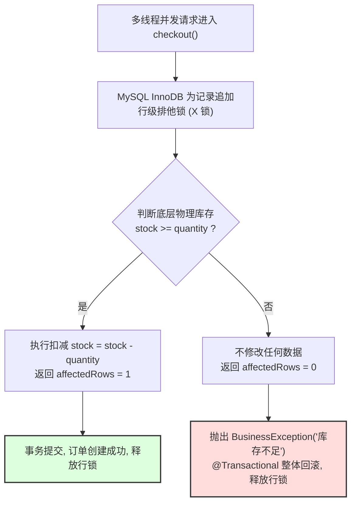
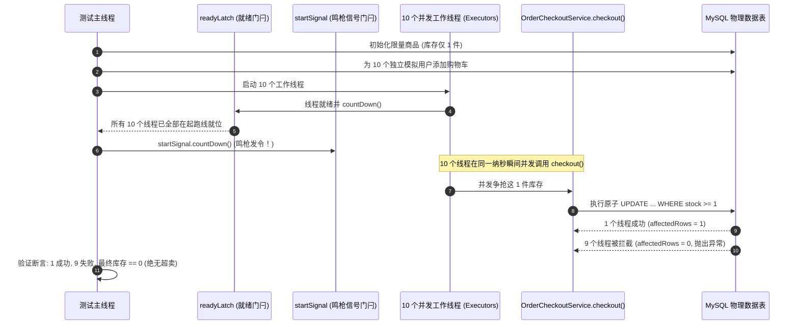

# 05 - 高并发库存防超卖原理与极简原子化设计

> 本文是电商平台课程作业核心技术讲义第五篇。深入剖析 **电商秒杀与下单场景下的四大库存扣减技术方案对比**、**“代码简化之道（Code Simplifier）”核心哲学在单 SQL 条件更新中的极致落地**、以及 **基于多线程 CountDownLatch 并发门闩的零超卖集成测试实战**。

---

## 1. 电商高并发场景下的“超卖（Overselling）”灾难

超卖是所有电商平台与分布式商业系统中最具破坏性的业务灾难之一。
- **问题本质**：库存余额只剩 1 件，在同一毫秒内有 100 个并发用户同时点击“立即购买”。如果并发控制失效，系统可能判定这 100 笔订单均有效并扣减库存，导致库存变为 `-99`。实际仓库无法履约，造成严重的商业信誉与经济损失。

---

## 2. 库存扣减四大技术方案横向评测

在工程演化中，开发者探索过多种并发控制方案，各自的性能、复杂度和适用场景存在显著差异：

```
+-----------------------------------------------------------------------------------------------+
|                                四大库存并发扣减方案优劣势横向对比                              |
+-------------------+------------------------------+--------------------+-----------------------+
| 方案名称          | 实现机理                     | 致命缺陷 / 复杂度  | 适用评级              |
+-------------------+------------------------------+--------------------+-----------------------+
| 1. 应用层查后更新 | Java 先查出库存，代码判定后   | 严重超卖！并发下   | 致命错误（零分方案）  |
|    (Check-then-Act)| 再执行 update stock = ...   | 多个线程读到相同值 |                       |
+-------------------+------------------------------+--------------------+-----------------------+
| 2. 数据库悲观锁   | SELECT ... FOR UPDATE        | 独占排他锁导致线程 | 吞吐量极低            |
|   (Pessimistic)   | 阻塞所有读写事务             | 堆积，易引发死锁   |                       |
+-------------------+------------------------------+--------------------+-----------------------+
| 3. 分布式锁       | Redis Redisson / Lua 脚本    | 引入网络开销、锁续 | 架构极其繁重，增加    |
|   (Distributed)   | 维护外部锁租约               | 期问题及故障点     | 额外网络与中间件故障点|
+-------------------+------------------------------+--------------------+-----------------------+
| 4. 单 SQL 条件原子| UPDATE ... SET stock=stock-Q | 零外部依赖，极低   | ★★★★★                 |
|    更新 (本项目)  | WHERE id=X AND stock >= Q    | 复杂度，天然绝对安全| 极简主义满分方案      |
+-------------------+------------------------------+--------------------+-----------------------+
```

### 2.1 方案 1：应用层查后更新（Check-then-Act 反模式）
```java
// 致命错误示范！
ShopProduct p = productMapper.selectById(productId);
if (p.getStock() >= quantity) {
    p.setStock(p.getStock() - quantity);
    productMapper.updateById(p); // 产生严重的并发覆写丢失 (Lost Update)
}
```
两个并发请求同时读到 `stock = 1`，都判定满足条件，随后先后执行 `set stock = 0`，原本 1 件库存被 2 个人买走，直接产生超卖。

### 2.2 方案 2：数据库悲观锁（`SELECT ... FOR UPDATE`）
在事务内通过 `FOR UPDATE` 锁定数据行：
- **缺陷**：并发量大时，数据库所有等待行锁的线程必须串行排队。连接池中的数据库连接长时间被阻塞占用，造成整个数据库吞吐量断崖式下滑，极易发生死锁（Deadlock）。

### 2.3 方案 3：分布式锁（Redis + Redisson）
在进入下单逻辑前，先向 Redis 申请一把分布式互斥锁：
- **缺陷**：分布式锁本身是极其复杂的分布式系统课题。需要考虑锁的租约时间（Lease Time）、看门狗自动续期（Watchdog）、主从切换导致的锁丢失问题。为了一个单体即可闭环的课程大作业强行引入复杂的分布式锁，属于典型的**过度设计（Over-Engineering）**。

### 2.4 方案 4：单 SQL 状态机原子条件更新（本项目方案）
```sql
UPDATE shop_product 
SET stock = stock - #{quantity} 
WHERE id = #{productId} 
  AND stock >= #{quantity} 
  AND is_deleted = 0;
```

---

## 3. “代码简化之道（Code Simplifier）”核心哲学

在经典的软件工程演进中，“最优秀、最坚固的代码往往是活动组件（Moving Parts）最少的那一种”。

### 3.1 为什么单 SQL 条件更新具备不可撼动的绝对安全性？
1. **InnoDB 引擎行级锁原子性保障**：
   - 当 MySQL 执行 `UPDATE` 语句时，InnoDB 存储引擎会在聚簇索引树上命中此行记录，并立即为该行追加一把**排他行级写锁（X 锁）**；
   - 所有的并发更新在此行上由存储引擎内核底层自动完成**物理串行化**执行，无需任何上层 Java 锁或分布式协调。
2. **硬件级 CAS 语义（比较并交换）**：
   - 关键在于 `WHERE stock >= #{quantity}` 条件是在获得行级锁之后、在数据库内核底层直接计算判定的；
   - 每一个线程执行时，看到的一定是前一个线程更新提交后的最新真实库存值。
3. **受影响行数（Affected Rows）充当无锁信号量**：
   - MySQL 执行完毕后会向 JDBC 驱动返回一个整型数字 `affectedRows`：
     - 若 `affectedRows == 1`：表明库存充足且扣减动作已经原子生效；
     - 若 `affectedRows == 0`：表明此时 `stock < quantity`，条件未满足，扣减未发生。
   - 业务代码根据受影响行数立即抛出异常并触发事务回滚，整个过程行云流水，没有任何冗余锁开销！



### 3.2 本项目源码精准定位

#### 1. Mapper 层原子 SQL 声明：`ShopProductMapper.java`
```java
@Mapper
public interface ShopProductMapper extends BaseMapper<ShopProduct> {

    /**
     * 原子单条 SQL 扣减库存，保证高并发下零超卖
     * UPDATE shop_product SET stock = stock - #{quantity} WHERE id = #{productId} AND stock >= #{quantity} AND is_deleted = 0
     * @return 实际影响行数（1 表示成功扣减，0 表示库存不足）
     */
    @Update("UPDATE shop_product SET stock = stock - #{quantity} WHERE id = #{productId} AND stock >= #{quantity} AND is_deleted = 0")
    int decrementStock(@Param("productId") Long productId, @Param("quantity") Integer quantity);
}
```

#### 2. Service 事务协调与熔断回滚：`OrderCheckoutServiceImpl.java`
```java
@Override
@Transactional(rollbackFor = Exception.class)
public OrderCheckoutResult checkout(Long userId, CheckoutCommand cmd) {
    // ... 前置参数与购物车检索逻辑 ...

    for (ShopCartItem item : cartItems) {
        ShopProduct product = productMap.get(item.getProductId());
        
        // 单 SQL 原子条件扣减库存
        int affectedRows = productMapper.decrementStock(product.getId(), item.getQuantity());
        if (affectedRows == 0) {
            // 受影响行数为 0 表示库存不足，立即抛出受检业务异常
            // @Transactional 将自动回滚当前事务中的所有操作（包括已生成的订单记录和前置扣减）
            throw new BusinessException("商品 [" + product.getName() + "] 库存不足，扣减失败");
        }
        // ... 生成快照与订单主表 ...
    }
}
```

---

## 4. 高并发集成测试验证：CountDownLatch 实战

在 `backend/src/test/java/com/shop/modules/commerce/OrderConcurrencyTest.java` 中，我们编写了严密的高并发集成测试用例，真实还原了秒杀压测场景。

### 4.1 测试核心设计：统一“鸣枪起跑”门闩



### 4.2 核心断言与验证指标

测试代码中的断言逻辑彻底证明了设计的健壮性：
```java
// 断言并发控制结果
assertThat(successCount.get())
    .as("高并发下抢占唯一库存，必须且只能有 1 单成功")
    .isEqualTo(1);

assertThat(failCount.get())
    .as("高并发下争抢失败的线程数量必须严格等于 9")
    .isEqualTo(9);

// 校验数据库最终库存：必须精确等于 0，绝不允许发生超卖甚至负库存
ShopProduct finalProduct = productMapper.selectById(testProductId);
assertThat(finalProduct.getStock())
    .as("唯一库存被扣减后剩余库存必须等于 0，严禁超卖产生负库存")
    .isEqualTo(0);
```

> [!TIP]
> 在答辩向答辩老师或考官展示此方案时，可直接运行 `OrderConcurrencyTest` 单元测试。绿色的测试结果（10 线程并发冲抢，1 成功 9 失败，库存归零）将成为证明你对并发控制深刻理解的“最有说服力的硬核证据”。
