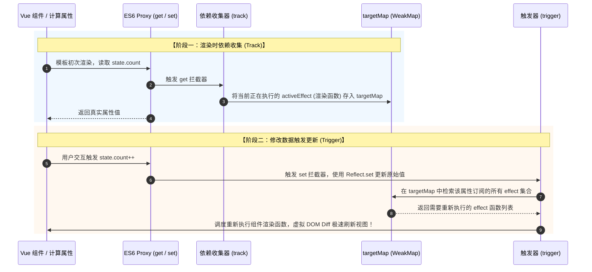
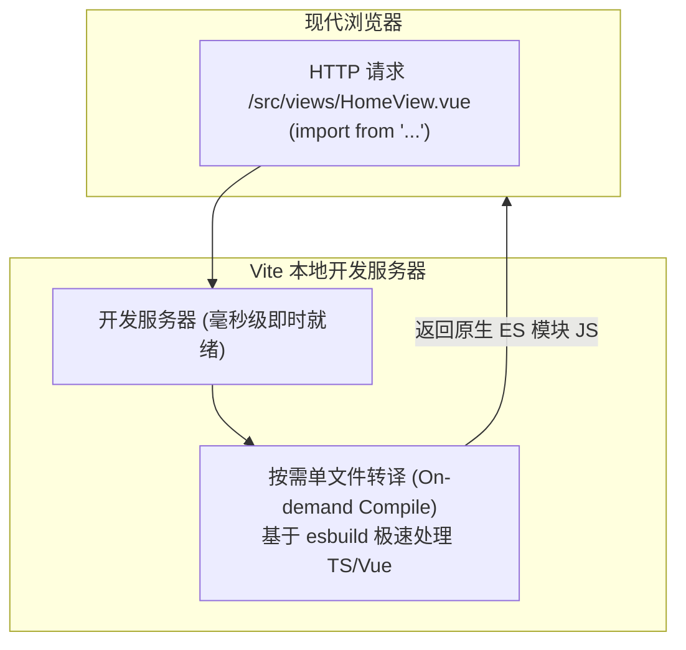

# 06 - Vue 3 响应式原理、Vite ESM 极速构建与现代前端架构

> 本文是电商平台课程作业核心技术讲义第六篇。深入解构 **Vue 3 响应式系统底层演进（Proxy vs. Object.defineProperty）**、**现代构建工具 Vite 原生 ESM 极速冷启动机制**、以及 **基于 Pinia 的客户端响应式深模块架构实践**。

---

## 1. Vue 3 响应式系统的底层重大飞跃：Proxy vs. Object.defineProperty

前端 MVVM 框架的核心生命线在于**数据驱动视图更新**。Vue 3 对响应式引擎进行了彻底的底层重构，用 ES6 `Proxy` 完全替代了 Vue 2 中的 `Object.defineProperty`。

```
【Vue 2：Object.defineProperty】
Object (属性预先递归遍历)  --->  无法监听新增/删除属性、无法原生监听数组索引修改

【Vue 3：ES6 Proxy】
Target Object  <---拦截代理---  Proxy (全方位捕获 13 种对象底层操作，动态懒代理)
```

### 1.1 核心机制深度对比矩阵

| 对比维度 | Vue 2（`Object.defineProperty`） | Vue 3（ES6 `Proxy` + `Reflect`） |
| :--- | :--- | :--- |
| **属性监听范围** | 只能劫持对象中**已存在**的属性，无法感知新增或删除属性 | **全方位代理整个对象**，动态新增属性、删除属性均能被捕获 |
| **数组变异监听** | 无法原生监听数组下标变更（`arr[0] = x`）及 `length` 修改；必须魔改 Hack 数组的 7 大原型方法（push, pop...） | **原生完整支持**。数组下标修改、`length` 变化均会触发 `set` 拦截 |
| **初始化性能** | 初始化阶段必须深层递归遍历对象的所有层级属性，大对象极易造成页面卡顿 | **按需惰性代理（Lazy Proxy）**。只有访问到嵌套深层属性时，才会动态为子对象包装 Proxy，初次加载性能大幅跃升 |
| **Set / Map 支持** | 完全不支持原生 ES6 Set、Map、WeakMap 响应式 | 原生全面支持各种集合类型的响应式更新 |
| **底层 API 数量** | 仅有 `get` 和 `set` 两个拦截器 | 提供 `has`、`deleteProperty`、`ownKeys` 等多达 **13 种拦截操作** |

### 1.2 Vue 3 依赖收集（Track）与触发更新（Trigger）原理

Vue 3 内部采用全局的弱引用哈希表 `targetMap`（`WeakMap<target, Map<key, Set<effect>>>`）维护响应式依赖关系：



### 1.3 `ref()` 与 `reactive()` 的选择与内部差异

- `reactive(obj)`：接收一个对象，直接通过 `new Proxy(obj, handlers)` 包装成响应式代理。
- `ref(value)`：既能接收对象，也能接收基本数据类型（如 `string`, `number`, `boolean`）。
  - **为什么基本类型需要 `ref`？**：在 JavaScript 中，基本类型是按值传递的，ES6 `Proxy` 只能代理引用对象。
  - **底层机理**：Vue 3 将基本数据类型包装为一个包含私有属性 `_value` 的对象，并通过 getter/setter 拦截对 `.value` 的访问与修改，从而统一接入响应式系统。

---

## 2. 现代构建工具 Vite 原理：原生 ESM vs. Webpack 打包机制

本项目前端完全抛弃了传统的 Webpack，全面拥抱由 Vue 创始人尤雨溪设计的下一代极速前端工具 **Vite**。

### 2.1 传统 Webpack 冷启动之痛

Webpack 遵循的是传统的**全量打包打包器（Bundler）**逻辑：
- 启动本地开发服务器之前，Webpack 必须从入口文件（`main.js`）开始，深度递归抓取整个工程的所有依赖、组件和图片，在内存中进行 AST 分析、Polyfill 注入与全量 Bundle 打包。
- 随着项目模块数量从几十个扩充到上百个，Webpack 的本地热更新和冷启动时间将从几秒恶化到数分钟之久（启动复杂度呈 $O(N)$ 线性恶化）。

### 2.2 Vite 基于浏览器原生 ESM 的毫秒级飞跃

现代浏览器已普遍支持标准 ECMAScript 模块（`<script type="module" src="...">`）。Vite 充分利用了这一前沿标准：

```
【传统 Webpack 打包流】
Entry ---> 分析全部依赖 ---> 打包生成单一大 Bundle 文件 ---> 启动 Dev Server (极慢)

【Vite 原生 ESM 流】
启动 Dev Server (瞬间完成) ---> 浏览器请求哪个 .vue，服务端就实时转译哪个 (按需编译，极快)
```



#### Vite 核心架构优势：
1. **毫秒级冷启动（$O(1)$ 启动开销）**：
   - Vite 启动时根本不预先打包整个项目，服务器只需要启动一个极轻量的 HTTP 静态服务（几百毫秒内就绪）；
   - 依赖项（如 `element-plus`、`pinia`、`axios`）在首次启动时利用由 Go 语言编写的极速编译器 **esbuild** 进行预构建（Pre-bundling），速度比基于 Node.js 的传统转译器快 10~100 倍。
2. **极速热重载（HMR, Hot Module Replacement）**：
   - 当开发者修改一个 Vue 单文件组件时，Vite 仅让浏览器重新请求这一个变动文件的原生 ESM 模块，其余模块完全保持原状，页面毫秒级即时刷新。

---

## 3. 客户端深模块实践：Pinia 响应式状态管理

在状态管理选型上，Vue 3 官方已将 **Pinia** 确立为 Vuex 的替代者。Pinia 彻底移除了 Vuex 中晦涩繁重的 `mutations` 概念，天然深度支持 TypeScript 类型推导。

### 3.1 前端深模块：`useCartStore` 架构案例

在 `frontend/src/stores/cart.ts` 中，我们将购物车的核心业务逻辑抽象为一个高内聚的**客户端深模块**：

```
+---------------------------------------------------------------------------------------+
|                                useCartStore (前端深模块)                              |
+---------------------------------------------------------------------------------------+
|  【极简对外契约】:                                                                    |
|    - items: Ref<CartItemVO[]>                                                         |
|    - checkedCount: ComputedRef<number> (已勾选商品件数)                               |
|    - totalAmount: ComputedRef<number>  (已勾选总金额)                                 |
|    - refreshCart()                                                                    |
|    - addToCart(productId, quantity)                                                   |
|    - updateQuantity(itemId, quantity)                                                 |
|    - toggleChecked(itemId, checked)                                                   |
+---------------------------------------------------------------------------------------+
|  【深层隐藏实现】:                                                                    |
|    - 封装 Axios API 异步网络请求与 JWT Header 携带                                    |
|    - 异常错误统一 Toast 提示并自动回滚本地乐观状态                                    |
|    - 自动触发全局导航栏购物车小红点角标实时联动刷新                                   |
+---------------------------------------------------------------------------------------+
```

### 3.2 深度封装让组件极度轻盈

由于 `useCartStore` 承担了数据同步与状态计算的深度，在具体的视图组件（如 `ProductDetailView.vue`、`HomeView.vue`）中，加购操作只需一行代码：

```ts
const cartStore = useCartStore();

// 一行代码完成加购，内部自动处理防抖、网络请求、红点刷新及异常提示
await cartStore.addToCart(productId.value, buyCount.value);
```

### 3.3 品牌产地（`origin`）与数据模型全链路贯通

在商品品牌管理与橱窗浏览中，前端配合后端扩展实现了“品牌产地”的全链路支持：
- **管理控制台**（`BrandManageView.vue`）：表格动态渲染产地 Tag 标签；抽屉表单支持输入产地国家或地区，并支持按产地关键字即时筛选；
- **前台商城橱窗**：商品详情与品牌展示卡片将产地作为核心背书属性呈现，提升电商交易真实感与视觉完整度。

---

## 4. 现代前端自动化测试工程体系：Vitest + happy-dom 毫秒测试实战

现代企业级前端工程绝不能依赖“人工点点看”的手工测试。本项目在前端建立了完整的自动化测试工程体系，采用与 Vite 深度共生的 **Vitest** + **`happy-dom`** 测试框架。

### 4.1 为什么选用 Vitest + happy-dom 而非传统的 Jest + jsdom？

| 选型对比维度 | 传统 Jest + jsdom 体系 | 现代 Vitest + happy-dom 体系（本项目采用） |
| :--- | :--- | :--- |
| **配置文件复用** | 必须单独编写繁琐的 `jest.config.js`，且路径别名 `@/` 需用正则在两处重复映射 | **零配置复用 `vite.config.ts`**，原生共享全部插件与路径别名 |
| **转译性能** | 依赖 Babel / ts-jest 进行二次转译，启动冷启动耗时数秒甚至十多秒 | **与 Vite 共享原生 ESM 与 esbuild**，测试套件毫秒级极速就绪（$O(1)$ 冷启动） |
| **DOM 仿真引擎** | `jsdom` 功能完整但体积极其沉重，执行速度较慢 | **`happy-dom`** 轻量精简，内存占用极低，DOM 节点解析速度比 jsdom 快 2~4 倍 |
| **TypeScript 支持** | 需配置繁重的类型映射与 transform | **开箱即用原生 TypeScript**，类型推导与生产构建完全一致 |

### 4.2 三大核心自动化测试套件剖析

```
frontend/test/
├── router.spec.ts    # 路由守卫与角色越权拦截测试
├── request.spec.ts   # Axios 网络拦截器与 JWT 携带测试
└── cart.spec.ts      # Pinia 购物车深模块响应式状态流转测试
```

#### 1. 路由守卫与鉴权越权测试（`router.spec.ts`）
- 模拟未登录顾客访问受保护路由（如 `/orders`），断言全局路由守卫自动重定向至 `/login?redirect=...`；
- 模拟普通顾客身份（`ROLE_CUSTOMER`）直接在地址栏输入访问 `/admin`，断言路由守卫精准捕获越权并拦截；
- 模拟管理员（`ROLE_ADMIN`）登录后访问 `/admin`，断言正常放行渲染。

#### 2. Axios 请求与响应拦截测试（`request.spec.ts`）
- **请求拦截**：模拟发起 HTTP 请求，断言拦截器（`request.ts`）直接通过 `localStorage.getItem('token')` 读取由 `useUserStore` 登录维持的 JWT 并挂载到 `satoken` 请求头；
- **401 响应熔断**：模拟后端返回 401 认证失效状态码，断言拦截器自动清除本地持久化凭证（`localStorage.removeItem('token')` 与 `localStorage.removeItem('user')`），杜绝脏状态蔓延。

#### 3. Pinia 购物车响应式状态测试（`cart.spec.ts`）
- 断言购物车勾选计算属性（`checkedCount`）与总计金额（`totalAmount`）在勾选状态变动时即时触发依赖响应式重算；
- 断言网络异常时自动触发本地乐观状态回滚，确保前端界面与真实后端状态严格一致。

### 4.3 运行前端测试命令
```bash
cd frontend
npm test
```
终端瞬间输出绿色全过结果（15 个测试用例秒级通过），充分展现了高标准的现代前端工程素养。
