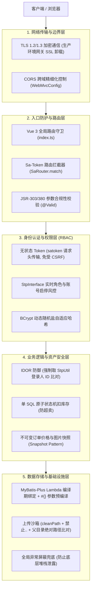
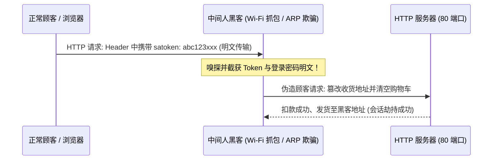
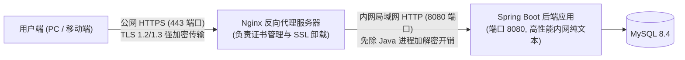

# 08 - 项目安全防护体系与网络传输防御（答辩知识全景指南）
> **Defense Knowledge: Full-Stack Security Architecture & HTTPS/TLS Principles**
> 
> 本文是电商平台课程作业与毕业设计答辩核心技术讲义第 08 篇。系统性总结了本项目的**全栈纵深安全防护体系（8 维防御）**、**网络传输层协议演进（HTTP vs. HTTPS / SSL 卸载标准架构）**、以及**高校答辩与技术面试高频安全考问满分应答指南**。

---

## 目录速览

- [1. 架构总览：电商系统 8 维纵深防御体系](#1-架构总览电商系统-8-维纵深防御体系)
- [2. 身份认证与权限控制（Sa-Token + 动态 RBAC）](#2-身份认证与权限控制sa-token--动态-rbac)
- [3. 密码学安全：为什么弃用 MD5 改用 BCrypt？](#3-密码学安全为什么弃用-md5-改用-bcrypt)
- [4. 越权漏洞防御：垂直越权与水平越权（IDOR）](#4-越权漏洞防御垂直越权与水平越权idor)
- [5. 交易并发与资产安全：原子防超卖与不可变快照](#5-交易并发与资产安全原子防超卖与不可变快照)
- [6. 注入防护、参数校验与文件上传沙箱](#6-注入防护参数校验与文件上传沙箱)
- [7. 网络传输安全深度解析：为什么本地用 HTTP？HTTPS 怎么保证安全？](#7-网络传输安全深度解析为什么本地用-httphttps-怎么保证安全)
  - [7.1 本地开发采用 HTTP 的核心权衡](#71-本地开发采用-http-的核心权衡)
  - [7.2 公网裸奔 HTTP 的致命风险（网络嗅探与 Token 劫持）](#72-公网裸奔-http-的致命风险网络嗅探与-token-劫持)
  - [7.3 工业界生产标准：Nginx SSL 卸载（SSL Termination）](#73-工业界生产标准nginx-ssl-卸载ssl-termination)
  - [7.4 生产部署与本地启用 HTTPS 的具体配置方案](#74-生产部署与本地启用-https-的具体配置方案)
- [8. 课程答辩安全专项核心考问与满分应答秘籍（Cheat Sheet）](#8-课程答辩安全专项核心考问与满分应答秘籍cheat-sheet)

---

## 1. 架构总览：电商系统 8 维纵深防御体系

本项目严格遵循计算机安全领域著名的**纵深防御原则（Defense in Depth）**，拒绝“单点脆弱”假设，在网络层、表现层、网关层、业务层、持久层和存储层均设置了独立的安全屏障：



---

## 2. 身份认证与权限控制（Sa-Token + 动态 RBAC）

### 2.1 无状态 JWT 架构与天然免疫 CSRF
- **传统 Cookie/Session 的弊端**：浏览器发出的请求会自动携带 Cookie，恶意第三方网站诱导用户点击链接即可发起跨站伪造请求（CSRF），后端必须引入繁重的 CSRF Token 校验。
- **本项目方案**：采用 **Sa-Token JWT Simple 模式**（[`SaTokenConfig.java`](file:///D:/JavaWeb/backend/src/main/java/com/shop/config/SaTokenConfig.java)），服务端基于 HMAC-SHA256 私钥颁发标准 JWT 令牌，前端在 Axios 拦截器中提取 `localStorage` 中的 Token，显式挂载到 HTTP Request Header `satoken: <token>` 中传输。浏览器跨站请求绝不会自动携带自定义 Header，**天然免疫 CSRF 攻击**。同时服务端保留 Redis 极轻量 Session，兼具无状态传输与即时封禁下线能力。

### 2.2 路由级声明式拦截
在 `com.shop.config.WebMvcConfig` 中：
- `/api/admin/**`：拦截未授权请求，强制核验 `ROLE_ADMIN`；
- `/api/cart/**`、`/api/orders/**`、`/api/auth/profile`：强制核验 `StpUtil.checkLogin()`；
- 前台公开浏览接口（`/api/portal/**`）与静态资源放行，实现最小权限最小暴露原则。

### 2.3 动态风控与秒级踢人下线
- 实现了 `cn.dev33.satoken.stp.StpInterface`（`StpInterfaceImpl`），鉴权时实时校验用户数据库最新状态（`status == 1`）。
- 管理员在后台封禁用户时（`UserServiceImpl.updateUserStatus`）：
  1. 将数据库状态置为 0；
  2. 调用 `StpUtil.logout(userId)` **强制注销该用户当前持有的所有活跃 Token**；
  3. 代码显式禁止管理员禁用自身账号，杜绝管理人员自锁。

---

## 3. 密码学安全：为什么弃用 MD5 改用 BCrypt？

### 3.1 对比分析

| 维度 | 普通 MD5 / 静态加盐 MD5 | BCrypt 自适应哈希（本项目采用） |
| :--- | :--- | :--- |
| **计算速度** | 极快（现代 GPU 每秒可算数十亿次） | **故意设计为 CPU/内存密集型（耗时 50~100ms）** |
| **彩虹表防御力** | 极差。相同明文产生固定密文，极易碰撞反推 | **极强。自带 128 位动态随机盐，相同明文生成截然不同密文** |
| **暴力破解成本** | 极低，几秒至几分钟可破解常见弱密码 | **极高，面对离线暴力枚举算力成本呈指数级剧增** |
| **算法标准** | 早已被安全界宣布淘汰弃用 | **工业界标准推荐（Spring Security / Sa-Token 官方标配）** |

### 3.2 源码佐证
- 注册加盐：`com.shop.modules.auth.service.impl.AuthServiceImpl`
  ```java
  String saltHashedPassword = BCrypt.hashpw(cmd.password(), BCrypt.gensalt());
  ```
- 登录比对：
  ```java
  if (!BCrypt.checkpw(cmd.password(), user.getPassword())) {
      throw new BusinessException(ResultCode.UNAUTHORIZED.getCode(), "用户名或密码错误");
  }
  ```

---

## 4. 越权漏洞防御：垂直越权与水平越权（IDOR）

### 4.1 垂直越权防御（Privilege Escalation）
普通顾客（`ROLE_CUSTOMER`）如果试图强行调用后台管理接口（如 `/api/admin/users`），在 `WebMvcConfig` 的 `SaInterceptor` 层面即被 `checkRole("ROLE_ADMIN")` 拦截，直接返回 `403 Forbidden`。

### 4.2 水平越权防御（Insecure Direct Object References - IDOR）
初学者最易犯的安全漏洞：在获取购物车或订单时，依赖前端传入 `userId`（如 `/api/orders?userId=2`），黑客只需篡改 URL 中的数字即可窥探他人隐私。

**本项目的防御方案**：
1. **服务端绑定登录凭证**：所有顾客端 Controller（`OrderController`、`CartController`）的接口形参中**绝对不接收客户端传入的 `userId` 或 `customerId`**，统一通过 `StpUtil.getLoginIdAsLong()` 从服务端加密线程上下文中提取；
2. **深度比对资源归属（基于严谨统一的 `customerId`）**：
   - 订单详情查看：
     ```java
     if (customerId != null && !customerId.equals(order.getCustomerId())) {
         throw new BusinessException(ResultCode.FORBIDDEN.getCode(), "无权查看或操作该订单");
     }
     ```
   - 购物车条目修改/删除：
     ```java
     ShopCartItem item = cartItemMapper.selectById(cartItemId);
     if (item == null || !customerId.equals(item.getCustomerId())) {
         throw new BusinessException(ResultCode.NOT_FOUND.getCode(), "未找到该购物车记录");
     }
     ```

---

## 5. 交易并发与资产安全：原子防超卖与不可变快照

### 5.1 单 SQL 状态机原子扣减库存（防超卖）
- **核心原子 SQL**（`ShopProductMapper.decrementStock`）：
  ```sql
  UPDATE shop_product 
  SET stock = stock - #{quantity} 
  WHERE id = #{productId} 
    AND stock >= #{quantity} 
    AND is_deleted = 0;
  ```
- **工作机制**：MySQL InnoDB 存储引擎在执行 `UPDATE` 时自动加行级排他锁（X 锁），所有并发请求在数据库内核层面排队。当库存不足时，更新返回 `affectedRows = 0`。
- **业务熔断**：`OrderCheckoutServiceImpl` 判断如果受影响行数为 0，立即抛出 `BusinessException` 触发 Spring `@Transactional` 事务无痕回滚，杜绝超卖。
- **事务提交后双重缓存淘汰（afterCommit）**：库存扣减成功后即刻失效商品详情缓存，并注册 `TransactionSynchronization.afterCommit` 钩子，确保在 MySQL 事务完全 commit 后二次淘汰，避免并发读线程在事务提交前将旧快照数据回写污染 Redis。
- **压测断言**：经 `OrderConcurrencyTest`（10 线程并发争抢 1 件库存）严格验证：1 笔成功、9 笔被原子拦截，库存精确归 0。

### 5.2 金额防篡改、不可变快照与收货地址值对象（DeliveryAddress）
- **金额不可信**：订单总结算金额完全由后端基于数据库中商品的真实单价和购买数量重算（委托 `ShopCartItem.calculateSubtotal()` 充血实体计算），客户端传来的任何价格均直接忽略；
- **收货地址值对象模式（`DeliveryAddress`）**：将收件人姓名、电话和地址封装为不可变的值对象，杜绝多字段数据泥团并提供防穿透校验；
- **不可变商品快照**：下单时将商品当时的名称、单价、主图深拷贝持久化至 `shop_order_item`。商家后续修改标题、降价或删除商品，历史订单数据均不会被篡改，保证法律效力与审计严肃性。

---

## 6. 注入防护、参数校验与文件上传沙箱

### 6.1 SQL 注入免疫
- 单表查询使用 MyBatis-Plus `LambdaQueryWrapper`，通过 `SysUser::getUsername` 在编译期强类型绑定字段；
- 自定义 SQL 采用 JDBC 预编译占位符 `#{}`，彻底阻断 SQL 注入。

### 6.2 文件上传 4 重沙箱防御（`LocalStorageService`）
1. **路径净化**：`StringUtils.cleanPath()` 过滤非法符号；
2. **检测路径穿越**：`if (storedFilename.contains("..")) throw BusinessException;`
3. **绝对路径沙箱比对**：
   ```java
   Path destinationFile = this.rootLocation.resolve(storedFilename).normalize().toAbsolutePath();
   if (!destinationFile.getParent().equals(this.rootLocation.toAbsolutePath())) {
       throw new BusinessException("禁止保存至存储根目录之外");
   }
   ```
4. **随机 UUID 重命名**：避免文件名覆盖和木马脚本执行；
5. **体积上限约束**：`application.yml` 限制单文件 10MB、总请求 20MB，防止恶意 DoS。

---

## 7. 网络传输安全深度解析：为什么本地用 HTTP？HTTPS 怎么保证安全？

### 7.1 本地开发采用 HTTP 的核心权衡
在本地开发、课程演示与答辩评审阶段，工程默认采用 HTTP 协议（`http://localhost:8080`），核心原因在于**开发便利性与无障碍部署**：
- 如果在本地强行生成自签名 SSL 证书（Self-Signed Cert），Chrome、Edge 等主流浏览器在访问时会强制弹出刺眼的红色不安全告警（`NET::ERR_CERT_AUTHORITY_INVALID`）；
- 前端 Vite 代理与 Axios 请求会因为证书未受系统根证书信任而被直接中断，给答辩老师和助教在本地拉取代码运行带来极大的调试摩擦。

---

### 7.2 公网裸奔 HTTP 的致命风险（网络嗅探与 Token 劫持）

尽管应用层有 BCrypt、Sa-Token 保护，但**如果系统在没有 HTTPS 的公网上直接开放 HTTP，依然存在极其严重的安全隐患**：



1. **Token 嗅探与会话劫持（Eavesdropping & Session Hijacking）**：
   - HTTP 协议所有请求头（Request Headers）和请求体（Body）均为明文传输。攻击者利用公共 Wi-Fi、局域网 ARP 欺骗等手段抓包，即可截获 `satoken` 凭据，在不需要知道密码的情况下伪造用户身份。
2. **中间人篡改（Man-in-the-Middle - MITM）**：
   - 攻击者可以篡改传输中的数据包，或者在 HTML/JS 响应中恶意植入盗号木马脚本。

**结论**：**应用层安全（Sa-Token / BCrypt）与传输层安全（HTTPS / TLS）相辅相成。公网上线时，HTTPS 是不可或缺的基础设施！**

---

### 7.3 工业界生产标准：Nginx SSL 卸载（SSL Termination）

在现代化互联网大厂和微服务架构中，**Spring Boot 后端通常不直接配置 SSL 证书**。标准的做法是在最外层搭建反向代理（如 Nginx、API 网关或云厂商负载均衡 SLB），实行 **SSL 卸载（SSL Termination）**：



#### 为什么采用“SSL 卸载”架构？
1. **证书集中维护**：只需在 Nginx 网关配置一套泛域名证书（结合 Certbot 自动化脚本每 90 天自动续期），无需在内网数百个微服务中反复配置 `.jks` 或 `.p12` 证书；
2. **释放 JVM 宝贵算力**：TLS 握手和对称加解密计算极度消耗 CPU。Nginx 基于 C 语言和 OpenSSL 构建，对底层硬件指令集做了极致优化；由 Nginx 扛下全部加密解密计算，**让 Spring Boot 和 JVM 将全部 CPU 资源留给核心业务逻辑**。

---

### 7.4 生产部署与本地启用 HTTPS 的具体配置方案

#### 方案 A：生产环境主流配置（Nginx 挂载 SSL）
在 Linux 服务器的 `/etc/nginx/conf.d/shop.conf` 中配置：

```nginx
server {
    listen 80;
    server_name shop.example.com;
    # 强制将所有 HTTP 请求 301 重定向到安全 HTTPS
    return 301 https://$host$request_uri;
}

server {
    listen 443 ssl http2;
    server_name shop.example.com;

    # CA 权威机构颁发的 SSL 证书文件
    ssl_certificate /etc/nginx/ssl/shop.example.com.pem;
    ssl_certificate_key /etc/nginx/ssl/shop.example.com.key;

    # 启用现代高强度 TLS 协议与加密套件
    ssl_protocols TLSv1.2 TLSv1.3;
    ssl_ciphers HIGH:!aNULL:!MD5;
    ssl_prefer_server_ciphers on;

    # 托管前端 Vue 3 构建产物
    location / {
        root /var/www/shop-frontend/dist;
        try_files $uri $uri/ /index.html;
    }

    # 反向代理后端 Spring Boot REST API
    location /api/ {
        proxy_pass http://127.0.0.1:8080/api/;
        proxy_set_header Host $host;
        proxy_set_header X-Real-IP $remote_addr;
        proxy_set_header X-Forwarded-For $proxy_add_x_forwarded_for;
        proxy_set_header X-Forwarded-Proto https; # 告知后端这是 HTTPS 请求
    }
}
```

#### 方案 B：本地单体环境在 Spring Boot 中直接配置 SSL
如果不需要反向代理，希望 Spring Boot 本身对外提供 HTTPS 服务：

1. **使用 JDK `keytool` 生成密钥库**：
   ```bash
   keytool -genkeypair -alias shop -keyalg RSA -keysize 2048 -storetype PKCS12 -keystore shop.p12 -validity 3650
   ```
   *将生成的 `shop.p12` 放置于 `backend/src/main/resources/` 目录。*

2. **在 `application.yml` 中开启 SSL 配置**：
   ```yaml
   server:
     port: 8443
     ssl:
       enabled: true
       key-store: classpath:shop.p12
       key-store-password: your_keystore_password
       key-store-type: PKCS12
       key-alias: shop
   ```
   *重启后端，访问 `https://localhost:8443` 即可启用加密通信。*

---

## 8. 课程答辩安全专项核心考问与满分应答秘籍（Cheat Sheet）

### 考问 1：你们系统在网络传输层为什么用 HTTP，不怕 Token 被中间人窃听吗？
> **满分回答话术**：  
> “老师，在当前的本地开发与答辩演示环境下，我们采用的是 HTTP，主要是为了保证在评测环境中零门槛一键运行，避免自签名证书引发浏览器不安全红屏拦截。  
> 但在真实生产上线环境中，我们遵循业界主流的**职责解耦**与**SSL 卸载（SSL Termination）**标准架构：对外由反向代理网关（如 Nginx）统一挂载 CA 权威证书，在 443 端口启用 TLS 1.3 实施端到端链路加密，拦截所有网络嗅探和中间人伪造；在内网环境再以高速 HTTP 转发给 Spring Boot 集群，既保障了公网传输绝对安全，又释放了 JVM 在加解密上的 CPU 计算开销。”

---

### 考问 2：高并发秒杀场景下，系统是如何彻底避免库存‘超卖’和负库存的？
> **满分回答话术**：  
> “老师，我们坚决摒弃了应用层‘查后更新’的并发竞态反模式，采用的是**单条带状态条件的原子 SQL 扣减**方案（`ShopProductMapper.decrementStock`）：  
> `UPDATE shop_product SET stock = stock - #{quantity} WHERE id = #{id} AND stock >= #{quantity} AND is_deleted = 0;`  
> 结合 MySQL InnoDB 行级排他锁，所有并发请求在数据库内核层面自动排队。当库存不足时受影响行数为 0，后端在 `OrderCheckoutServiceImpl` 中判断若影响行数为 0，立即抛出业务异常触发 Spring 事务整体回滚，绝无超卖风险。我们还专门编写了 10 线程并发压测用例 `OrderConcurrencyTest` 进行断言验证。”

---

### 考问 3：什么是水平越权（IDOR）？你在项目中是如何防御的？
> **满分回答话术**：  
> “水平越权是指同级别权限的用户通过篡改资源 ID 访问或修改他人数据。本项目的防御体现在两个层面：  
> 1. **入口凭据信任度**：在所有涉及个人私有数据的 Controller 中，形参绝对不接收前端传入的 `customerId`，而是直接通过 `StpUtil.getLoginIdAsLong()` 从服务端加密 Token 上下文提取；  
> 2. **数据访问所有权严格校验**：在订单查询、支付和购物车修改等 Service 中，统一使用无二义性的 `customerId` 领域属性，取出数据后第一件事就是校验 `if (!customerId.equals(resource.getCustomerId())) throw ForbiddenException;`，彻底从业务逻辑层封死水平越权漏洞。”

---

### 考问 4：密码为什么不用 MD5？BCrypt 的工作原理是什么？
> **满分回答话术**：  
> “普通 MD5 计算极快且相同输入产生固定输出，已被离线彩虹表和字典碰撞完全攻破。本项目采用工业级标准的 BCrypt 单向哈希算法：  
> 1. **动态随机盐**：每次注册时内部生成 128 位随机 Salt 并打包存入密文字符串中，即使两个用户设置完全相同的密码，数据库中保存的密文也截然不同，使彩虹表彻底失效；  
> 2. **自适应工作因子（Cost Factor）**：故意设计为 CPU/内存密集型（默认迭代 1024 轮），单次耗时约 50~100ms。正常用户登录体验不受影响，但将黑客暴力破解成本提高数万倍。”
