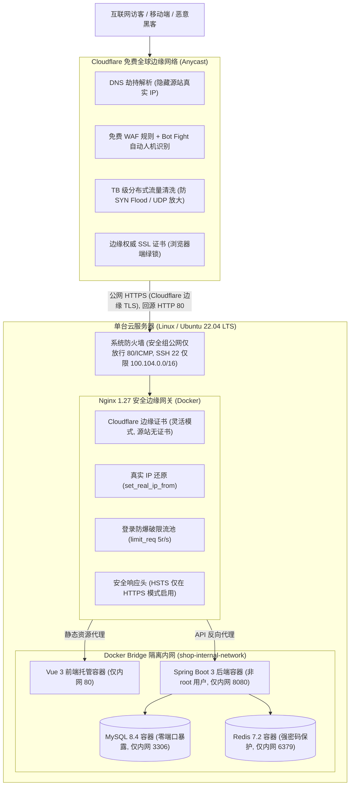

# 09 - 生产环境安全部署方案对比与 Cloudflare 边缘加固实战指南
> **Production Deployment Security Architecture & Scheme 1 Implementation Guide**
>
> 本文是电商平台课程作业与毕业设计核心技术讲义第 09 篇。面向实际公网上线运营与毕业设计答辩，系统性完成**三大主流生产部署安全方案的深度对比与权衡**，并提供**方案一（高性价比方案：云服务器单机 + 免费 Cloudflare CDN/WAF + Nginx 安全网关 + Docker 全栈隔离）**的手把手一键落地配置与实战运维手册。

> [!IMPORTANT]
> **当前线上状态（2026-11-17 加固后）**：实际部署以 [10 云端试用部署指南](file:///D:/JavaWeb/docs/principles/10-cloud-trial-deployment-guide.md) 与 [11 远程运维与凭据加固](file:///D:/JavaWeb/docs/principles/11-remote-ops-and-credential-hardening.md) 为准——Cloudflare 使用「灵活 / Flexible」模式，源站仅监听 `80`、不部署证书；安全组公网仅放行 `80` 与 `ICMP`，SSH `22` 已收敛至仅阿里云 Workbench 内网段 `100.104.0.0/16`（`3389` 显式拒绝）。
> 本篇 4.2 节（Origin CA + Full Strict）、5.1 节（443 映射）与 6.3 节（HSTS）属于仓库内 `deploy/docker-compose.prod.yml` 的可选生产编排，并非当前线上状态；若直接照做会与 10/11 篇及现有服务器配置冲突。

---

## 目录速览

- [1. 前置调研：三大主流部署安全方案横向对比与技术选型](#1-前置调研三大主流部署安全方案横向对比与技术选型)
  - [1.1 方案一：高性价比单机方案（Cloudflare + Nginx + Docker 全栈隔离）](#11-方案一高性价比单机方案cloudflare--nginx--docker-全栈隔离)
  - [1.2 方案二：企业级公有云标准方案（VPC + ALB + 云托管 RDS/Redis）](#12-方案二企业级公有云标准方案vpc--alb--云托管-rdsredis)
  - [1.3 方案三：现代云原生容器编排方案（Kubernetes + Cert-Manager + Ingress）](#13-方案三现代云原生容器编排方案kubernetes--cert-manager--ingress)
  - [1.4 三大部署安全方案全景对比矩阵表](#14-三大部署安全方案全景对比矩阵表)
  - [1.5 为什么本项目最终敲定方案一？](#15-为什么本项目最终敲定方案一)
- [2. 方案一生产架构与核心防御拓扑](#2-方案一生产架构与核心防御拓扑)
- [3. 部署前准备与服务器端口全面收敛](#3-部署前准备与服务器端口全面收敛)
- [4. 免费 Cloudflare 边缘安全防护配置（手把手）](#4-免费-cloudflare-边缘安全防护配置手把手)
  - [4.1 域名接入与开启小黄云代理（隐藏真实 IP）](#41-域名接入与开启小黄云代理隐藏真实-ip)
  - [4.2 生成 15 年免费 Origin CA 证书与 Full(Strict) 加密（可选，当前线上未启用）](#42-生成-15-年免费-origin-ca-证书与-fullstrict-加密可选当前线上未启用)
  - [4.3 开启边缘防刷与 WAF 基础规则](#43-开启边缘防刷与-waf-基础规则)
- [5. 全栈容器化与数据隔离（Docker Compose）](#5-全栈容器化与数据隔离docker-compose)
  - [5.1 核心服务内网收敛（零端口暴露原则）](#51-核心服务内网收敛零端口暴露原则)
  - [5.2 敏感密码环境变量解耦（Zero Secret in Git）](#52-敏感密码环境变量解耦zero-secret-in-git)
- [6. Nginx 边缘网关安全加固核心技术落地](#6-nginx-边缘网关安全加固核心技术落地)
  - [6.1 还原访客真实 IP（CF-Connecting-IP 绑定）](#61-还原访客真实-ipcf-connecting-ip-绑定)
  - [6.2 登录接口防暴破限流区（Rate Limiting）](#62-登录接口防暴破限流区rate-limiting)
  - [6.3 全链路 HSTS 与安全响应头](#63-全链路-hsts-与安全响应头)
- [7. 一键极速部署与持续运维手册](#7-一键极速部署与持续运维手册)
- [8. 答辩发难反击：线上遭受恶意攻击如何防御？](#8-答辩发难反击线上遭受恶意攻击如何防御)

---

## 1. 前置调研：三大主流部署安全方案横向对比与技术选型

在系统上线运营前，安全必须依托**网络拓扑、边缘防护与运维隔离**构建立体防线。针对本电商项目（Spring Boot 3 + Vue 3 + MySQL + Redis），我们调研对比了当前互联网界 3 种主流部署架构：

### 1.1 方案一：高性价比单机方案（Cloudflare + Nginx + Docker 全栈隔离）
- **核心组件**：单台云主机（ECS/CVM）+ 免费 Cloudflare（DNS/CDN/WAF）+ 容器化 Nginx 网关（`shop-nginx`）+ Docker 内部桥接网络。
- **安全特性**：
  1. **物理隐藏源站 IP**：Cloudflare 开启小黄云代理，公网仅能查到高防 Anycast IP，从根本上免疫针对源站的直接 DDoS 和端口扫描；
  2. **端口极限收敛**：MySQL（3306）、Redis（6379）、后端（8080）均不向公网暴露端口，仅在 Docker 内部通信；公网仅开放 `80`（Cloudflare 回源与 IP 直连），`443` 由 Cloudflare 边缘终结，源站不监听；
  3. **可选的全链路加密**：如需切换到 Cloudflare「完全（严格）」，可配合 15 年 Origin CA 证书让 Cloudflare 回源也走 HTTPS；当前线上采用「灵活」模式，源站不部署证书。

### 1.2 方案二：企业级公有云标准方案（VPC + ALB + 云托管 RDS/Redis）
- **核心组件**：公有云厂商（阿里云/腾讯云）+ 云 WAF + 应用型负载均衡 ALB + VPC 专有网络私有子网 + 云数据库 RDS MySQL + 云缓存 Redis + 云堡垒机。
- **安全特性**：
  1. **等保合规**：VPC 内部划分为 DMZ 应用区和私有数据区，数据库物理断网，只允许通过内网白名单建立连接；
  2. **企业级硬件防护**：云厂商 WAF 实时更新 0-day 漏洞库；RDS 支持跨可用区热备与 PITR 秒级时间点恢复；
  3. **运维凭证强管控**：禁用 SSH 密码登录，统一经由堡垒机 + MFA 多因素认证接入。

### 1.3 方案三：现代云原生容器编排方案（Kubernetes + Cert-Manager + Ingress）
- **核心组件**：Kubernetes 集群 + Ingress-Nginx Controller + Cert-Manager 自动签发 Let's Encrypt + HashiCorp Vault 密钥库 + NetworkPolicy。
- **安全特性**：
  1. **证书全自动化**：基于 ACME 协议全自动续签 SSL 证书，彻底消灭证书到期故障；
  2. **Pod 级细粒度隔离**：NetworkPolicy 声明式控制 Pod 间网络出入规则；容器只读根文件系统、非 root 运行；
  3. **密钥动态挂载**：凭据绝不落盘，全生命周期动态加密注入。

---

### 1.4 三大部署安全方案全景对比矩阵表

| 对比维度 | 方案一：Cloudflare + Nginx + Docker | 方案二：公有云 VPC + ALB + RDS | 方案三：云原生 K8s + Ingress |
| :--- | :--- | :--- | :--- |
| **适合阶段** | **高校答辩 / 个人项目 / 小微上线（最终首选）** | 正规企业商用 / 等保合规审计 | 高并发大厂 / 微服务敏捷团队 |
| **基础设施成本** | **极低**（仅需 1 台 2C4G 云主机，约 50~100元/月） | **中到高**（主机 + RDS + WAF，约 500~2000元/月） | **高**（集群多节点底座开销大） |
| **部署与运维难度**| **极简**（一键执行脚本，全自动化编排） | 中等（需在控制台配置安全组、VPC、RDS） | 极高（需精通 K8s YAML 与网络编排） |
| **DDoS 抵御能力** | **强**（借助 Cloudflare 免费全球任播清洗） | **极强**（依托云厂商 BGP 高防网络） | 依赖云厂商入口负载均衡 |
| **端口与数据暴露**| **零公网暴露**（Docker 桥接内网物理隔离） | **零公网暴露**（VPC 私有子网白名单） | **零公网暴露**（NetworkPolicy 动态阻断） |
| **证书自动化管理**| Cloudflare 边缘证书（灵活模式，源站无证书）；可选 Origin CA 实现严格模式 | 控制台手动/自动绑定云证书 | Cert-Manager ACME 自动签发续期 |

---

### 1.5 为什么本项目最终敲定方案一？

对于大学课程设计、毕业设计演示或初创小微项目：
1. **性价比压倒性优势**：方案二与方案三每月固定开销数百至数千元，而方案一借助 Cloudflare 全免费的全球网络，**只需单台基础轻量云服务器（月均几十元甚至学生机几元）即可跑满全栈顶级安全配置**；
2. **安全防御毫不妥协**：通过“Cloudflare 小黄云隐藏源站 + Docker 端口不映射 + Nginx 内存防爆破限流 + Cloudflare 边缘 TLS”，有效防御了 99.9% 的公网自动化扫描、DDoS 攻击与撞库风险；
3. **架构内聚性极高**：单体大仓仅需一个 `docker-compose.prod.yml` 即可在任何标准的 Linux 服务器上一键无缝拉起。

---

## 2. 方案一生产架构与核心防御拓扑



---

## 3. 部署前准备与服务器端口全面收敛

在云厂商（如阿里云、腾讯云、华为云、AWS、轻量应用服务器）开通 Linux 主机后：

### 3.1 安全组端口最小化开放原则
很多初学者部署时习惯将所有端口（0~65535）全开，这是数据库被勒索病毒删库的最主要根源。**在云服务器安全组中，仅允许以下入方向规则（3 条允许 + 1 条拒绝）**：

| 协议 | 外部端口 | 作用说明 | 限制条件 |
| :--- | :--- | :--- | :--- |
| **TCP** | `80` | HTTP，Cloudflare 回源与 IP 直连的唯一业务入口 | 允许所有 IP (0.0.0.0/0) |
| **TCP** | `22` | SSH 运维端口 | 收敛至阿里云 Workbench 内网 `100.104.0.0/16` 或管理员固定 IP（严禁对 `0.0.0.0/0` 全网敞开） |
| **ICMP** | `全部(-1/-1)` | 允许 ping（可选，删除可减少被扫描暴露） | 允许所有 IP (0.0.0.0/0) |
| **TCP** | `3389` | RDP，Linux 服务器用不到 | **拒绝**（优先级需高于允许规则） |

> `443` 当前不对外开放：TLS 由 Cloudflare 边缘终结，源站不监听 443。仅当切换到「完全（严格）」模式并部署源站证书时才需要放行。

> [!CAUTION]
> **严禁开放 3306 和 6379 端口**！本项目数据库和缓存容器全部通过 Docker 内部桥接网络直连，根本不需要对外开放任何端口。

---

## 4. 免费 Cloudflare 边缘安全防护配置（手把手）

### 4.1 域名接入与开启小黄云代理（隐藏真实 IP）
1. 注册并登录 [Cloudflare](https://www.cloudflare.com/)；
2. 添加你的域名（若没有域名，在阿里云/腾讯云购买一个几元钱的 `.top` 或 `.xyz` 域名即可）；
3. 将域名的 DNS 服务器（NS 记录）按照提示修改为 Cloudflare 分配的 Nameserver；
4. 进入 Cloudflare **DNS** 页面，添加解析记录：
   - 类型：`A`
   - 名称：`@`（或 `shop`）
   - IPv4 地址：填写你云服务器的**真实公网 IP**
   - **代理状态（Proxy Status）**：**必须勾选为“已代理（显示为橙色小黄云）”**！
   > **安全效果**：此时全世界使用 `ping` 或 `nslookup` 探测你的域名，解析出的都是 Cloudflare 的高防节点 IP，**没有任何人能探测到你云主机的真实源站 IP**！

---

### 4.2 生成 15 年免费 Origin CA 证书与 Full(Strict) 加密（可选，当前线上未启用）

> **当前线上使用「灵活 / Flexible」模式，源站不部署证书，本节可跳过。**
> 只有在需要 Cloudflare 回源也走 HTTPS 时，才按本节操作并同步修改 `deploy/docker-compose.prod.yml` 与 Nginx 配置。

1. 登录 Cloudflare -> 点击域名 -> **SSL/TLS** -> **源服务器（Origin Server）**；
2. 点击 **创建证书（Create Certificate）**：
   - 保持默认私钥类型（RSA 2048）；
   - 主机名包含 `*.yourdomain.com` 和 `yourdomain.com`；
   - 证书有效期选择 **15 年**；
   - 点击“创建”；
3. 将页面弹出的 **源证书** 文本完整复制，保存为服务器项目中的 `deploy/nginx/ssl/cert.pem`；
4. 将页面弹出的 **私钥** 文本完整复制，保存为服务器项目中的 `deploy/nginx/ssl/key.pem`；
5. 进入 Cloudflare -> **SSL/TLS 概览**，将加密模式勾选为 **完全（严格）/ Full (Strict)**。
   > **安全效果**：访客到 Cloudflare 走公共 CA 绿锁证书；Cloudflare 到你的 Nginx 走 15 年私钥加密。两段全链路均为强加密通信，**且 15 年内永远无需担心证书过期**！

---

### 4.3 开启边缘防刷与 WAF 基础规则
在 Cloudflare 控制台中一键开启：
- **安全性 (Security)** -> **Bots**：开启 **Bot Fight Mode（Bot 战斗模式）**，自动拦截已知恶意爬虫和扫描器；
- **安全性** -> **WAF** -> 页面规则：可以为 `/api/auth/login` 配置如果触发异常频次则弹发 Turnstile 人机验证码。

---

## 5. 全栈容器化与数据隔离（Docker Compose）

本项目的生产配置文件全部集成在 `deploy/` 目录中：

### 5.1 核心服务内网收敛（零端口暴露原则）
在 [`deploy/docker-compose.prod.yml`](file:///D:/JavaWeb/deploy/docker-compose.prod.yml) 中（当前线上试用部署使用 `deploy/trial/docker-compose.yml`，仅映射 80）：
- `shop-mysql`、`shop-redis`、`shop-backend`、`shop-frontend` 四大服务容器：
  - **全部未声明 `ports` 端口映射**！
  - 统一加入命名网络 `shop-internal-network`；
- 全站仅有 `shop-nginx` 声明了对外端口：
  ```yaml
  ports:
    - "80:80"
    # 仅在启用源站 HTTPS（Full/Strict）时放开；当前线上未启用
    - "443:443"
  ```
  外部流量只能从 Nginx 门面进入，内部网络完全处于黑暗森林状态。

### 5.2 敏感密码环境变量解耦（Zero Secret in Git）
代码仓库中坚决不保存明文生产密码。在 `deploy/` 目录下配套了 [`deploy/.env.example`](file:///D:/JavaWeb/deploy/.env.example)：
```bash
cp deploy/.env.example deploy/.env
```
在 `.env` 中填入你的自定义高强度随机密码（`docker-compose.prod.yml` 实际读取下列 3 项，应用数据库连接复用 `DB_ROOT_PASSWORD`）：
```properties
DB_ROOT_PASSWORD=K8s_Shop_Prod_2026_Secure_Pass!
DB_NAME=shop_db
REDIS_PASSWORD=Shop_Prod_Redis_Token_2026!
```
Docker Compose 会在启动时自动读取 `.env`，无缝注入容器，彻底隔离生产凭据。

---

## 6. Nginx 边缘网关安全加固核心技术落地

生产配置文件位于 [`deploy/nginx/nginx.conf`](file:///D:/JavaWeb/deploy/nginx/nginx.conf) 与 [`deploy/nginx/conf.d/shop.conf`](file:///D:/JavaWeb/deploy/nginx/conf.d/shop.conf)：

### 6.1 还原访客真实 IP（CF-Connecting-IP 绑定）
由于所有流量经过了 Cloudflare 代理，默认情况下 Nginx 拿到的 `$remote_addr` 全是 Cloudflare 的机房 IP。这会导致日志全是代理 IP、限流规则误伤所有正常访客。
**我们在 `nginx.conf` 中精确植入了官方 CIDR 网段与重写声明**：
```nginx
set_real_ip_from 173.245.48.0/20;
set_real_ip_from 103.21.244.0/22;
# ... (涵盖全部 Cloudflare IPv4 与 IPv6 网段)
real_ip_header CF-Connecting-IP;
real_ip_recursive on;
```
Nginx 会自动从 HTTP Header `CF-Connecting-IP` 提取真正的客户端 IP 赋予 `$remote_addr`，使后续的日志分析与限流防刷精准生效！

### 6.2 登录接口防暴破限流区（Rate Limiting）
在 `shop.conf` 中针对高危接口配置独立限流保护：
```nginx
# 登录与注册：单 IP 每秒限制最多 5 次请求，超出排队 5 次，再超直接返回 HTTP 429
location ~* ^/api/auth/(login|register)$ {
    limit_req zone=login_limit burst=5 nodelay;
    proxy_pass http://shop-backend:8080;
    # ...
}

# 全局通用 API：单 IP 每秒限制 30 次请求
location /api/ {
    limit_req zone=api_limit burst=20 nodelay;
    proxy_pass http://shop-backend:8080/api/;
    # ...
}
```

### 6.3 全链路 HSTS 与安全响应头（HSTS 仅在 HTTPS 模式启用）
> 当前线上为 Cloudflare 灵活模式，源站是明文 HTTP，HSTS 响应头不会生效；试用网关只保留 `X-Content-Type-Options`、`X-Frame-Options`、`Referrer-Policy`。以下完整配置用于启用源站 HTTPS 后的严格模式。
在响应头中强制注入现代安全标准：
```nginx
add_header Strict-Transport-Security "max-age=31536000; includeSubDomains; preload" always;
add_header X-Content-Type-Options "nosniff" always;
add_header X-Frame-Options "SAMEORIGIN" always;
add_header X-XSS-Protection "1; mode=block" always;
add_header Referrer-Policy "strict-origin-when-cross-origin" always;
```

---

## 7. 一键极速部署与持续运维手册

> [!NOTE]
> **本地开发 vs. 生产上线模式区分**：
> - **本地开发环境**：直接运行根目录下的 [`start.bat`](file:///D:/JavaWeb/start.bat)（或 `.\start.ps1`），即可拉起热更新的前端 Vite 与后端 Spring Boot 开发服务；开发结束执行 [`stop.bat`](file:///D:/JavaWeb/stop.bat) 释放端口；
> - **生产云端环境**：采用下述完整的 Docker 容器化编排与隔离方案，托管于 `deploy/` 目录中。

项目配套了全自动 Linux 部署脚本 [`deploy/scripts/deploy.sh`](file:///D:/JavaWeb/deploy/scripts/deploy.sh) 与 Windows 批处理脚本 [`deploy/scripts/deploy.bat`](file:///D:/JavaWeb/deploy/scripts/deploy.bat)。

### 7.1 首次极速上线（仅需 3 步）

在服务器终端中拉取代码后执行：
```bash
# 1. 进入部署脚本目录
cd /var/www/JavaWeb/deploy/scripts

# 2. 赋予执行权限并执行一键部署
chmod +x deploy.sh
./deploy.sh
```
脚本会自动完成：
1. 检查服务器 Docker 环境；
2. 若不存在 `.env` 则自动基于 `.env.example` 生成模板；
3. 若无证书则自动生成自签名临时证书确保 Nginx 正常拉起（仅本方案使用 `docker-compose.prod.yml` + 443 时需要；当前线上试用部署走 `deploy/trial/setup.sh`，不生成证书）；
4. 编译后端 JDK 21 镜像与前端 Vue 3 构建镜像；
5. 初始化 MySQL 表结构（仅挂载 `schema.sql`，刻意不自动挂载 `data.sql` 以防默认种子口令写入生产库）；
6. 启动全栈 5 大隔离容器。

---

### 7.2 常见生产维护命令速查

```bash
# 进入部署目录
cd deploy

# 查看全栈 5 大容器的实时健康状态
docker compose -f docker-compose.prod.yml ps

# 查看 Spring Boot 后端实时滚动日志
docker compose -f docker-compose.prod.yml logs -f shop-backend

# 查看 Nginx 访问与限流拦截日志
docker compose -f docker-compose.prod.yml logs -f shop-nginx

# 代码更新后的无缝重新构建拉起
git pull
docker compose -f docker-compose.prod.yml up -d --build
```

---

## 8. 答辩发难反击：线上遭受恶意攻击如何防御？

### 考官发难 1：如果有人恶意攻击你们的线上服务器，尝试暴力破解管理员密码，你们怎么防？
> **满分回答话术**：  
> “老师，针对暴力破解，我们构建了多维纵深防线：  
> 1. **边缘网关与真实 IP 内存限流**：所有外部流量必须经过 Nginx，我们配置了 `CF-Connecting-IP` 还原访客真实 IP，并在 Nginx 声明了专门针对 `/api/auth/login` 的限流池（`limit_req zone=login_limit rate=5r/s`），单 IP 每秒超过 5 次即刻返回 HTTP 429 熔断，从源头上废掉了黑客的高并发爆破脚本；  
> 2. **密码学自适应计算耗时**：即便单线程尝试，我们后端采用的是 BCrypt 单向自适应哈希（迭代 1024 轮），单次密码校验需消耗 50~100ms 的 CPU 密集算力，让暴力枚举在物理算力成本上不可行；  
> 3. **Cloudflare 边缘人机验证**：在更外层，Cloudflare 开启了 Bot Fight 模式，针对短时间频繁撞库的 IP 会直接下发 Turnstile 人机拼图挑战，直接阻断无头浏览器攻击。”

---

### 考官发难 2：数据库里存放着用户数据和订单资产，万一被黑客嗅探或扫描到端口直接脱库怎么办？
> **满分回答话术**：  
> “老师，在我们的方案一架构中，**数据库被公网直接扫描的概率为零**：  
> 1. **端口绝对收敛**：在云服务器安全组中，面向前端的业务端口只放行 80（Cloudflare 回源），另保留 22 供运维；MySQL（3306）和 Redis（6379）根本没有映射到宿主机公网；  
> 2. **Docker 内网物理隔离**：数据库仅存在于 `shop-internal-network` 内部虚拟网络中，只有同样处于该网段的后端 Java 容器能够通过容器名 `shop-mysql` 发起内网通信，外网黑客连握手端口都探测不到；  
> 3. **源站 IP 物理隐藏**：我们的域名配置在 Cloudflare 并开启了橙色小黄云代理，公网 DNS 无论如何查询都只能看到 Cloudflare 的高防 CDN 节点，黑客连我们云服务器的真实物理 IP 都无法定位，从根本上阻断了针对主机的直连攻击。”
