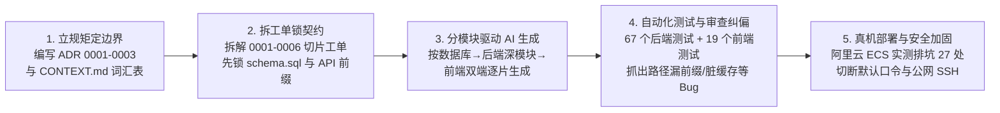
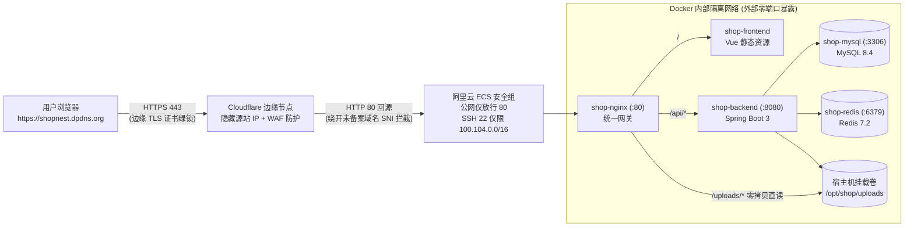
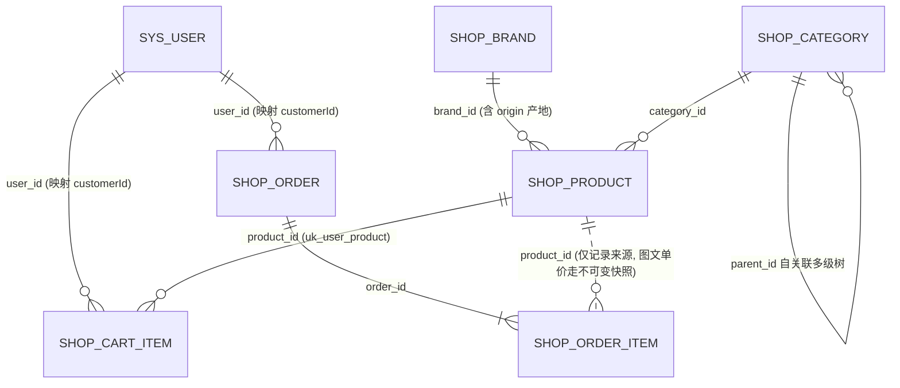
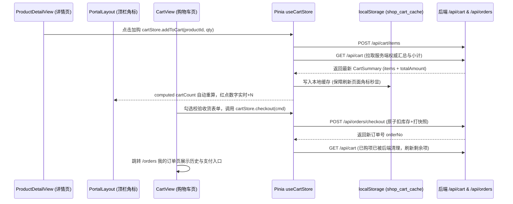
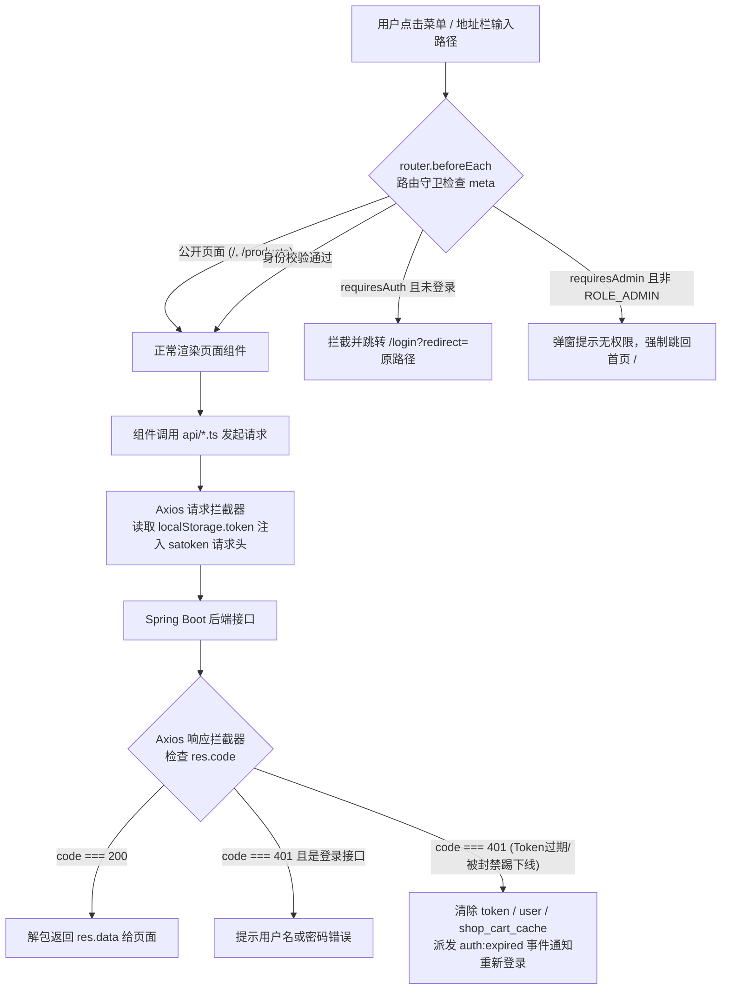

# JavaWeb Shop 现代电商平台 —— 团队四人详细分工、AI 协作复盘与答辩速成全攻略

> **适用团队**：1号（组长：后端架构与部署运维）、2号（数据库与缓存存储层）、3号（前端商城前台与交易交互）、4号（前端管理后台与工程基建/测试）  
> **基准资料**：严格对标并同步覆盖 [`docs/`](file:///D:/JavaWeb/docs) 全套文档（3 篇 ADR、数据库字典、00~11 号原理与实战讲义）及项目全部源码实现。  
> **阅读目标**：哪怕此前没有逐行手敲代码，只要按各自章节读完，就能**彻底搞懂我们是怎么指挥 AI 把项目做出来的、用到了什么核心技术、踩过什么真实大坑、系统是怎么跑起来的，上台答辩对答如流、绝不一头雾水**。

---

## 目录导航（按角色快速跳转）

- [第 0 部分：全员必读 —— 项目全景、AI 辅助开发总流程与答辩接力剧本](#第-0-部分全员必读--项目全景ai-辅助开发总流程与答辩接力剧本)
  - [0.1 四人分工总览与职责边界矩阵](#01-四人分工总览与职责边界矩阵)
  - [0.2 我们的真实开发模式：如何科学指挥 AI 完成高质量工程（答辩统一口径）](#02-我们的真实开发模式如何科学指挥-ai-完成高质量工程答辩统一口径)
  - [0.3 答辩现场 10 分钟四人无缝接力剧本](#03-答辩现场-10-分钟四人无缝接力剧本)
- [第 1 部分：1号同学专属手册 —— 后端核心架构（不含数据库）与全栈部署运维](#第-1-部分1号同学专属手册--后端核心架构不含数据库与全栈部署运维)
- [第 2 部分：2号同学专属手册 —— 数据库架构设计、MyBatis-Plus 持久层与 Redis 缓存层](#第-2-部分2号同学专属手册--数据库架构设计mybatis-plus-持久层与-redis-缓存层)
- [第 3 部分：3号同学专属手册 —— 前端商城前台（Customer Portal）与购物交易闭环](#第-3-部分3号同学专属手册--前端商城前台customer-portal与购物交易闭环)
- [第 4 部分：4号同学专属手册 —— 前端管理后台（Admin Console）、工程基建与自动化测试](#第-4-部分4号同学专属手册--前端管理后台admin-console工程基建与自动化测试)
- [第 5 部分：答辩前 24 小时全队联调与准备清单](#第-5-部分答辩前-24-小时全队联调与准备清单)

---

## 第 0 部分：全员必读 —— 项目全景、AI 辅助开发总流程与答辩接力剧本

### 0.1 四人分工总览与职责边界矩阵

本项目是一个**前后端分离单体大仓（Monorepo）现代电商系统**，包含面向买家的**商城前台（Storefront `/`）**与面向运营者的**管理后台（Admin Console `/admin`）**，并已完成阿里云 ECS 容器化与 Cloudflare HTTPS 公网上线。

| 成员 | 角色头衔 | 核心交付物（代码 / 配置 / 测试） | 必读 `docs/` 核心资料 | [`07-course-defense-qa.md`](file:///D:/JavaWeb/docs/principles/07-course-defense-qa.md) 认领题号 |
| :--- | :--- | :--- | :--- | :--- |
| **1号（你）** | **组长 / 后端与运维架构负责人** | Spring Boot 3.3.4 公共底座、Sa-Token + JWT 鉴权、4 大模块 Controller/Service 业务编排、后端 67 个单元与并发测试、一键脚本、Docker/Nginx/ECS/Cloudflare 部署与安全加固 | [`00`](file:///D:/JavaWeb/docs/principles/00-beginner-guide.md)、[`01`](file:///D:/JavaWeb/docs/principles/01-springboot3-internals-and-architecture.md)、[`02`](file:///D:/JavaWeb/docs/principles/02-auth-and-satoken.md)、[`08`](file:///D:/JavaWeb/docs/principles/08-defense-knowledge.md)、[`09`](file:///D:/JavaWeb/docs/principles/09-scheme1-production-deployment-guide.md)、[`10`](file:///D:/JavaWeb/docs/principles/10-cloud-trial-deployment-guide.md)、[`11`](file:///D:/JavaWeb/docs/principles/11-remote-ops-and-credential-hardening.md) | **Q1、Q3、Q4**（外加线上部署、HTTPS 与安全加固考问） |
| **2号同学** | **数据库与缓存存储层负责人** | MySQL 8.4 `shop_db` 7 张核心表设计、[`schema.sql`](file:///D:/JavaWeb/docs/sql/schema.sql) / [`data.sql`](file:///D:/JavaWeb/docs/sql/data.sql)、索引与不可变订单快照、MyBatis-Plus 实体/Mapper/AST 分页、单 SQL 原子扣减/回补库存、Redis 分区缓存与双删策略 | [`00`](file:///D:/JavaWeb/docs/principles/00-beginner-guide.md)、[`docs/sql/README.md`](file:///D:/JavaWeb/docs/sql/README.md)、[`03`](file:///D:/JavaWeb/docs/principles/03-orm-and-mybatis-plus.md)、[`04`](file:///D:/JavaWeb/docs/principles/04-redis-caching-patterns.md)、[`05`](file:///D:/JavaWeb/docs/principles/05-concurrency-and-inventory-safety.md) | **Q2、Q5、Q6、Q7、Q10、Q11** |
| **3号同学** | **前端商城前台（Portal）负责人** | 前台布局 `PortalLayout`、玻璃拟态 `glass.css` 与 `v-reveal` 动效、`ProductCard`、前台 5 大页面（首页橱窗、商品列表、商品详情、购物车、我的订单）、Pinia `useCartStore` 深模块及购物车单测 | [`00`](file:///D:/JavaWeb/docs/principles/00-beginner-guide.md)、[`ADR-0002`](file:///D:/JavaWeb/docs/adr/0002-domain-boundaries-and-commerce-flow.md)、[`06`](file:///D:/JavaWeb/docs/principles/06-vue3-and-vite-modern-frontend.md)（第 1、3 节） | **Q8**（外加前台购物流程、`useCartStore` 与首页性能优化考问） |
| **4号同学** | **前端管理后台（Admin）与基建负责人** | Vite 构建与代理、Axios 统一拦截器 `request.ts`、登录注册页 `LoginView`、`useUserStore`、路由越权守卫 `router/index.ts`、后台 6 大页面（看板、商品、品牌、分类、订单、用户）、Vitest 鉴权测试 | [`00`](file:///D:/JavaWeb/docs/principles/00-beginner-guide.md)、[`06`](file:///D:/JavaWeb/docs/principles/06-vue3-and-vite-modern-frontend.md)（第 2、4 节）、[`08`](file:///D:/JavaWeb/docs/principles/08-defense-knowledge.md)（前端防越权部分） | **Q9、Q12**（外加数据看板统计、Axios 拦截器与自动化测试考问） |

---

### 0.2 我们的真实开发模式：如何科学指挥 AI 完成高质量工程（答辩统一口径）

本项目使用 AI 编程工具（如 Trae / Claude / Cursor 等 Agent 工具）辅助完成。**如果答辩老师问“你们用了 AI 吗？怎么用的？”，千万不要说“一句话让 AI 生成完的”，也不要慌张隐瞒，而是大方展示我们的「规格驱动（Spec-Driven）AI 协同软件工程流程」**——这在仓库里是有完整证据链支撑的：



1. **第一步：先给 AI 戴上“架构紧箍咒”（防胡乱选型与过度设计）**
   - 直接让 AI 写电商项目，AI 极易写出兩種极端烂代码：要么用老掉牙的 JSP / Java 8 / MD5，要么过度设计引入 Spring Security 复杂过滤器链、Redisson 分布式锁、多维 SPU/SKU 笛卡尔积表，导致项目跑不起来也讲不明白。
   - 我们在动工前先确立了 3 份架构决策记录（[`ADR-0001`](file:///D:/JavaWeb/docs/adr/0001-core-tech-stack-and-architecture.md)、[`ADR-0002`](file:///D:/JavaWeb/docs/adr/0002-domain-boundaries-and-commerce-flow.md)、[`ADR-0003`](file:///D:/JavaWeb/docs/adr/0003-infrastructure-and-educational-artifacts.md)）和领域统一语言文档 [`CONTEXT.md`](file:///D:/JavaWeb/CONTEXT.md)，强制规定：技术栈锁定 **Java 21 + Spring Boot 3.3 + Sa-Token + MyBatis-Plus + Vue 3 + Vite**；商品采用**独立商品模型**；买家在业务层统一叫 `customerId`（不准泛化乱叫 `userId`）。
2. **第二步：拆解 6 张垂直切片工单（防上下文爆炸与前后脱节）**
   - 见 [`docs/agents/issue-tracker.md`](file:///D:/JavaWeb/docs/agents/issue-tracker.md) 记录的工单体系：我们将大项目拆成 `0001`（脚手架与双端布局）→ `0002`（登录鉴权与用户管理）→ `0003`（品牌与分类目录）→ `0004`（商品管理与前台橱窗）→ `0005`（购物车与原子下单闭环）→ `0006`（原理讲义与自动化测试），每次只让 AI 聚焦打穿一个完整闭环。
3. **第三步：人类主导验收、自动化压测与线上实操排坑**
   - AI 生成初版代码后出现了不少典型隐患（例如前端部分接口漏写 `/api` 前缀、登录输错密码被误判为会话过期、高并发事务提交前删缓存仍有脏读窗口、云端部署遇到阿里云未备案域名 SNI 拦截、默认管理员种子密码暴露等）。我们通过 **JUnit 5 多线程并发压测（67 用例）+ Vitest 前端测试（19 用例）+ 阿里云真机实测** 逐一定位并指挥 AI 修正到位。

---

### 0.3 答辩现场 10 分钟四人无缝接力剧本

建议按以下动线完成汇报演示，逻辑层层递进，每人都有实操画面和硬核技术输出：

1. **第 1 棒 —— 1号同学（2.5 分钟：立全局 + 秀公网环境 + 讲后端安全架构）**
   - 直接在浏览器打开公网线上地址 `https://shopnest.dpdns.org`（锁标绿锁正常），用 30 秒讲清 Monorepo 全栈选型（Spring Boot 3.3 + Vue 3 + MySQL 8.4 + Redis 7.2 + Docker）。
   - 讲清后端两大支柱：**Sa-Token JWT Simple + Redis 双模认证（含 BCrypt 密码安全）** 与 **深模块（Deep Modules）架构设计**，并点出云端部署如何用 Cloudflare 解决未备案域名 SNI 拦截、收敛公网暴露面。
2. **第 2 棒 —— 3号同学（2.5 分钟：演买家前台闭环 + 讲响应式与客户端深模块）**
   - 登录买家账号演示：**首页单请求聚合橱窗**（秒开无瀑布流）→ **分类/品牌/价格组合检索** → **商品详情图集与品牌产地展示** → **加入购物车**（角标实时跳动）→ **勾选结算生成订单** → **我的订单查看快照与模拟支付**。
   - 顺势点出技术亮点：Vue 3 `Proxy` 响应式、`useCartStore` 深模块封装（异常库存禁选、`localStorage` 缓存与跨账号自动清理）。
3. **第 3 棒 —— 4号同学（2.5 分钟：演管理员后台闭环 + 讲工程基建与防越权测试）**
   - 先用买家身份手动在地址栏敲 `/admin`，现场展示**路由守卫拦截跳回首页**；再切管理员账号进入后台：展示**运营数据看板（近七日成交额与低库存预警）** → **修改刚才下单商品的价格/库存、维护品牌产地** → **订单管理一键发货** → **用户管理演示封禁风控**。
   - 顺势点出技术亮点：Vite 原生 ESM 极速构建、Axios 拦截器统一解包与 401 分流处理、Vitest + `happy-dom` 19 个自动化测试断言验证防越权闭环。
4. **第 4 棒 —— 2号同学（2.5 分钟：收尾镇场 —— 用刚才的操作验证数据一致性、快照与防超卖）**
   - 切回买家历史订单页面（或展示数据库表）：指出刚才 4 号管理员改了商品价格，但 3 号买家的历史订单价格**分毫不差**，引出 **`shop_order_item` 不可变快照设计** 与 7 张核心表关系（含 `customerId` DDD 防腐映射）。
   - 压轴讲透本项目最高频考点：**单条原子 SQL + InnoDB 行锁防超卖（配合取消订单原子回补）**，以及 **Redis Cache-Aside 分区缓存 + 事务提交后（`afterCommit`）二次淘汰**如何保证数据库与缓存最终一致。

---

## 第 1 部分：1号同学专属手册 —— 后端核心架构（不含数据库）与全栈部署运维

### 1.1 你的角色范围与交付物全景清单

你是本项目的**技术负责人（架构师 + 后端主力 + DevOps 运维）**。除底层数据库建模、SQL 调优与 Redis 键值设计交由 2 号深挖外，后端整个服务框架、安全认证、四大业务编排、全套后端测试以及从本地脚本到阿里云公网上线的全部工作均归属你名下：

- **后端公共底座（[`backend/src/main/java/com/shop/common/`](file:///D:/JavaWeb/backend/src/main/java/com/shop/common) & [`config/`](file:///D:/JavaWeb/backend/src/main/java/com/shop/config)）**：统一响应体 `Result<T>` / `PageResult<T>`、全局异常处理器 `GlobalExceptionHandler`、本地文件存储沙箱 `LocalStorageService` 与通用上传接口 `/api/common/upload`、Sa-Token 配置、CORS 与静态资源映射 `WebMvcConfig`、Swagger OpenAPI 3 文档配置。
- **认证与业务服务层（[`backend/src/main/java/com/shop/modules/`](file:///D:/JavaWeb/backend/src/main/java/com/shop/modules)）**：共 **11 个 Controller、27+ 核心 REST 接口**，涵盖 `auth`（注册/登录/个人资料）、`catalog`（前台橱窗/检索与后台品牌/分类/商品业务编排）、`commerce`（购物车、高并发下单结算事务、订单五态状态机流转）、`system`（后台用户查询与启停风控）。
- **后端自动化测试（[`backend/src/test/java/com/shop/`](file:///D:/JavaWeb/backend/src/test/java/com/shop)）**：**15 个测试类、67 个测试用例**（含 `OrderConcurrencyTest` 10 线程秒杀并发压测）。
- **全栈启停与公网部署运维（[`deploy/`](file:///D:/JavaWeb/deploy) & 根目录脚本）**：Windows 一键启停脚本（[`start.bat`](file:///D:/JavaWeb/start.bat) / [`start.ps1`](file:///D:/JavaWeb/start.ps1) / [`stop.bat`](file:///D:/JavaWeb/stop.bat) / [`stop.ps1`](file:///D:/JavaWeb/stop.ps1)）、前后端多阶段 `Dockerfile`、生产 5 容器隔离编排 [`docker-compose.prod.yml`](file:///D:/JavaWeb/deploy/docker-compose.prod.yml)、阿里云 ECS 云端试用编排 [`deploy/trial/`](file:///D:/JavaWeb/deploy/trial)、Cloudflare HTTPS 接入与 Workbench CLI 远程安全加固。

---

### 1.2 AI 辅助开发与云端部署全流程复盘（聚焦“我们如何指挥 AI 与排坑”）

#### 第一步：立架构规矩，让 AI 搭出干净的 Spring Boot 3 底座
- **我们给 AI 的指令策略**：明确写入 [`ADR-0001`](file:///D:/JavaWeb/docs/adr/0001-core-tech-stack-and-architecture.md) 与 [`ADR-0003`](file:///D:/JavaWeb/docs/adr/0003-infrastructure-and-educational-artifacts.md)——要求基于 **Java 21 + Spring Boot 3.3.4**（强制全量使用 `jakarta.*` 命名空间，严禁出现 Spring Boot 2 时代的 `javax.*` 导包错误）；要求实现 100% 离线可运行（不绑阿里云 OSS，改用本地磁盘 `./uploads` + Spring MVC 静态路径映射 `/uploads/**`）；所有接口统一返回 `Result<T>`（含 `code`、`message`、`data`、`timestamp`），并自动暴露 `/swagger-ui/index.html` 供前后端联调。
- **技术落地成果**：AI 生成了极简稳固的全局异常兜底（业务异常抛 `BusinessException` 返回友好中文提示，未知异常屏蔽底层堆栈防信息泄露）以及带 **4 层路径穿越防护** 的本地图片存储服务。

#### 第二步：认证鉴权升级 —— 从有状态会话切向 Sa-Token JWT Simple + Redis 双模
- **我们给 AI 的指令策略**：拒绝配置极其臃肿黑盒的 Spring Security 6，指定选用国产轻量级权限框架 **Sa-Token 1.39.0**；密码存储严禁明文或 MD5，强制使用 **BCrypt 动态随机盐哈希**；后台路由 `/api/admin/**` 通过声明式拦截器统一校验 `ROLE_ADMIN`。
- **演进与关键调整**：项目初期先跑通基础 Token 登录，随后在迭代提交（`2647961`）中，我们指挥 AI 接入 `sa-token-jwt`（注册 `StpLogicJwtForSimple`）与 `sa-token-redis-jackson`，升级为 **“客户端持有 HMAC-SHA256 签名 JWT + 服务端保留 Redis 会话状态”的混合模式**。这样既实现了跨端无状态 Header 传输（`satoken` 请求头，天然免疫浏览器 Cookie 带来的 CSRF 攻击），又保留了管理员在后台点击“禁用用户”时调用 `StpUtil.logout(userId)` **秒级强制踢人下线** 的风控能力！

#### 第三步：按“深模块”原则驱动 AI 编写四大业务模块与并发压测
- **我们给 AI 的指令策略**：AI 写 Java 代码很容易犯“形式主义分层病”——每张表机械生成一套毫无逻辑的 Service 接口和透传实现，把复杂判断全堆在 Controller 里。我们以《软件设计哲学》中的 **深模块（Deep Modules：接口极简、内部实现极深）** 约束 AI：
  - 例如下单接口，Controller 只调一行 `orderCheckoutService.checkout(customerId, cmd)`；AI 必须在 Service 的 `@Transactional` 事务内部一次性完成：**筛选已勾选购物车项 → 批量查商品校验上架状态 → 调 2 号设计的单条原子 SQL 扣库存 → 生成不可变商品快照写入订单明细 → 封装 `DeliveryAddress` 值对象 → 清理已购购物车 → 触发事务提交后二次删缓存**。
  - 同时要求 AI 补齐完整的订单五态流转（待支付 `UNPAID` → 已支付 `PAID` → 已发货 `SHIPPED` → 已完成 `COMPLETED` / 已取消 `CANCELLED`），并编写 **JUnit 5 + Mockito + Spring Boot Test** 测试套件验证。最终跑通 15 个测试类共 **67 个自动化测试用例**，其中 `OrderConcurrencyTest` 用 `CountDownLatch` 模拟 10 个线程同一瞬间抢最后 1 件商品，实测验证 **1 笔成功、9 笔拦截回滚、库存精准归 0**。

#### 第四步：容器化打包、阿里云 ECS 真机上线与 Cloudflare 破局（对应讲义 09 / 10）
- **我们是怎么做的**：为了让评委老师随时能在公网点开体验，我们租用了阿里云华北 2（北京）2 核 4G ECS（`123.57.26.237`）。由于云服务器只有 2Mbps 带宽且内存有限，如果在服务器上跑 `mvn package` 和 `npm build` 会极慢甚至撑爆内存，我们采用 **“本地构建产物（`app.jar` + `dist/`）+ 服务器跑 5 个官方轻量容器（MySQL 8.4 / Redis 7.2 / Temurin 21 JRE / Frontend Nginx / Gateway Nginx）”** 的方案，配合 AI 排查打通了整条公网链路，最终上线 `https://shopnest.dpdns.org`。

#### 第五步：AI Agent 远程接入体检与线上安全加固（对应讲义 11）
- **我们是怎么做的**：上线次日（2026-11-17），为了让 AI 代理能直接连接云服务器做自动化安全巡检而不用人工复制粘贴命令，我们打通了阿里云 **Workbench CLI** 免密结构化运维通道。AI 首次只读体检就揪出了一个极易被忽视的**高危安全隐患**：线上数据库挂载了演示用的 `data.sql`，导致公开文档里的默认管理员账密 `admin / admin123` 在公网依然能直接登录后台！我们随即指挥 AI 完成了四步闭环加固：**重置强口令 → 清除 Redis 中 5 个存量 `satoken*` 会话 → 修改生产编排彻底移除 `data.sql` 挂载（防重装复发） → 将阿里云安全组 SSH 22 端口从 `0.0.0.0/0` 全网开放收敛至仅允许阿里云 Workbench 内网网段 `100.104.0.0/16` 访问**。

---

#### 🛠️ 1号真实踩坑与排错精华汇总（答辩被问“遇到过什么困难”直接挑 2~3 个讲！）

| 阶段 | 真实踩到的坑（现象） | 根因定位 | 我们如何解决 |
| :--- | :--- | :--- | :--- |
| **本地脚本** | 双击 `start.bat` 检测 WSL 存在但拉不起 Redis | 脚本写死了 `Ubuntu-22.04` 发行版名，机器装的是别的名称或未起服务；且根目录 `docker-compose.yml` 后来放的是试用全栈编排（Redis 带密码），而本地 `application.yml` 默认连无密码 Redis | 明确区分本地开发用独立无密码容器 `docker run -d -p 6379:6379 redis:7.2-alpine`，并在 `stop.ps1` 中只杀 `8080`/`5173` 进程、保留 `3306`/`6379` 数据服务不断开 |
| **镜像拉取** | 服务器 `docker compose up -d` 卡死，`docker images` 一直是空的 | 从聊天框复制镜像加速 URL 到 `/etc/docker/daemon.json` 时不小心带入了 Markdown 反引号 `` ` ``，且部分云厂商自带加速器回源失败 | 用 `od -c /etc/docker/daemon.json` 查出隐藏反引号字节；写循环脚本批量探测 `https://<mirror>/v2/` 返回码，筛选出返回 `401/200` 的可用源（`docker.m.daocloud.io`、`docker.1ms.run`），配合 `nohup` 后台拉取 |
| **容器启动** | 静态网页能开，但所有接口报 `502 Bad Gateway`，`shop-backend` 反复 `Restarting (0)` | 试用编排直接用官方 `eclipse-temurin:21-jre` 镜像挂载 `app.jar`，但初版漏写了启动命令 `command`，官方 JRE 镜像无默认启动入口，启动即以退出码 0 结束 | 补齐 `command: ["java", "-jar", "/app/app.jar"]` 并 `--force-recreate` 重建容器，后端 5 秒内正常启动 |
| **HTTPS 上线（最经典！）** | 服务器 Nginx 配好了证书，用 `https://123.57.26.237` 能通，但一换成域名 `https://shopnest.dpdns.org` 立即报错 `Connection was reset`，且 Nginx 里连一条错误日志都没有 | **阿里云大陆节点对未备案域名实施云网络层 TLS SNI 拦截**！浏览器发出的 TLS `ClientHello` 明文带有未备案的境外免费域名 `dpdns.org`，流量还没进服务器就被机房防火墙发 `RST` 掐断了 | 接入 **Cloudflare**：把域名 NS 托管到 Cloudflare 并开启**橙色云代理**，SSL 模式设为 **Flexible（灵活）**——用户浏览器到 Cloudflare 走正规 HTTPS 443 显示绿锁，Cloudflare 回阿里云源站走纯 HTTP 80（无 TLS SNI 握手），完美绕开拦截且隐藏了源站真实 IP |
| **端口收敛** | 安全组删掉了测试用的 `8080`/`8443` 端口，服务器上 `ss -tlnp` 却还在监听 | 只改了云控制台安全组，忘了同步删 `docker-compose.yml` 里的 `ports` 映射，或改完没加 `--force-recreate` | 同步清理 `docker-compose.yml` 仅留 `80:80`，执行 `docker compose up -d --force-recreate shop-nginx`，实现 MySQL/Redis/后端零公网端口暴露 |
| **安全加固** | 修改了线上 `admin` 密码后，发现旧浏览器居然还能继续操作后台 | Sa-Token 的活跃会话缓存在 Redis 中，单纯改 MySQL 里的密码哈希**不会自动吊销已签发的存量会话**；且单向只测“新密码能登”不够严谨 | 连入 `shop-redis` 批量扫描清理所有 `satoken*` 键，并双向实测验证：**新强口令返回 200、旧默认口令返回 401** |
| **远程自动化** | Windows 下让 AI 用 `workbench exec -c` 传多行 Bash 脚本巡检服务器时频频报 `ParserError` | 多行脚本经过本地 PowerShell 与远端 Shell 双重转义时，引号和换行符被吃掉 | 在本地将多行 Bash 脚本转为 **UTF-8 Base64 字符串**，远端执行 `echo $b64 \| base64 -d \| bash`，彻底消灭跨平台引号转义问题 |

---

### 1.3 核心架构细节深挖（1号答辩加分点）

1. **订单全状态机的并发 CAS 保护（详见 [`05-concurrency-and-inventory-safety.md`](file:///D:/JavaWeb/docs/principles/05-concurrency-and-inventory-safety.md) 第 3.4 节）**：
   - 除了下单扣库存用条件 SQL 外，我们在 [`OrderCheckoutServiceImpl.java`](file:///D:/JavaWeb/backend/src/main/java/com/shop/modules/commerce/service/impl/OrderCheckoutServiceImpl.java) 中对**模拟支付（`payUnpaidOrder`）**、**后台发货（`shipPaidOrder`）**、**未发货取消订单（`cancelUnshippedOrder`）**全部采用了数据库条件更新抢占状态迁移权（判断 `affectedRows == 0`）。
   - 例如：如果顾客点“取消订单”的同一毫秒管理员点了“标记发货”，数据库行锁保证只有一个状态更新成功：若发货先成功，取消的 SQL 返回 `affectedRows = 0` 直接抛异常提示“订单状态已变更”，绝不会出现“货已经发了，库存却被退回去、订单变成已取消”的商业事故！
2. **两套部署架构的定位区分（详见讲义 [`09`](file:///D:/JavaWeb/docs/principles/09-scheme1-production-deployment-guide.md) 与 [`10`](file:///D:/JavaWeb/docs/principles/10-cloud-trial-deployment-guide.md)）**：
   - 仓库内同时保留了 [`deploy/docker-compose.prod.yml`](file:///D:/JavaWeb/deploy/docker-compose.prod.yml)（监听 80/443，带 Nginx `limit_req` 登录 5r/s 限流、HSTS、`CF-Connecting-IP` 真实 IP 还原、15 年 Origin CA 证书说明）和 [`deploy/trial/docker-compose.yml`](file:///D:/JavaWeb/deploy/trial/docker-compose.yml)（监听 80）。
   - **标准解释口径**：“`prod.yml` 是为**已完成国内 ICP 备案的企业正式域名**准备的端到端 Full(Strict) 加密方案；而当前线上演示机使用的是无法国内备案的 `dpdns.org` 免费域名，实测触发了云厂商 SNI 阻断，因此线上运行的是 `deploy/trial/` 架构，由 Cloudflare 边缘节点承担 HTTPS 终结与防刷，源站仅开 80 端口做内网容器转发。”

---

### 1.4 1号零迷茫速成知识梳理与核心链路图

#### ⏱️ 45 分钟速成准备路线
1. **前 15 分钟（跑通链路）**：本地运行 `.\start.ps1`（或直接打开线上 `https://shopnest.dpdns.org` 和本地 `http://localhost:8080/swagger-ui/index.html`），对照 [`00-beginner-guide.md`](file:///D:/JavaWeb/docs/principles/00-beginner-guide.md) 第 4 节看懂“登录”和“结算下单”两条请求是怎么从 Controller 走到 Service 的。
2. **中间 15 分钟（吃透核心原理）**：速读 [`01`](file:///D:/JavaWeb/docs/principles/01-springboot3-internals-and-architecture.md)（重点看 `AutoConfiguration.imports` 和深模块）+ [`02`](file:///D:/JavaWeb/docs/principles/02-auth-and-satoken.md)（重点看 JWT 三段式结构、Sa-Token 拦截器、BCrypt）。
3. **最后 15 分钟（复盘部署与安全故事）**：浏览 [`08`](file:///D:/JavaWeb/docs/principles/08-defense-knowledge.md) 第 1 节的 8 维防御图，记住本手册 1.2 节表格里的“SNI 拦截用 Cloudflare 破局”和“默认口令与 SSH 22 内网收敛”两个实战故事。

#### 🧠 核心技术“人话速懂卡”

| 技术名词 | 人话一句话秒懂 | 在项目里干什么用 |
| :--- | :--- | :--- |
| **Spring Boot 3 自动装配** | 框架启动时自动去读依赖包里的 `AutoConfiguration.imports` 清单，按 `@Conditional` 条件自动帮我们把数据库连接池、Redis、MyBatis 配好，不用手写一堆 XML | 整个 `backend/` 零繁琐 XML 开箱即用（注意 Boot 3 已废弃 Boot 2 的 `spring.factories`） |
| **深模块（Deep Module）** | 像汽车油门踏板：踩下去这个接口极其简单，但引擎盖底下封装了极其复杂的喷油点火变速逻辑 | `OrderCheckoutService.checkout()` 对外就 1 个方法，内部包办校验、扣库存、打快照、删购物车、双删缓存 |
| **Sa-Token JWT Simple + Redis** | 发给前端一张带防伪签名的电子通行证（JWT），同时保安室（Redis）留一份登记簿；平时不依赖 Cookie 防跨站伪造，遇到坏人还能撕掉登记簿立刻踢他下线 | 负责全站登录态维持、`ROLE_ADMIN` 后台权限拦截、封禁账号秒级踢下线 |
| **BCrypt 自适应哈希** | 每次加密密码都随机撒一把不一样的“盐”，而且故意算得很慢（约 50~100ms），正常人登录无感，黑客拿显卡跑字典暴力破解直接算到破产 | 注册与改密时加密存入 `sys_user.password`（形如 `$2a$10$...`），彻底淘汰不安全的 MD5 |
| **IDOR（水平越权防御）** | 张三登录了，故意把查订单接口里的订单 ID 改成李四的订单号想偷看；后端绝不信任前端传的用户 ID，强制从当前 Token 解析出真实登录人比对归属 | `OrderCheckoutServiceImpl.requireOwnedOrder()` 严格校验 `!customerId.equals(order.getCustomerId())` |
| **Nginx 反向代理与容器隔离** | 把 MySQL、Redis、Spring Boot 全部关进没有外网门的 Docker 内网房间，门口只留一个保安亭（Nginx 80/443）对外接客并按路径分发：`/api/` 转后端，`/uploads/` 直接读磁盘发图，其余给前端页面 | 杜绝数据库 `3306`、Redis `6379` 暴露在公网被黑客扫端口勒索 |

#### 🔗 线上公网流量与容器隔离拓扑图（答辩画图/口述神器）



---

### 1.5 1号专属答辩高频考问与满分应答库

#### 考问 1（讲义 Q1）：为什么不用业界常见的 Spring Security，而选用 Sa-Token？无状态 JWT 怎么实现管理员禁用用户后立刻踢下线？
- **考官意图**：看你是不是盲目抄框架，懂不懂纯无状态 JWT“签发后无法提前作废”的经典痛点。
- **满分回答话术**：
  > “老师，我们在做架构选型（ADR-0001）时专门对比过两者：Spring Security 6 概念非常厚重，要配很长的 `SecurityFilterChain` 过滤器链，默认偏传统 Session 模式，在前后端分离项目里排查鉴权问题成本很高。  
  > 而 Sa-Token 底层基于标准 Spring MVC `HandlerInterceptor` 拦截器，通过一行 `SaRouter.match("/api/admin/**", r -> StpUtil.checkRole("ROLE_ADMIN"))` 就能清晰锁住管理后台。  
  > 更关键的是，纯无状态 JWT 有个痛点——令牌一旦发出去，没过期前服务端管不了。我们采用了 **Sa-Token 的 JWT Simple + Redis 混合模式**：前端请求头 `satoken` 携带防篡改的 JWT 令牌（免除 Cookie 的 CSRF 风险），同时服务端在 Redis 维护轻量级会话状态。一旦管理员在后台禁用某个违规账号，`UserServiceImpl` 立即调用 `StpUtil.logout(userId)` 清除其 Redis 会话，并且 `StpInterfaceImpl` 每次鉴权还会核验状态，实现了**无状态传输与秒级强踢下线的兼得**。”

#### 考问 2（讲义 Q3）：你们文档里反复强调“深模块（Deep Modules）”设计，这在你的后端代码里是怎么体现的？
- **考官意图**：考察软件工程架构设计素养，看代码是不是流水账。
- **满分回答话术**：
  > “老师，很多课程设计容易写成‘浅模块’——Controller 像记流水账一样连调五六个只有一行代码的 Service，业务规则散落一地。我们参考了斯坦福 John Ousterhout 教授《软件设计哲学》的**深模块原则：对外暴露的接口极简，但内部封装极深**。  
  > 典型例子是我们的结算服务 `OrderCheckoutService.checkout(customerId, cmd)`：Controller 只需要传登录顾客 ID 和收货命令这两个参数；但在方法内部的同一个 `@Transactional` 事务里，它深度内聚了**已勾选购物车过滤、商品批处理防穿透校验、单 SQL 原子防超卖扣库存、不可变商品快照生成、`DeliveryAddress` 收货值对象转换、已结算购物车物理清理以及事务提交后 Redis 缓存二次淘汰**共 7 步复杂容错逻辑。调用方完全不用操心底层细节，这就是深模块的价值。”

#### 考问 3（讲义 Q4）：用户密码是怎么存的？为什么不用 MD5 或固定加盐 MD5？
- **考官意图**：考察 Web 安全基本功。
- **满分回答话术**：
  > “我们全面采用 **BCrypt 自适应单向哈希算法**，数据库存的是 `$2a$10$...` 开头的 60 位密文。之所以坚决不用 MD5，有两个核心原因：第一，MD5 计算太快了，现代显卡每秒能跑上百亿次碰撞，配合预计算的彩虹表几秒钟就能反查出常见密码；第二，BCrypt 每次加密都会自动生成 **128 位动态随机盐** 并混入密文中，哪怕两个用户都设密码为 `123456`，数据库里的密文也完全不同，彻底废掉彩虹表；同时 BCrypt 故意设计了迭代工作因子（默认 $2^{10}=1024$ 轮），单次校验耗时约几十毫秒，正常用户登录毫无感觉，但黑客离线暴力破解的算力成本会呈指数级暴涨。”

#### 考问 4：既然前端已经做了路由拦截不让普通用户进 `/admin`，如果有人绕过网页直接用 Postman 调后台接口或者改订单 ID 偷看别人订单，后端怎么防？
- **考官意图**：考察垂直越权、水平越权（IDOR）与文件上传安全。
- **满分回答话术**：
  > “前端拦截只是交互体验优化，真正的安全底线全在后端：  
  > 1. **防垂直越权**：`WebMvcConfig` 注册了全局 Sa-Token 拦截器，所有 `/api/admin/**` 请求在进 Controller 前必须通过 `checkActiveUser()` 和 `StpUtil.checkRole("ROLE_ADMIN")`，普通顾客用 Postman 强调直接返回 `403 Forbidden`。  
  > 2. **防水平越权（IDOR）**：所有购物车和顾客订单接口（如查订单详情、取消订单），Controller **绝不接收前端传来的 userId**，一律从 `StpUtil.getLoginIdAsLong()` 提取当前登录人真实 `customerId`，并在 `requireOwnedOrder` 方法中强制比对订单归属人，不匹配直接抛 403。  
  > 3. **防上传路径穿越**：`LocalStorageService` 先用 `cleanPath` 净化文件名、拦截 `..` 路径符、强制用 UUID 重命名保留白名单后缀，并校验落盘文件的父目录绝对路径必须严格等于 `uploads` 根目录，杜绝木马覆盖系统文件。”

#### 考问 5（部署王炸题）：你们把项目部署到阿里云上了，为什么源站只开 80 端口配 Cloudflare，而不是直接在阿里云 Nginx 上开 443 配 HTTPS？
- **考官意图**：检验是不是真的亲手部署过国内云服务器，懂不懂网络协议排查。
- **满分回答话术**：
  > “这正是我们真机上线时踩到的最硬核的一个坑！一开始我们用 `acme.sh` 签好了证书配在服务器 Nginx 上，结果发现用纯 IP 访问 HTTPS 是通的，但只要带上我们的免费域名 `shopnest.dpdns.org` 访问，连接立刻报 `Connection was reset`，而且服务器 Nginx 连一条握手日志都没收到。  
  > 抓包排查后定位到：**阿里云大陆节点对未完成国内 ICP 备案的域名有网关级 TLS SNI 拦截**——因为 TLS 握手第一步 `ClientHello` 里域名是明文传输的，云防火墙识别到未备案域名直接在半路发 `RST` 包阻断了。而境外免费后缀无法做国内备案，所以我们把 DNS 切到 **Cloudflare 开启橙色云代理（Flexible 模式）**：用户浏览器到 Cloudflare 边缘节点走标准 443 HTTPS（浏览器正常显示安全绿锁），Cloudflare 回源阿里云 ECS 走纯 HTTP 80（没有 TLS `ClientHello` SNI 字段），既合法合规打通了全网 HTTPS 访问，又顺带隐藏了源站真实公网 IP 防 DDoS 扫描。”

#### 考问 6：上线之后你们是怎么做安全加固的？怎么防止数据库或服务器被黑客扫端口攻破？
- **考官意图**：考察生产运维安全意识。
- **满分回答话术**：
  > “我们做了三层收敛加固（详见讲义 11）：  
  > 第一，**容器网络隔离**：5 个容器跑在独立的 Docker Bridge 内网里，MySQL `3306`、Redis `6379` 和后端 `8080` **完全不映射宿主机端口**，外网根本连不到数据库；  
  > 第二，**切断默认种子口令与会话残留**：上线巡检发现初始演示数据里的默认管理员口令存在风险后，我们立刻重置为高强度随机口令，清空了 Redis 里全部存量 `satoken*` 会话防止旧令牌继续生效，并在生产编排里彻底移除了 `data.sql` 挂载；  
  > 第三，**收敛公网 SSH 暴露面**：我们打通了阿里云内网运维通道，把安全组 `22` 端口从 `0.0.0.0/0` 全网开放改为仅放行阿里云 Workbench 服务内网段 `100.104.0.0/16`，外网对 22 端口连 TCP 三次握手都建不起来，彻底断绝了 SSH 暴力撞库。”

#### 考问 7：商品图片存在本地磁盘而不是云 OSS，如果重新部署更新容器，上传过的图片会丢吗？访问慢不慢？
- **考官意图**：考察 Docker Volume 持久化与 Nginx 静态托管原理。
- **满分回答话术**：
  > “不会丢，而且访问很快。我们在 `docker-compose.yml` 里把宿主机的 `/opt/shop/uploads` 目录通过 Docker Volume 持久化双向挂载到了后端容器和 Nginx 网关容器里，哪怕 `docker compose down` 销毁重建容器，宿主机磁盘上的图片依然完好无损。同时，线上访问 `/uploads/**` 时由最外层的 Nginx 通过 `alias` 直接从磁盘零拷贝（sendfile）返回图片并附加 30 天浏览器缓存头，根本不需要经过后端的 Tomcat 线程池，极大减轻了 Java 进程负担。”

#### 考问 8（AI 协作追问）：你用 AI 辅助写后端和排障，怎么证明核心逻辑在你的掌控之下而不是盲信 AI？
- **考官意图**：考察工程把控力与验证手段。
- **满分回答话术**：
  > “我们对 AI 坚持两条铁律：**‘先定规格再生成，全靠测试与实测说话’**。比如 AI 初版给试用编排写 `docker-compose.yml` 时漏了官方 JRE 镜像的 `command` 导致无限重启，改管理员密码时也没提醒清 Redis 旧会话——光听 AI 说‘改好了’是绝对不行的。我们在后端建立了 15 个测试类共 **67 个自动化断言用例**（包括 10 线程并发抢单压测），任何 AI 生成或重构的代码必须 `mvn test` 全绿；线上每做一项加固，都用反向攻击测试（如拿旧密码登录验 401、从公网测 22 端口验超时）拿到实测证据才算闭环。”

---

## 第 2 部分：2号同学专属手册 —— 数据库架构设计、MyBatis-Plus 持久层与 Redis 缓存层

### 2.1 你的角色定位、与 1 号的协作边界及核心交付清单

你是本项目的**数据架构与高性能存储层负责人**。很多同学担心“只管数据库是不是没东西讲”——在本项目里恰恰相反！电商系统最核心的考点（**高并发防超卖、订单历史防篡改、MySQL 索引优化、MyBatis-Plus 底层原理、Redis 缓存与数据库一致性**）全部集中在你这一块，整整占了 [`07-course-defense-qa.md`](file:///D:/JavaWeb/docs/principles/07-course-defense-qa.md) 12 道压轴考题中的 **6 道**！

- **与 1 号的清晰边界**：1 号负责上层 Spring Boot 框架、登录鉴权拦截、Controller/Service 业务流程串联与云端部署；你负责底层 **MySQL 7 张表结构与约束设计、初始化脚本、Entity/Mapper 数据持久层映射、核心原子 SQL 调优，以及 Redis 缓存键空间规划与双写一致性机制**。
- **你的核心交付物清单**：
  - **SQL 脚本与全量数据字典**：[`docs/sql/schema.sql`](file:///D:/JavaWeb/docs/sql/schema.sql)（7 张核心表 DDL）、[`docs/sql/data.sql`](file:///D:/JavaWeb/docs/sql/data.sql)（预置管理员/顾客账号、6 大带产地品牌、9 个多级分类、7 款商品）、[`docs/sql/README.md`](file:///D:/JavaWeb/docs/sql/README.md)（370+ 行数据库架构与字段字典）。
  - **MyBatis-Plus 持久层与原子 SQL**：7 个实体类（`SysUser`、`ShopBrand`、`ShopCategory`、`ShopProduct`、`ShopCartItem`、`ShopOrder`、`ShopOrderItem`）、7 个 `Mapper` 接口（核心看 [`ShopProductMapper.java`](file:///D:/JavaWeb/backend/src/main/java/com/shop/modules/catalog/mapper/ShopProductMapper.java) 的原子扣减/回补 SQL）、持久层配置 [`MybatisPlusConfig.java`](file:///D:/JavaWeb/backend/src/main/java/com/shop/config/MybatisPlusConfig.java)。
  - **Redis 缓存设计与一致性工具**：`catalog:*` 8 类精细化缓存 Key 体系、[`TransactionalCacheEvictor.java`](file:///D:/JavaWeb/backend/src/main/java/com/shop/common/cache/TransactionalCacheEvictor.java) 事务提交后二次淘汰机制。

---

### 2.2 AI 辅助数据建模与缓存落地全流程复盘（聚焦“我们如何指挥 AI 与排坑”）

#### 第一步：立下 5 条铁律，防止 AI 生成“学生作业级”缺陷表结构
如果直接跟 AI 说“帮我建个电商数据库”，AI 经常会偷懒用 `DOUBLE` 存价格、订单表直接连商品表查价格、或者一上来整出七八张复杂的 SKU 属性规格表。我们在生成 [`schema.sql`](file:///D:/JavaWeb/docs/sql/schema.sql) 前给 AI 下达了 5 条硬性规范：
1. **精简高内聚建模（ADR-0002）**：采用**增强型独立商品模型**，把商城收敛为最精炼的 **7 张核心表**（用户、品牌、分类、商品、购物车项、主订单、订单明细快照），砍掉过度设计的 SPU/SKU 笛卡尔积表，但给品牌表增加扩展字段 **`origin VARCHAR(64)`（品牌产地）**，给商品表设计 **`main_image`（必填主图）+ `sub_images`（可选多图）+ `detail_html`（富文本）**。
2. **金额零误差铁律**：所有价格、小计、订单总额一律强制用 **`DECIMAL(10, 2)`**，Java 对应 `BigDecimal`，严禁出现 `FLOAT` / `DOUBLE` 浮点精度丢失（比如 `0.1 + 0.2 = 0.30000000000000004`）。
3. **历史交易不可变快照铁律**：`shop_order_item` 必须冗余存储下单那一刻的 **`product_name`、`product_image`、`unit_price`**，跟原商品表彻底解耦，防止商家改价后历史订单跟着变。
4. **软删除与物理表分类治理**：基础资料表（用户、品牌、分类、商品）统一加 `is_deleted TINYINT DEFAULT 0` 走逻辑删除；购物车和订单财务表不加逻辑删除。
5. **字符集与引擎标准**：全库强制 **MySQL 8.4 + InnoDB 引擎 + `utf8mb4` 字符集**（支持生僻字与 Emoji，支持行级锁与 ACID 事务）。

#### 第二步：针对高频查询场景，指挥 AI 精准设计联合索引与唯一约束
- 为了不让数据库在数据量变大后全表扫描，我们梳理出核心查询路径让 AI 落地索引：
  - **防购物车重复行**：在 `shop_cart_item` 建立唯一联合索引 **`uk_user_product (user_id, product_id)`**——同一个顾客把同一件商品加购两次时，只累加 `quantity` 数量，绝不在表里插两条重复记录。
  - **加速“我的订单”倒序分页**：顾客最高频的操作是“按时间倒序看自己的订单”，我们在 `shop_order` 建立复合索引 **`idx_user_order (user_id, created_at)`**，一步完成等值过滤与有序扫描，彻底消除 MySQL 昂贵的 `Using filesort` 外部排序。
  - **分类树与多维检索加速**：`shop_category` 建 `idx_parent_id` 加速递归拼树；`shop_product` 建 `idx_category`、`idx_brand`、`idx_price` 支撑前台多条件筛选与价格排序。

#### 第三步：用 DDD 防腐层与充血模型重构 AI 初版“贫血实体类”
- AI 初版生成的 Entity 全是干巴巴的 Getter/Setter，而且把所有表的 `user_id` 原封不动映射成 `userId`，收货人三个字段（姓名、电话、地址）在方法参数里到处乱传。
- 我们依据 [`CONTEXT.md`](file:///D:/JavaWeb/CONTEXT.md) 指挥 AI 做了三次漂亮重构（详见 [`docs/sql/README.md`](file:///D:/JavaWeb/docs/sql/README.md) 第 4 节）：
  1. **通用语言防腐映射**：数据库列名保持传统 `user_id` 不动，Java 实体 `ShopCartItem` 和 `ShopOrder` 用 `@TableField("user_id") private Long customerId;` 映射，让业务代码一眼分清这是“下单顾客”而不是“后台管理员”。
  2. **消除数据泥团（Data Clumps）**：把 `receiver_name`、`receiver_phone`、`receiver_address` 三列封装成高内聚的 `DeliveryAddress` 值对象，统一做非空校验与去空格净化。
  3. **消除特性依恋（Feature Envy）**：把“单价 × 数量 = 行小计”的计算逻辑放回 `ShopCartItem.calculateSubtotal()` 和 `ShopOrderItem.calculateSubtotal()` 实体内部，不再散落在外面到处写乘法。

#### 第四步：摒弃繁重分布式锁，用“单条原子 SQL”攻克秒杀防超卖与取消回补
- AI 一听到“高并发防超卖”，第一反应往往是往项目里塞 Redisson 分布式锁或 Lua 脚本。我们对照 [`05-concurrency-and-inventory-safety.md`](file:///D:/JavaWeb/docs/principles/05-concurrency-and-inventory-safety.md) 评估了 4 种方案，果断否决过度设计，让 AI 在 `ShopProductMapper` 中写下全项目最精炼的一条原子 SQL：
  ```sql
  UPDATE shop_product SET stock = stock - #{quantity}
  WHERE id = #{productId} AND stock >= #{quantity} AND is_deleted = 0
  ```
- 利用 MySQL InnoDB 执行 `UPDATE` 时自动加 **行级排他锁（X 锁）** 的内核机制，把“判断库存够不够”和“扣减库存”合并成不可分割的原子操作，零外部中间件依赖就实现了绝对不超卖！同时配套写了 `incrementStock` 用于未发货订单取消时原子归还库存。

#### 第五步：落地 Redis Cache-Aside 分区缓存与“事务提交后二次淘汰”
- 为了扛住商城首页和商品详情的高频读流量（读写比 > 100:1），我们指挥 AI 引入 Redis 7.2 实现 **Cache-Aside（旁路缓存：先读缓存，未命中查库回写；写库后主动删缓存）**，并专门解决了两个并发与分页深水区问题（见下表）。

---

#### 🛠️ 2号真实踩坑与排错精华汇总（答辩被问“数据库和缓存遇到过什么问题”直接讲！）

| 踩坑领域 | 真实踩到的坑（现象） | 根因定位 | 我们如何指挥 AI 解决 |
| :--- | :--- | :--- | :--- |
| **Redis 键冲突** | 前台展示全部品牌后，管理员去后台翻了一下第 2 页品牌列表，结果前台品牌展示全乱套或变成半截数据了 | 初版缓存 Key 取得太粗暴，全量查询和后台带分页/关键词筛选的查询共用或互相覆盖了同一个缓存空间 | 设计**精细化分区缓存 Key**：全量用 `catalog:brand:all` / `catalog:brand:portal:all`，推荐用 `catalog:brand:featured:{limit}`，后台分页动态拼接 `catalog:brand:list:{page}:{size}:{kw}:{status}`，写操作时统一批量淘汰 |
| **并发脏缓存** | 高并发下单扣库存时，明明在 `@Transactional` 方法里删了商品详情缓存，极少数情况下前台刷新还是读到扣减前的旧库存 | **事务尚未 Commit 时就删了缓存**！此时另一个并发读线程进来发现缓存空了，去查 MySQL（因隔离级别读到未提交前的旧库存快照）又把旧库存回写进了 Redis，形成永久脏缓存 | 抽离公共组件 [`TransactionalCacheEvictor`](file:///D:/JavaWeb/backend/src/main/java/com/shop/common/cache/TransactionalCacheEvictor.java)：先立即删一次缓存，再通过 Spring `TransactionSynchronization.afterCommit` 注册钩子，等 **MySQL 事务真正提交落盘后再补删第二次**，彻底粉碎脏回写 |
| **重复退库存** | 未发货订单点取消会退还库存，但如果网络卡顿时连点两次“取消”（或顾客与管理员同时点取消），库存可能会被白白多加一次 | 如果先在 Java 里判断 `status == UNPAID` 再改状态、加库存，两个并发请求都会通过 `if` 判断 | 先执行数据库条件更新 `cancelUnshippedOrder`（要求当前状态必须是未发货才改为 `CANCELLED`），只有拿到 `affectedRows == 1` 抢到状态迁移权的那个请求才执行 `incrementStock` 回补库存 |
| **缓存中间件宕机** | 本地开发忘起 Redis 服务时，打开商城首页直接报 500 白屏 | 初版代码直接裸调 `stringRedisTemplate`，连接异常直接往外抛中断了主业务 | 在缓存读写外层包裹容灾降级（Graceful Degradation）：捕获 Redis 连接/超时异常打 Warn 日志，**自动无缝降级为直查 MySQL**，保证缓存挂了商城照样能逛能买 |
| **Docker 挂载空目录坑** | 在 `deploy/trial` 目录直接跑 `docker compose up` 时，MySQL 容器启动报错，发现 `./sql/schema.sql` 居然变成了一个空文件夹！ | `deploy/trial/` 仓库里默认不重复存 SQL 文件，宿主机路径不存在时，Docker 会自动把挂载源当成**空目录**创建出来挂载进 `/docker-entrypoint-initdb.d/` | 明确打包规范：部署前必须先把 `docs/sql/schema.sql` 复制到 `deploy/trial/sql/`；且生产环境 `docker-compose.prod.yml` **刻意只挂 `schema.sql` 不挂 `data.sql`**，防止默认演示账号流入生产库 |

---

### 2.3 核心表设计与持久层亮点深挖（2号答辩加分点）

1. **为什么 7 张表里只有 4 张表有 `is_deleted` 软删除，另外 3 张没有？（详见 [`docs/sql/README.md`](file:///D:/JavaWeb/docs/sql/README.md) 第 1 节）**
   - **有 `is_deleted` 的 4 张表**：`sys_user`、`shop_brand`、`shop_category`、`shop_product`。因为它们是基础主数据，被历史数据引用，逻辑删除（`UPDATE ... SET is_deleted = 1`）方便审计追溯且不破坏关联。
   - **刻意不加 `is_deleted` 的 3 张表**：
     - `shop_cart_item`（购物车行项）：属于高频临时暂存数据，而且表上有 `uk_user_product (user_id, product_id)` 唯一联合索引！如果用软删除，顾客删掉某商品再重新加购就会撞上唯一索引报错，所以购物车移除和结算后清理**必须用物理 `DELETE`**。
     - `shop_order` 与 `shop_order_item`（主订单与订单快照）：属于**商业财务凭证**，任何人在任何时候都不允许删除订单记录（哪怕取消订单也只是状态流转为 `CANCELLED`），而且 `shop_order_item` 连 `updated_at` 字段都没有（只有 `created_at`），从物理表结构上宣示它是**只读不可变快照**！
2. **全项目持久层“零 XML”极简设计**：
   - 7 个 Mapper 全部继承 MyBatis-Plus `BaseMapper<T>`，单表增删改查走 `LambdaQueryWrapper`（编译期检查字段名防手误拼错），仅有的几条自定义原子 SQL 直接用 `@Update` 注解写在 Mapper 接口上，整个项目没有一个繁琐的 `.xml` 映射文件。

---

### 2.4 2号零迷茫速成知识梳理与核心数据链路图

#### ⏱️ 45 分钟速成准备路线
1. **前 15 分钟（认清 7 张表）**：打开 [`docs/sql/README.md`](file:///D:/JavaWeb/docs/sql/README.md) 浏览第 1~4 节，记住 7 张表的名字、它们之间谁连谁、哪几个关键索引（`uk_user_product`、`idx_user_order`）和 3 个 DDD 设计亮点。
2. **中间 15 分钟（吃透 MySQL 与 MP 原理）**：读 [`03-orm-and-mybatis-plus.md`](file:///D:/JavaWeb/docs/principles/03-orm-and-mybatis-plus.md)（重点看 AST 分页怎么改写 SQL、为什么自增 `BIGINT` 主键适配 InnoDB B+ 树聚簇索引）+ [`05-concurrency-and-inventory-safety.md`](file:///D:/JavaWeb/docs/principles/05-concurrency-and-inventory-safety.md)（背熟那一行 `decrementStock` 原子扣库存 SQL）。
3. **最后 15 分钟（吃透 Redis 缓存套路）**：读 [`04-redis-caching-patterns.md`](file:///D:/JavaWeb/docs/principles/04-redis-caching-patterns.md)，搞懂 Cache-Aside 读写流程、“为什么删缓存比改缓存好”、“事务 `afterCommit` 二次淘汰”以及“穿透/击穿/雪崩”三兄弟的区别。

#### 🧠 核心技术“人话速懂卡”

| 技术名词 | 人话一句话秒懂 | 在项目里干什么用 |
| :--- | :--- | :--- |
| **InnoDB B+ 树聚簇索引** | 表数据本身就按主键 `id` 从小到大排好序存在 B+ 树最底层的叶子节点上；用 `BIGINT AUTO_INCREMENT` 每次都往队尾顺序追加，不会把中间书页挤裂 | 7 张表统一采用 `BIGINT` 自增主键保障高吞吐写入与毫秒级主键定位 |
| **单 SQL 原子扣减 + 行锁** | 不把库存拿到 Java 里算完再存回去，而是直接让数据库执行“如果库存够就减掉”；InnoDB 会给这一行商品上锁让并发请求排队，扣到 0 后面的人立刻拿到影响行数 0 回滚 | `ShopProductMapper.decrementStock()` 零超卖核心机密 |
| **AST 抽象语法树分页** | MyBatis-Plus 拦截你的查询 SQL，先用 `JSqlParser` 把它拆成语法树，智能砍掉没用的 `ORDER BY` 跑一遍 `COUNT(*)` 算总条数，再在原 SQL 尾巴拼上 `LIMIT ?, ?` 查当页数据 | 全站商品、订单、品牌、用户分页列表自动高效物理分页 |
| **不可变快照（Snapshot）** | 下单就像给当时的商品拍张“拍立得照片”钉在订单明细表里；以后店里这件衣服涨价、改名、下架，你手里的老照片小票一字不变 | `shop_order_item` 冻结 `product_name`、`product_image`、`unit_price` |
| **Cache-Aside（旁路缓存）** | 读的时候先看备忘录（Redis），没有再去翻字典（MySQL）并抄到备忘录上；改字典的时候直接把旧备忘录撕掉（`DEL`），下次谁读谁再重抄最新的 | 首页橱窗（TTL 15m）、商品详情（30m）、品牌（6h）、分类树（24h）全部采用 |
| **穿透 / 击穿 / 雪崩** | **穿透**：坏人狂查根本不存在的 ID=-1（防：参数校验+存空值）；**击穿**：某一个爆款刚过期瞬间一万个人冲进来（防：互斥锁）；**雪崩**：十万个商品同一秒钟集体过期压垮数据库（防：过期时间加随机几分钟抖动） | 答辩缓存必考三连问标准答案 |

#### 🔗 7 张核心表 ER 关系全景图



---

### 2.5 2号专属答辩高频考问与满分应答库

#### 考问 1（讲义 Q2 —— 全场最高频必考题！）：电商下单高并发最怕超卖，你们数据库层面是怎么保证绝对不超卖的？为什么不用 Redis 分布式锁？
- **考官意图**：考察并发竞态（Race Condition）、InnoDB 行锁、事务回滚以及架构克制力。
- **满分回答话术**：
  > “老师，我们坚决摒弃了初学者常写的‘先 `SELECT` 查出库存、Java 里 `if` 判断够不够、再 `UPDATE` 回去’的错误写法，因为并发下两个线程同时读到库存为 1 都会通过判断造成超卖。  
  > 我们采用的是**数据库单条条件原子更新 SQL**：  
  > `UPDATE shop_product SET stock = stock - #{quantity} WHERE id = #{productId} AND stock >= #{quantity} AND is_deleted = 0`  
  > 底层原理是：MySQL InnoDB 引擎在执行这条 `UPDATE` 时，会通过聚簇索引自动给这行商品加上**行级排他锁（X 锁）**，让并发请求在数据库内核层面串行排队执行。当库存被扣到不足时，`WHERE stock >= #{quantity}` 不成立，数据库直接返回受影响行数 `affectedRows = 0`，外层 Service 立即抛出 `BusinessException` 触发 `@Transactional` 整个下单事务无痕回滚。  
  > 至于为什么不用 Redis 分布式锁或悲观锁 `FOR UPDATE`：悲观锁会长时间占住数据库连接容易死锁；分布式锁要引入锁续期（Watchdog）和主从切换丢锁等极高复杂度。对于单库电商闭环，单条条件原子 SQL 零外部故障点、吞吐极高，我们还用 10 线程 `CountDownLatch` 并发抢 1 件库存的压测验证了 1 成 9 败、库存精准归 0。”

#### 考问 2（讲义 Q10）：顾客买完东西后，管理员去后台把这件商品涨价了或者删掉了，顾客点开历史订单看到的金额和名字会变吗？
- **考官意图**：考察范式与反范式权衡、电商快照模式。
- **满分回答话术**：
  > “绝对不会变！如果严格死守第三范式，`shop_order_item` 只存一个 `product_id` 每次连表查 `shop_product`，那商家一涨价历史账单全乱了，在真实商业里是严重事故。  
  > 所以我们在 `shop_order_item` 表里采用了经典的**反范式不可变快照设计（Snapshot Pattern）**：顾客点击结算下单的那一瞬间，系统把当时商品的标题、封面主图和成交单价深拷贝写入 `product_name`、`product_image`、`unit_price` 三个快照列，并且这张表连 `updated_at` 和软删除列都没有，写入即永久冻结。后续原商品怎么改价、改名甚至软删除，历史订单展示的永远是交易达成那一刻的真实凭据。”

#### 考问 3（讲义 Q6）：项目里哪些地方用了 Redis？改了商品或下了单之后，怎么保证 Redis 缓存和 MySQL 数据库的数据一致？
- **考官意图**：考察 Cache-Aside 模式、“删缓存 vs 改缓存”以及事务并发脏读。
- **满分回答话术**：
  > “我们在读多写少的目录场景全面用了 Redis，包括首页聚合橱窗（`catalog:showcase:home`，15 分钟）、商品详情（`catalog:product:detail:{id}`，30 分钟）、分类树（24 小时）和分区品牌缓存（6 小时）。  
  > 一致性上我们采用 **Cache-Aside + 事务提交后双重淘汰**：  
  > 1. **写库后淘汰（DEL）而非更新缓存**：因为并发写时直接改缓存可能因线程执行乱序导致旧值覆盖新值，且没人读的冷数据频繁算缓存纯属浪费；  
  > 2. **`afterCommit` 二次淘汰防并发脏回写**：在下单扣库存这种带 `@Transactional` 的事务里，如果只在事务中间删一次缓存，万一事务还没提交，另一个读请求进来查到旧库存又写回 Redis 就脏了。所以我们封装了 `TransactionalCacheEvictor`，先删一次，再注册 Spring 的 `TransactionSynchronization.afterCommit` 钩子，等 MySQL 事务真正 Commit 后再补删一次，同时配合 TTL 过期兜底和 Redis 宕机降级直查库，确保高可靠最终一致。”

#### 考问 4（讲义 Q7）：能简单说说什么是缓存穿透、缓存击穿、缓存雪崩，以及你们怎么防的吗？
- **考官意图**：经典八股结合项目落地。
- **满分回答话术**：
  > “可以的老师：  
  > - **缓存穿透**是恶意请求反复查根本不存在的数据（比如商品 `id = -999`），缓存没有就次次打穿到 MySQL。我们通过接口层参数合法性校验 + 查不到时缓存短 TTL 空结果拦截，超大规模场景还可前置布隆过滤器；  
  > - **缓存击穿**是某一个超级爆款 Key 过期那一瞬间，成百上千并发同时未命中冲向数据库。可通过互斥锁（只让一个线程查库重建）或热点 Key 逻辑过期解决；  
  > - **缓存雪崩**是大批缓存 Key 在同一时间集体过期或 Redis 宕机。我们在设计 TTL 时按业务分级错开（15 分钟 / 30 分钟 / 6 小时 / 24 小时）并可叠加随机抖动时间打散过期峰值，同时代码里做了 `try-catch` 异常降级保护。”

#### 考问 5（讲义 Q5）：你们列表查询用了 MyBatis-Plus 分页插件，知道它在底层是怎么把普通 SQL 变成分页查询的吗？
- **考官意图**：考察 ORM 底层插件代理与 AST 解析原理。
- **满分回答话术**：
  > “我们在 `MybatisPlusConfig` 里注册了 `PaginationInnerInterceptor(DbType.MYSQL)`。它底层基于 **MyBatis 的 Plugin 动态代理机制** 拦截 `Executor.query()` 方法，并利用 **`JSqlParser` 把原始 SQL 解析成 AST（抽象语法树）**：第一步先自动剥离掉不影响行数的 `ORDER BY` 子句，改写出一条高效的 `SELECT COUNT(*) ...` 算出总条数 `total`；第二步在原语法树末尾动态拼接上 MySQL 方言的 `LIMIT ?, ?` 节点并安全绑定分页参数。用语法树改写而不是简单字符串拼接，哪怕遇到多表连接或子查询也不会拼错语法。”

#### 考问 6（讲义 Q11）：为什么数据库表里字段名叫 `user_id`，到了你们 Java 实体类里全改名叫 `customerId`？这不是自找麻烦吗？
- **考官意图**：考察 DDD 通用语言与防腐层思维。
- **满分回答话术**：
  > “这不是麻烦，而是为了消除业务语义混淆。系统里有两类人：后台管理员（Administrator）和前台买家顾客（Customer）。如果订单和购物车代码里到处写泛化的 `userId`，读代码时很容易搞混这到底是下单买家还是操作员。我们保留数据库物理列名 `user_id` 照顾传统 SQL 习惯，在实体类上用一行 `@TableField("user_id") private Long customerId;` 建立 **ORM 防腐层**，让上层所有业务接口语义一清二楚；同理我们还把收货人姓名、电话、地址三列封装成了 `DeliveryAddress` 值对象，消除数据泥团。”

#### 考问 7（表结构深度追问）：我看到 `shop_product` 表有 `is_deleted` 软删除字段，为什么 `shop_cart_item` 和 `shop_order` 表没有？
- **考官意图**：现场看 `schema.sql` 提问，检验是不是自己思考过表设计。
- **满分回答话术**：
  > “这是刻意区分设计的：商品、品牌、分类、用户是基础主档案，删了还可能被历史单据关联，所以必须用 `is_deleted` 软删除保留痕迹；而 `shop_cart_item` 购物车是高频增删的临时表，且上面建有 `(user_id, product_id)` 唯一联合索引，如果软删除不真删，用户删掉某商品再加购就会触发唯一键冲突报错，所以购物车必须物理删除；至于 `shop_order` 和 `shop_order_item` 属于严肃的交易财务凭证，业务上根本不允许任何删除操作，取消交易只能走状态机流转为 `CANCELLED`，所以也不设删除位。”

#### 考问 8：顾客取消订单时，库存是怎么退回去的？如果并发连点两次取消，会不会多退一份库存？
- **考官意图**：考察逆向流程的严谨性。
- **满分回答话术**：
  > “系统规定只有未发货状态（`UNPAID` 或 `PAID`）才允许取消，一旦发货（`SHIPPED`）严禁直接取消。在取消方法里，我们同样先执行一条带状态条件的原子更新 `cancelUnshippedOrder`（`WHERE id = ? AND status IN ('UNPAID', 'PAID')`）去抢占状态迁移权——如果并发连点两次，只有第一个请求能拿到 `affectedRows == 1` 把状态改成 `CANCELLED`，第二个请求拿到 `0` 直接报错退出；只有抢成功的那一次才会遍历订单明细调用 `incrementStock` 把库存原子加回去，并同步淘汰商品详情和首页缓存，绝对不会多退库存。”

---

## 第 3 部分：3号同学专属手册 —— 前端商城前台（Customer Portal）与购物交易闭环

### 3.1 你的角色定位、与 4 号的前端边界及核心交付清单

你是本项目的**商城前台（Customer Portal）用户体验与交易状态负责人**。在答辩现场，评委老师第一眼看到的商城门面、轮播橱窗、商品筛选、详情画廊、购物车联动计算和下单支付流程，全部由你主导呈现！

- **与 4 号的前端双端边界**：单套 Vue 3 工程按业务视窗一分为二（见 [`ADR-0002`](file:///D:/JavaWeb/docs/adr/0002-domain-boundaries-and-commerce-flow.md)）——4 号负责底层网络请求封装、登录鉴权守卫以及 `/admin` 管理后台 6 个页面；你负责 **`/` 路径下的整个买家前台视窗（5 个大型页面 + 前台布局 + 公共商品卡片 + 全局视觉动效 + 购物车状态中心，总代码约 165KB）**。
- **你的核心交付物清单**：
  - **前台布局、视觉样式与公共组件**：前台顶栏/底栏骨架 [`PortalLayout.vue`](file:///D:/JavaWeb/frontend/src/layouts/PortalLayout.vue)（含实时购物车数量角标、全局关键词搜索与用户快捷下拉菜单）、全局玻璃拟态设计语言 [`glass.css`](file:///D:/JavaWeb/frontend/src/styles/glass.css)、可复用商品卡片 [`ProductCard.vue`](file:///D:/JavaWeb/frontend/src/components/ProductCard.vue)、视口滚动渐显指令 [`reveal.ts`](file:///D:/JavaWeb/frontend/src/directives/reveal.ts)。
  - **买家购物闭环 5 大核心视图（[`frontend/src/views/portal/`](file:///D:/JavaWeb/frontend/src/views/portal)）**：
    1. [`HomeView.vue`](file:///D:/JavaWeb/frontend/src/views/portal/HomeView.vue)：焦点轮播、多级分类导航、甄选品牌墙（含产地展示）、热销爆款与新品上架专区；
    2. [`ProductListView.vue`](file:///D:/JavaWeb/frontend/src/views/portal/ProductListView.vue)：关键词搜索、多级分类联动、品牌筛选、价格区间过滤、多维排序与分页；
    3. [`ProductDetailView.vue`](file:///D:/JavaWeb/frontend/src/views/portal/ProductDetailView.vue)：主副图画廊切换、品牌与产地背书标签、实时库存显示、购买件数步进器、富文本图文详情渲染；
    4. [`CartView.vue`](file:///D:/JavaWeb/frontend/src/views/portal/CartView.vue)：购物车行项增减删、单选/全选动态计价、下架/缺货失效商品置灰拦截、收货人三要素表单校验与一键结算；
    5. [`OrderHistoryView.vue`](file:///D:/JavaWeb/frontend/src/views/portal/OrderHistoryView.vue)：按订单状态 Tab 筛选分页、查看订单快照详情、模拟在线支付（`UNPAID→PAID`）、确认收货（`SHIPPED→COMPLETED`）及未发货取消订单。
  - **客户端状态深模块与单测**：Pinia 购物车状态库 [`stores/cart.ts`](file:///D:/JavaWeb/frontend/src/stores/cart.ts)、前台 API 模块（[`product.ts`](file:///D:/JavaWeb/frontend/src/api/product.ts)、[`cart.ts`](file:///D:/JavaWeb/frontend/src/api/cart.ts)、[`order.ts`](file:///D:/JavaWeb/frontend/src/api/order.ts)）以及自动化测试 [`cart.spec.ts`](file:///D:/JavaWeb/frontend/test/cart.spec.ts)、[`user-cart-sync.spec.ts`](file:///D:/JavaWeb/frontend/test/user-cart-sync.spec.ts)（共 8 个断言用例）。

---

### 3.2 AI 辅助商城前台与交易状态开发全流程复盘（聚焦“我们如何指挥 AI 与排坑”）

#### 第一步：投喂视觉参考图，禁止 AI 生成“千篇一律的 Element Plus 蓝白后台风”
- **我们是怎么指挥 AI 的**：如果直接让 AI 写 Vue 商城，它 100% 会堆砌默认的 `el-card` 和刺眼的默认蓝按钮，一眼看上去像简陋的管理系统而不是现代电商。我们在仓库 [`.design-refs/`](file:///D:/JavaWeb/.design-refs) 目录下专门准备了 4 种现代 UI 视觉风格参考图（暗黑霓虹、杂志编辑风、极简禅意、新粗野主义），指导 AI 抽离出一套统一的全局视觉样式表 [`glass.css`](file:///D:/JavaWeb/frontend/src/styles/glass.css)（玻璃拟态半透明毛玻璃层次、统一圆角阴影变量与排版字体），并把商品展示抽成高复用的 [`ProductCard.vue`](file:///D:/JavaWeb/frontend/src/components/ProductCard.vue) 组件，让首页、列表页风格高度统一。

#### 第二步：重构首屏数据加载，打通“浏览 → 筛选 → 详情”导购链路
- **我们是怎么指挥 AI 的**：
  - **首页防瀑布流聚合**：要求首页挂载时只发 **1 次** `GET /api/portal/home` 请求，一次性拿齐轮播图、分类树、推荐品牌、8 件热销品和 8 件新品，渲染速度翻倍。
  - **多条件组合检索与 URL 联动**：在 `ProductListView.vue` 中，要求支持从首页点击任意分类或品牌带参数跳转过来，支持一级父分类自动包含旗下所有二级子分类商品，并支持按价格区间和最新/价格排序。
  - **详情页体验打磨**：在 `ProductDetailView.vue` 中，打通后端新增的 **品牌产地（`origin`）** 展示，实现左侧缩略图画廊点击切换大图，限制购买数量最大不超过当前 `stock` 库存（库存为 0 或下架时隐藏购买按钮并展示已售罄/暂不可购提示）。

#### 第三步：按“前端深模块”标准，指挥 AI 封装 Pinia `useCartStore`
- **我们是怎么指挥 AI 的**：如果把购物车的网络请求、本地缓存、总价计算散写在首页、详情页、导航栏和购物车页 4 个地方，改一处全崩。我们参照讲义 [`06`](file:///D:/JavaWeb/docs/principles/06-vue3-and-vite-modern-frontend.md) 第 3 节，要求 AI 用 Vue 3 **Composition API 风格（`defineStore('cart', () => { ... })`）** 把购物车做成高内聚的客户端深模块：
  - 页面组件想加购，只需调一行 `await cartStore.addToCart(productId, count)`；
  - 顶部导航栏 [`PortalLayout.vue`](file:///D:/JavaWeb/frontend/src/layouts/PortalLayout.vue) 里的购物车小红点数字绑定计算属性 `cartStore.cartCount`，加购成功瞬间自动跳动更新，完全不需要手动操作 DOM 或父子组件层层传参！

#### 第四步：打磨购物车结算边界与订单五态交互，并用自动化单测锁死逻辑
- 针对电商购物车最容易出 Bug 的边界场景（比如商品躺在购物车里期间被管理员下架了，或者库存被人买光了），我们指挥 AI 在 `useCartStore` 和 `CartView.vue` 中加入了严密的 `isCheckableItem` 校验，并打通了结算收货表单与 `OrderHistoryView.vue` 的支付、确认收货、取消订单全套闭环，最后让 AI 基于 Vitest 编写了 8 个状态流转单测确保万无一失。

---

#### 🛠️ 3号真实踩坑与排错精华汇总（答辩被问“做前端遇到过什么 Bug”直接讲！）

| 踩坑场景 | 真实踩到的坑（现象） | 根因定位 | 我们如何指挥 AI 解决 |
| :--- | :--- | :--- | :--- |
| **接口 404 / 返回 HTML（最典型 AI 坑！）** | 首页和商品列表页发请求状态码是 200，但页面渲染不出来商品，打开 F12 Network 发现返回的不是 JSON，而是 `index.html` 网页源码！ | AI 生成 [`api/product.ts`](file:///D:/JavaWeb/frontend/src/api/product.ts) 初版时漏写了 `/api` 前缀（写成了 `/portal/home`），而 Vite 代理和线上 Nginx 只把 `/api/` 开头的请求转给后端 8080，没带 `/api` 的请求被当成前端页面路由回退给了 `index.html` | 全局排查所有 `frontend/src/api/*.ts` 文件，强制对齐后端 `@RequestMapping`，统一补齐 `/api/portal/...` 前缀 |
| **首页请求瀑布流卡顿** | 初版首页打开时一瞬间并发甩出 5 个接口（查轮播、查分类、查品牌、查热销、查新品），在 2Mbps 带宽云服务器上首屏一顿一顿地闪 | 典型的多接口碎片化请求问题，每次 HTTP 往返都有延迟开销 | 前后端协同改为单次聚合接口 `GET /api/portal/home`（后端配 Redis 15 分钟缓存），前端一次请求渲染整页 |
| **购物车全选撞上失效商品** | 顾客购物车里有 3 件商品，其中 1 件刚被商家后台下架（或库存变 0），顾客点“全选”去结算直接报错被拦回 | 初版 `toggleCheckAll` 无脑把所有条目都设为 `checked = true`，没剔除失效和库存不足的条目 | 编写 `isCheckableItem(item)` 函数：全选时**自动跳过已下架（`productStatus === 0`）、零库存及购买数超库存的商品**，但仍允许用户对异常商品取消勾选或移除，并补写单测锁死该行为 |
| **换账号登录购物车串号** | 浏览器先登账号 A 加了购物车，退出后换账号 B（或登录过期），导航栏角标一瞬间还闪现账号 A 的商品数量 | 为了首屏秒开角标，购物车把摘要存在了 `localStorage.shop_cart_cache`，初版退出登录只清了 `token` 忘了清购物车本地缓存 | 在 `useCartStore` 监听全局自定义事件 `window.addEventListener('auth:expired', resetCart)` 和 `'cart:reset'`，登出或 401 失效时同步清空内存状态与 `shop_cart_cache` |
| **商品详情副图空白** | 部分商品后台只传了必填主图、没传副图，或者种子数据副图是逗号分隔字符串而新建商品是 JSON 数组，导致详情页轮播图裂开 | 前后端历史多图格式不统一且缺少空副图回退策略 | 确立**主图/副图职责分离规范**：主图单张必填用于列表、购物车和订单快照；详情页解析副图同时兼容 JSON 与逗号分隔，副图为空时自动拿主图作为首张画廊图兜底 |

---

### 3.3 核心交互细节深挖（3号答辩加分点）

1. **`v-reveal` 滚动入场动效的高性能与无障碍设计（详见 [`06-vue3-and-vite-modern-frontend.md`](file:///D:/JavaWeb/docs/principles/06-vue3-and-vite-modern-frontend.md) 第 3.6 节）**：
   - 页面往下滑时商品卡片优雅上浮淡入，我们**没有**用传统的 `window.addEventListener('scroll', ...)`（滚动事件每秒触发几十次极易造成页面掉帧卡顿），而是在 [`directives/reveal.ts`](file:///D:/JavaWeb/frontend/src/directives/reveal.ts) 中封装了自定义指令 `v-reveal`：
     - 全局共用**同一个单例 `IntersectionObserver`** 异步监听元素是否进入视口；
     - 一旦元素滑入屏幕加上 `.is-in` 类触发动画后，立刻调用 `obs.unobserve(el)` **取消监听释放内存**，组件卸载 `unmounted` 时也会清理；
     - 更贴心的是检测了系统的 `window.matchMedia('(prefers-reduced-motion: reduce)')`，如果用户电脑开启了“减弱动态效果”无障碍选项，直接跳过动画立即展示，体现专业前端工程素养。
2. **为什么购物车改数量/勾选后不直接在前端改数字，还要再调一次 `fetchCart()`？**
   - 在 [`stores/cart.ts`](file:///D:/JavaWeb/frontend/src/stores/cart.ts) 中，`addToCart`、`updateQuantity`、`toggleCheck` 执行完写接口后都会立刻 `await fetchCart()` 拉取服务端最新汇总。这是因为电商场景下商品可能随时被后台改价或被别人买走库存，**金额与库存校验必须以服务端返回的权威快照为准**，防止前端本地自算金额与后端真实结算价出现偏差（状态漂移）。

---

### 3.4 3号零迷茫速成知识梳理与前台交互链路图

#### ⏱️ 45 分钟速成准备路线
1. **前 15 分钟（亲手走一遍买家流程）**：打开网站，登录演示顾客 `customer / 123456`，依次点一遍：**首页 → 点某个分类进列表页筛选 → 点进商品详情看产地与多图 → 加入购物车（盯一眼右上角数字变化）→ 进购物车勾选填收货地址点结算 → 在我的订单里点“立即支付”**。
2. **中间 15 分钟（吃透 Vue 3 响应式原理）**：精读 [`06-vue3-and-vite-modern-frontend.md`](file:///D:/JavaWeb/docs/principles/06-vue3-and-vite-modern-frontend.md) 第 1 节与第 3 节，把“Vue 3 `Proxy` 为什么比 Vue 2 `Object.defineProperty` 强”这 3 条对比背熟。
3. **最后 15 分钟（看懂自己的核心文件）**：扫一眼 [`stores/cart.ts`](file:///D:/JavaWeb/frontend/src/stores/cart.ts) 的方法名列表和本手册 3.2 节的 5 个踩坑故事，做到心里有底。

#### 🧠 核心技术“人话速懂卡”

| 技术名词 | 人话一句话秒懂 | 在你负责的前台哪里用到 |
| :--- | :--- | :--- |
| **Vue 3 `Proxy` 响应式** | 给数据对象套一层透明感应罩：谁读了数据就记在小本本上（`track` 依赖收集），数据一改就精准通知读过它的组件重绘（`trigger` 触发更新），再也不用手动刷页面 | 所有前台页面的商品列表、筛选条件、弹窗开关、购物车数量实时刷新 |
| **`ref` vs `computed`** | `ref` 存基础状态（比如购买件数 `buyCount`）；`computed` 是“自动联动公式”（比如购物车总件数 `cartCount`、是否全选 `isAllChecked`，底层列表一变它自动重算并缓存结果） | 各 `.vue` 视图与 `stores/cart.ts` |
| **Pinia 状态管理** | 跨页面共享的“中央数据仓库”。详情页往仓库加了件商品，顶部导航栏和购物车页因为连着同一个仓库，瞬间同步感知，不用层层传 props | `useCartStore` 串联导航栏角标、商品详情页加购、购物车结算页 |
| **`IntersectionObserver`** | 浏览器原生提供的“元素进屏幕探测器”，不占主线程滚动性能，元素滑进视野才触发回调 | `v-reveal` 指令实现首页与商品卡片丝滑渐显 |

#### 🔗 买家从“加购”到“下单”前端状态流转图



---

### 3.5 3号专属答辩高频考问与满分应答库

#### 考问 1（讲义 Q8 —— 前端必考头号理论题！）：你们前端用了 Vue 3，能说说 Vue 3 的响应式原理相比 Vue 2 有什么本质升级吗？为什么 `Proxy` 比 `Object.defineProperty` 好？
- **考官意图**：考察现代前端框架底层原理掌握度。
- **满分回答话术**：
  > “老师，Vue 3 用 ES6 原生的 **`Proxy` + `Reflect`** 彻底重构了 Vue 2 的 `Object.defineProperty`，核心有三大质的飞跃：  
  > 第一，**监听范围更全**：Vue 2 只能劫持对象已经存在的属性，动态新增或删除属性检测不到（必须调 `$set`），也无法原生监听数组下标修改（如 `arr[0] = x`）；而 `Proxy` 代理的是整个对象本身，支持多达 13 种底层拦截操作，对象属性增删、数组下标和 `length` 变化、`Map/Set` 集合全部原生响应式支持；  
  > 第二，**初始化性能更好（惰性代理 Lazy Proxy）**：Vue 2 在组件初始化时必须把大对象从外到里一次性深度递归遍历完，嵌套深了首屏会卡；Vue 3 只有当模板真正读取到某层嵌套子对象时，才按需给那一层套上 `Proxy`，首屏加载快得多；  
  > 第三，配合全局 `WeakMap` 结构的依赖收集器（`track` 收集、`trigger` 派发），内存回收更干净，不会造成引用泄露。”

#### 考问 2：为什么基本类型（比如数字、布尔值）在 Vue 3 里要用 `ref()`，还要多写一个 `.value`？
- **考官意图**：顺着 Q8 追问，检验是不是死记硬背。
- **满分回答话术**：
  > “因为 JavaScript 里的 ES6 `Proxy` 语法规定**只能代理对象（引用类型）**，没法直接代理 `number`、`boolean`、`string` 这些按值传递的基本类型。所以 Vue 3 的 `ref()` 把基本类型包装成了一个带有 `.value` 属性的包装对象，通过拦截 `.value` 的 getter 和 setter 接入同一套依赖收集与触发更新系统；而在 `<template>` 模板里 Vue 编译器会自动帮我们解包，就不用写 `.value` 了。”

#### 考问 3：看你们导航栏右上角有个购物车数量角标，在商品详情页点“加入购物车”后，导航栏是怎么实时更新数字的？如果换了个账号登录，怎么防止看到上一个人的购物车缓存？
- **考官意图**：考察 Pinia 跨组件状态共享与本地持久化边界。
- **满分回答话术**：
  > “我们用 Pinia 封装了高内聚的客户端深模块 `useCartStore`（`frontend/src/stores/cart.ts`）。导航栏角标直接绑定了 Store 里的 `computed` 计算属性 `cartCount`；详情页点击加购调用 `cartStore.addToCart()` 后，Store 内部发完加购请求会立刻调 `fetchCart()` 同步服务端最新购物车列表并写入响应式变量 `cartSummary`，Vue 的响应式系统自动触发导航栏重新渲染角标。  
  > 为了刷新网页时角标不闪烁归零，我们把数据同步缓存到了 `localStorage` 的 `shop_cart_cache` 键里；同时为了**严防跨账号串号**，我们在 `useCartStore` 里监听了全局 `auth:expired` 和 `cart:reset` 事件——只要用户点击退出登录，或者请求收到 401 登录失效，Store 会立即清空内存数组并删掉 `localStorage.shop_cart_cache`。”

#### 考问 4：如果顾客把一件库存只剩 1 件的商品放进购物车，还没付款时管理员把商品下架了（或者被别人买光了），顾客在购物车点“全选结算”会怎么样？
- **考官意图**：考察前端交易异常工况的防御细节。
- **满分回答话术**：
  > “我们专门处理了这个真实电商痛点！在 `useCartStore` 里写了 `isCheckableItem` 判定函数：购物车拉取列表时会实时带出每件商品当前的 `productStatus`（上下架状态）和实时 `stock`（可用库存）。如果某件商品已经下架、库存归零或者加购数量超过了剩余库存，它在界面上会给出醒目状态提示，而且顾客点‘全选’时，`toggleCheckAll` 会**自动跳过这些异常商品不去勾选**（但允许顾客手动取消勾选或删掉它）；同时后端结算接口还会再做一道兜底校验，前后端双重保障不会提交无效订单。”

#### 考问 5：你们商城首页内容挺多的（轮播、分类、品牌、热销、新品），打开首页前端要发几个请求？是怎么优化首屏加载速度的？
- **考官意图**：考察前端网络性能与接口设计意识。
- **满分回答话术**：
  > “打开首页**只发 1 个业务请求**（`GET /api/portal/home`）！早期如果拆成 5 个独立接口并发去拉，在弱网或低带宽云服务器上会产生明显的请求排队和局部区块先后跳出的闪烁感。我们前后端协同设计了**首页聚合橱窗接口**，后端配合 Redis `catalog:showcase:home` 15 分钟内存缓存，前端 `HomeView.vue` 在 `onMounted` 里一次请求毫秒级拿齐 5 大板块数据；再加上图片懒加载与基于 `IntersectionObserver` 的 `v-reveal` 视口渐显指令，首屏既快又流畅。”

#### 考问 6：商品详情页里的图文介绍（`detail_html`）是怎么渲染的？副图如果不传会不会报错？
- **考官意图**：考察页面健壮性与容错细节。
- **满分回答话术**：
  > “商品在设计上严格区分了单张必填封面 `mainImage` 和可选多张画廊图 `subImages`。详情页解析图片列表时同时兼容了 JSON 数组和逗号分隔格式，如果商家新增商品时没传副图，画廊会自动退回使用主图单图展示，绝不会出现空白破图；详情区在通过 `v-html` 渲染富文本前，专门调用了 **`DOMPurify.sanitize(...)` 进行客户端 HTML 净化**，配合后台仅限 `ROLE_ADMIN` 录入，双重阻断 XSS 脚本注入。”

---

## 第 4 部分：4号同学专属手册 —— 前端管理后台（Admin Console）、工程基建与自动化测试

### 4.1 你的角色定位与核心交付物清单

你是本项目的**前端工程化基建、权限防线与管理后台（Admin Console）负责人**。如果说 3 号决定了买家逛店爽不爽，那么你决定了**整个前端工程跑得稳不稳、权限严不严、商家运营管不管用、自动化测试能不能跑通**！

- **你的核心交付物清单**：
  - **前端构建与网络通信底座**：Vite 构建与开发代理配置 [`vite.config.ts`](file:///D:/JavaWeb/frontend/vite.config.ts)、Axios 全局请求/响应拦截器 [`api/request.ts`](file:///D:/JavaWeb/frontend/src/api/request.ts)、图片上传安全白名单校验工具 [`utils/image.ts`](file:///D:/JavaWeb/frontend/src/utils/image.ts)、订单状态字典工具 [`utils/order.ts`](file:///D:/JavaWeb/frontend/src/utils/order.ts)。
  - **登录认证与全局路由权限防线**：登录/注册双模式视图 [`LoginView.vue`](file:///D:/JavaWeb/frontend/src/views/auth/LoginView.vue)、用户状态仓库 [`stores/user.ts`](file:///D:/JavaWeb/frontend/src/stores/user.ts)（导出 `useUserStore`）、双端路由表与 RBAC 导航守卫 [`router/index.ts`](file:///D:/JavaWeb/frontend/src/router/index.ts)。
  - **管理后台布局与 6 大运营视图（[`frontend/src/views/admin/`](file:///D:/JavaWeb/frontend/src/views/admin)，总代码约 110KB+）**：
    1. [`AdminLayout.vue`](file:///D:/JavaWeb/frontend/src/layouts/AdminLayout.vue)：后台侧边导航栏、顶栏管理员信息、一键切回商城前台入口与退出登录；
    2. [`DashboardView.vue`](file:///D:/JavaWeb/frontend/src/views/admin/DashboardView.vue)：四大核心 KPI 卡片（今日销售额及环比、订单总量、在售商品及缺货统计、注册用户）、近七日成交额动态柱状图、5 种订单状态占比条、低库存预警榜（`stock <= 10`）与系统环境状态面板；
    3. [`ProductManagementView.vue`](file:///D:/JavaWeb/frontend/src/views/admin/ProductManagementView.vue)：商品多条件分页检索、新建/编辑弹窗表单、主图单张上传 + 副图多张管理、上下架状态开关、富文本详情编辑与逻辑删除；
    4. [`BrandManagementView.vue`](file:///D:/JavaWeb/frontend/src/views/admin/BrandManagementView.vue)：品牌 CRUD、Logo 上传、**品牌产地（`origin`）** 标签渲染与名称/产地/描述关键字检索；
    5. [`CategoryManagementView.vue`](file:///D:/JavaWeb/frontend/src/views/admin/CategoryManagementView.vue)：多级树形表格（Tree Table）展示、新增根分类/子分类、含子分类禁止删除安全交互；
    6. [`OrderManagementView.vue`](file:///D:/JavaWeb/frontend/src/views/admin/OrderManagementView.vue)：全平台订单按单号/状态/收货手机号筛选分页、查看快照与收货地址详情、标记发货（`PAID→SHIPPED`）及取消未发货订单；
    7. [`UserManagementView.vue`](file:///D:/JavaWeb/frontend/src/views/admin/UserManagementView.vue)：系统用户按关键词/角色/状态分页筛选、账号启用/封禁开关（联动后端强制踢下线）。
  - **前端自动化测试体系（[`frontend/test/`](file:///D:/JavaWeb/frontend/test)）**：搭建 **Vitest 2.1.9 + `happy-dom`** 毫秒级测试环境，编写 [`router.spec.ts`](file:///D:/JavaWeb/frontend/test/router.spec.ts)（7 个路由越权拦截测试）与 [`request.spec.ts`](file:///D:/JavaWeb/frontend/test/request.spec.ts)（4 个拦截器 Token 注入与 401 熔断测试），协同 3 号达成全套 **4 个测试文件、19 个用例 100% 秒过**。

---

### 4.2 AI 辅助后台与前端基建开发全流程复盘（聚焦“我们如何指挥 AI 与排坑”）

#### 第一步：锁定 Vite 5 + TypeScript + Axios 统一网关，消灭跨域与重复样板代码
- **我们是怎么指挥 AI 的**：
  - 摒弃启动缓慢的老旧 Webpack（`vue-cli`），要求基于原生 ESM 驱动的 **Vite 5.4.9** 构建，并在 [`vite.config.ts`](file:///D:/JavaWeb/frontend/vite.config.ts) 配置本地开发反向代理：把 `/api` 和 `/uploads` 统一转发到 `http://localhost:8080`，开发期彻底零跨域烦恼；生产环境 `VITE_API_BASE_URL` 留空走相对路径，无缝衔接线上 Nginx 反向代理。
  - 要求 AI 在 [`request.ts`](file:///D:/JavaWeb/frontend/src/api/request.ts) 封装全局唯一的 Axios 实例：**请求拦截器**自动从 `localStorage.getItem('token')` 取出令牌挂到 `satoken` 请求头；**响应拦截器**统一按后端 `Result<T>` 协议判断 `res.code === 200` 自动解包返回 `res.data`，让上层 6 个管理页面只拿干净的业务数据，不用每个页面重复写 `if (res.data.code === 200)`。

#### 第二步：构建双端路由表与 `router.beforeEach` 权限守卫
- **我们是怎么指挥 AI 的**：单套前端代码同时跑买家前台和管理员后台，权限边界决不能糊涂。我们指导 AI 在 [`router/index.ts`](file:///D:/JavaWeb/frontend/src/router/index.ts) 用路由元信息明确分级：
  - 公开路由（首页、商品列表、详情）：所有人可逛；
  - 登录保护路由（`/cart`、`/orders`）：标记 `meta: { requiresAuth: true }`，未登录自动跳 `/login?redirect=原路径`，登完丝滑跳回；
  - 后台管理路由（`/admin` 下全部 6 个子页）：标记 `meta: { requiresAdmin: true }`，普通顾客哪怕手动改浏览器地址栏硬闯，守卫检查 `userStore.isAdmin`（即 `role === 'ROLE_ADMIN'`）不通过，当场弹窗拦截并弹回首页 `/`。

#### 第三步：克制依赖膨胀，指挥 AI 打造轻量零 ECharts 数据看板与 5 大管理页
- **我们是怎么指挥 AI 的**：
  - 做后台首页 `DashboardView.vue` 时，AI 默认想装一个几百 KB 甚至上 MB 的 `echarts` 库。我们果断拒绝臃肿依赖，指挥 AI 用 Vue `computed` 聚合订单与商品数据，直接用**原生 CSS Flex + 动态百分比高度/宽度过渡动画**画出了颜值极高的近七日成交额柱状图和订单状态分布条，打包体积轻巧且与全站玻璃拟态风格浑然一体！
  - 在商品、品牌、分类管理页中，统一接入公共上传接口 `/api/common/upload`，打通 **品牌产地 `origin`** 的增删改查标签化展示，并加入防误删、防自锁等运营安全细节。

#### 第四步：引入 Vitest + `happy-dom` 自动化测试证明安全性
- 光嘴上说“路由防越权做好了”不够硬核，我们指挥 AI 直接复用 `vite.config.ts` 配置接入 **Vitest + `happy-dom`**，模拟未登录、普通买家、管理员三种角色硬闯 `/admin`，以及模拟后端返回 `401` 令牌失效，运行 `npm test` 3 秒内输出 19 个绿勾，用自动化工程证据说话。

---

#### 🛠️ 4号真实踩坑与排错精华汇总（答辩被问“后台和拦截器遇到过什么坑”直接讲！）

| 踩坑模块 | 真实踩到的坑（现象） | 根因定位 | 我们如何指挥 AI 解决 |
| :--- | :--- | :--- | :--- |
| **登录报错误判（超经典！）** | 用户在登录页故意输错密码测试，后端正常返回业务码 `401（用户名或密码错误）`，结果页面居然弹窗提示 **“登录状态已失效，请重新登录”**！ | AI 初版在 `request.ts` 响应拦截器里一刀切：只要见到 `res.code === 401` 就当成 Token 过期处理，吞掉了后端真实的密码错误提示 | 在 `request.ts` 第 46 行专门加上精准分流：若 `res.code === 401` 且请求 URL 包含 `/api/auth/login`，直接弹窗显示后端返回的 `用户名或密码错误`；只有**非登录接口**返回 401，才走清空 `token`/`user`/`shop_cart_cache` 并派发 `auth:expired` 事件的会话失效流程 |
| **后台上传图片 404** | 商品管理页表单保存都正常，唯独点 `el-upload` 上传商品主图时直接报 404 | `el-upload` 组件内部自己发请求不走我们的 `api/*.ts` 函数，AI 初版把上传 `action` 写成了 `/common/upload`，漏了 `/api` 前缀没走代理 | 统一修正上传路径为 `/api/common/upload`，并手动从 `localStorage` 取 `satoken` 注入上传组件的 `:headers` 属性中（因为上传接口受后端登录态保护） |
| **上传 SVG 脚本注入隐患** | 如果文件上传只检查 `file.type.startsWith('image/')`，攻击者可以上传带 `<script>` 恶意代码的 `.svg` 矢量图文件，别人打开图片就会中招 XSS | SVG 本质是 XML 文档，浏览器直接打开会执行里面的 JavaScript 脚本 | 抽离公共校验函数 [`beforeImageUpload`](file:///D:/JavaWeb/frontend/src/utils/image.ts)：限定单图 `< 5MB`，白名单只放行 `.jpg/.jpeg/.png/.gif/.webp/.bmp/.ico`，**显式拉黑排除 `.svg` 文件** |
| **看板单接口报错整页崩溃** | 初版数据看板用 `Promise.all` 同时拉用户、订单、商品三个接口，一旦某个接口偶发超时，整个仪表盘所有卡片全部白屏报错 | `Promise.all` 具有“一损俱损”短路特性，任意一个 Promise reject 就会进整体 catch | 改用 **`Promise.allSettled`** 并发请求，并为三块数据维护独立的错误状态：哪怕订单接口超时，用户数和在售商品卡片照常渲染，超时卡片优雅显示 `—` 并支持点击“刷新数据”重试 |
| **云服务器冷启动请求超时** | 部署到 2 核 4G 试用机后，长时间没人访问首次打开页面偶发提示网络超时 | 初版 Axios `timeout` 设得太短（5~10 秒），首次请求若碰上容器 JVM / 连接池冷启动略慢就会被前端主动掐断 | 将 `request.ts` 的 `timeout` 调整为充裕的 `30000ms`（30 秒），并对超时（`ECONNABORTED`）、断网、500 错误分别给出清晰中文排障提示 |

---

### 4.3 核心后台设计细节深挖（4号答辩加分点）

1. **后台数据看板 `DashboardView.vue` 的核心统计逻辑（详见 [`06-vue3-and-vite-modern-frontend.md`](file:///D:/JavaWeb/docs/principles/06-vue3-and-vite-modern-frontend.md) 第 3.4 节）**：
   - **数据怎么来的**：页面挂载时并发调后台已有的用户分页、订单分页、商品分页接口（通过 `fetchAllPages` 按每页 100 条自动拉齐记录，无需后端额外开发统计 SQL）。
   - **口径怎么算的**：只有状态属于 **`PAID`（已支付）、`SHIPPED`（已发货）、`COMPLETED`（已完成）** 的订单才计入有效成交额（未支付 `UNPAID` 和已取消 `CANCELLED` 严禁算进营收！）；自动对比今日与昨日成交额算出环比涨跌百分比；自动筛选在售且 `stock <= 10` 的商品按库存升序排出前 6 名放进**低库存预警面板**，点击直接跳商品管理补货。
2. **后台业务防呆保护细节**：
   - **分类防误删**：删除一级父分类时，如果底下还挂着二级子分类，后端拦截报错、前端弹窗提醒“请先删除子分类”，防止分类树断链；
   - **管理员防自锁**：在用户管理页，管理员不能把自己的账号点禁用，防止把自己踢下线锁在门外。

---

### 4.4 4号零迷茫速成知识梳理与鉴权链路图

#### ⏱️ 45 分钟速成准备路线
1. **前 15 分钟（实操后台全功能）**：先登普通顾客 `customer / 123456`，在浏览器地址栏末尾手敲 `/admin` 回车，亲眼看一次被踢回首页的提示；然后退出换管理员 `admin`（本地默认 `admin123`）登录，把左侧菜单 **仪表盘 → 商品管理 → 品牌管理 → 分类管理 → 订单管理 → 用户管理** 挨个点一遍。
2. **中间 15 分钟（吃透工程化原理）**：精读 [`06-vue3-and-vite-modern-frontend.md`](file:///D:/JavaWeb/docs/principles/06-vue3-and-vite-modern-frontend.md) 第 2 节（Vite 原生 ESM vs Webpack）和第 4 节（Vitest + `happy-dom` 为什么比 Jest + `jsdom` 快）。
3. **最后 15 分钟（跑一次测试 + 记熟拦截器）**：在终端执行 `cd frontend && npm test`，亲眼看 4 个文件 19 个测试秒级通过；对照下方流程图记熟 `request.ts` 和 `router/index.ts` 的配合逻辑。

#### 🧠 核心技术“人话速懂卡”

| 技术名词 | 人话一句话秒懂 | 在你负责的基建/后台哪里用到 |
| :--- | :--- | :--- |
| **Vite 原生 ESM + esbuild** | 传统 Webpack 像“把整本字典全抄完才准开门营业”（越写越慢）；Vite 像“先秒开门，浏览器翻到哪一页才实时翻译哪一页”，依赖包用 Go 写的 `esbuild` 预编译，快 10~100 倍 | `frontend/` 秒级冷启动与毫秒级热更新（HMR） |
| **Axios 请求/响应拦截器** | 前端所有网络请求的“统一安检门”：出门自动贴上 `satoken` 通行证，进门自动拆掉后端 `Result<T>` 快递盒，发现 401 通行证作废立刻收缴并通知重登 | [`frontend/src/api/request.ts`](file:///D:/JavaWeb/frontend/src/api/request.ts) |
| **Vue Router 全局前置守卫** | 页面切换前的“门禁保安”（`router.beforeEach`）：每跳一个网址前先查目标页要不要登录（`requiresAuth`）、要不要管理员身份（`requiresAdmin`），不够格当场拦下重定向 | [`frontend/src/router/index.ts`](file:///D:/JavaWeb/frontend/src/router/index.ts) 第 103~136 行 |
| **Vitest + `happy-dom`** | 不用真的打开笨重的 Chrome 浏览器，在内存里用极轻量的 `happy-dom` 模拟网页环境（`localStorage`、URL 跳转），3 秒自动跑完 19 个测试脚本验明代码没改坏 | [`frontend/test/`](file:///D:/JavaWeb/frontend/test) 4 大测试套件 |

#### 🔗 前端“路由守卫 + Axios 拦截器”立体鉴权闭环图



---

### 4.5 4号专属答辩高频考问与满分应答库

#### 考问 1（讲义 Q9 —— 前端工程化必考题！）：为什么你们前端构建工具选用 Vite，而不用传统的 Webpack？它启动和热更新为什么那么快？
- **考官意图**：考察现代前端工具链底层机制。
- **满分回答话术**：
  > “老师，核心差异在于两者的工作原理完全不同：  
  > 1. **Webpack 是全量打包器（Bundler）**：开发服务器启动前，必须从入口文件开始递归扫描全项目所有组件和依赖，全部编译打包成 Bundle 后才能提供服务，复杂度是 $O(N)$，项目越大启动和热更新越慢；  
  > 2. **Vite 利用现代浏览器原生支持的 ES Module（`<script type="module">`）**：启动时根本不做全量打包，毫秒级直接拉起开发服务器（$O(1)$ 冷启动），浏览器当前页面请求到哪个 `.vue` 文件，Vite 才按需实时编译那一个文件；  
  > 3. 对于第三方依赖（如 Element Plus、Pinia），Vite 首次启动时采用 Go 语言编写的 **esbuild** 做预构建，速度比基于 JS 的传统打包器快 10 到 100 倍；改代码热更新（HMR）时也只精确失重绘变动的单个模块。”

#### 考问 2（讲义 Q12 —— 权限安全必考题！）：如果一个普通买家登录之后，不点按钮，直接在浏览器地址栏输入 `/admin` 想进管理后台，前端是怎么拦住他的？你们怎么用测试证明这段逻辑可靠？
- **考官意图**：考察前端路由鉴权与自动化测试实战。
- **满分回答话术**：
  > “我们建立了**前端路由守卫 + 后端接口强鉴权 + Vitest 自动化测试**三重闭环：  
  > 第一，在 `frontend/src/router/index.ts` 中，所有 `/admin` 子路由都配置了元信息 `meta: { requiresAdmin: true }`，全局前置守卫 `router.beforeEach` 会在每次跳转前读取 `useUserStore` 的 `isAdmin` 属性（校验角色是否为 `ROLE_ADMIN`）。普通顾客硬敲 `/admin` 时，`isAdmin` 为 false，前端在组件挂载前就立刻阻断导航、弹出无权提示并重定向回商城首页 `/`；  
  > 第二，就算有人懂技术绕过前端直接发 HTTP 请求调 `/api/admin/**`，后端的 Sa-Token 拦截器也会直接回绝 `403 Forbidden`；  
  > 第三，我们在 `frontend/test/router.spec.ts` 中基于 **Vitest + `happy-dom`** 编写了专门的自动化单元测试，模拟未登录访客、普通顾客、管理员三种角色访问 `/admin`，执行 `npm test` 秒级跑通全套 19 个测试断言，用可执行的代码验证了防越权逻辑严丝合缝。”

#### 考问 3：点开你们后台首页（仪表盘），上面有今日销售额、近七日成交额柱状图和低库存预警，这个图表是用 ECharts 做的吗？数据是怎么算出来的？
- **考官意图**：现场看页面细节发问，检验是不是真正熟悉自己负责的后台。
- **满分回答话术**：
  > “老师，这里我们特意**没有引入笨重的 ECharts 库**，而是采用**客户端响应式聚合 + 原生 CSS 动态图表**实现的！  
  > 一方面，为了保持后端接口精简高内聚，仪表盘通过 `Promise.allSettled` 并发调用现有的订单、商品、用户分页接口获取数据——用 `allSettled` 而不是 `Promise.all` 的好处是：就算某一个接口偶发超时，另外几块统计卡片依然正常显示，不会整页崩溃；  
  > 另一方面，前端 `computed` 计算属性自动过滤出已付款（`PAID` / `SHIPPED` / `COMPLETED`）的有效订单，按日期归集近 7 天营收并算出每个柱子的高度百分比，用 CSS 过渡动画渲染柱状图和 5 种状态占比条，同时自动挑出在售且库存 `<= 10` 的商品生成低库存预警榜，点击就能一键跳去补货，既轻量又实用。”

#### 考问 4：讲讲你们 `request.ts` 里的 Axios 拦截器具体干了哪几件事？如果管理员在后台把某个正在逛街的用户封禁了，前端会发生什么？
- **考官意图**：考察前后端联调通信与会话生命周期闭环。
- **满分回答话术**：
  > “`request.ts` 是整个前端的网络总枢纽，主要干三件事：  
  > 1. **自动带令牌**：请求拦截器每次发请求前从 `localStorage` 读取 `token`，自动塞进 `satoken` 请求头，而且因为用的是自定义 Header 而不是 Cookie，天然防住了跨站请求伪造（CSRF）；  
  > 2. **统一拆包装**：后端所有接口都返回 `{ code, message, data, timestamp }`，响应拦截器判断 `code === 200` 就直接把 `res.data` 剥出来交给业务页；  
  > 3. **精准处理 401 被踢下线**：如果管理员在后台把某用户封禁了，后端会立刻清掉他的 Redis 会话；该用户在前端再点任何需要登录的操作时，后端返回 `code === 401`。我们的响应拦截器识别到**非登录接口返回 401** 后，立即清除 `localStorage` 里的 `token`、`user` 和 `shop_cart_cache`，并派发全局 `auth:expired` 事件通知 Pinia 清空内存状态、提示用户重新登录（同时我们还专门排除了 `/api/auth/login` 本身的 401，确保输错密码时正常提示‘用户名或密码错误’）。”

#### 考问 5：在后台管理商品和品牌上传图片时，前端做了什么安全限制？为什么要单独禁止上传 `.svg` 图片？
- **考官意图**：考察前端安全细节。
- **满分回答话术**：
  > “我们在 `utils/image.ts` 里封装了统一的 `beforeImageUpload` 钩子：除了限制单张图片不超过 5MB、只放行 JPG/PNG/WebP 等常规位图后缀外，还**显式拦截禁止了 `.svg` 格式**。因为 SVG 文件本质上是 XML 代码，黑客可以在 `.svg` 图片里嵌入恶意的 `<script>` 脚本标签；一旦上传成功被其他用户或管理员在浏览器直接打开查看图片，脚本就会执行造成**存储型 XSS 攻击**，所以必须在入口处严格拉黑。”

#### 考问 6：我看品牌管理里有个“产地（`origin`）”标签和筛选，能说说这个字段在你们前后端是怎么贯通的吗？
- **考官意图**：考察全栈数据流贯通认知。
- **满分回答话术**：
  > “这是我们在基础品牌模型上做的特色业务扩展：2 号同学在 `shop_brand` 表新增了 `origin VARCHAR(64)` 列并预置了苹果（美国加利福尼亚）、华为（中国深圳）等真实产地；1 号同学在后端 `ShopBrand` 实体、`BrandCommand`/`BrandVO` 和品牌分页关键字检索（支持匹配品牌名、产地或描述）里打通了读写并接入 Redis 缓存淘汰；我在后台 `BrandManagementView.vue` 的对话框表单里支持录入修改产地、在表格用 Tag 渲染并支持关键字查询；3 号同学在前台首页品牌墙和商品详情页把产地作为品牌背书展示给买家，一条线完整跑通。”

#### 考问 7（工程化与 AI 追问）：前端为什么选 Vitest + `happy-dom` 做测试，而不是传统的 Jest + `jsdom`？在 AI 辅助写前端时测试帮到了什么？
- **考官意图**：考察现代测试工具选型与 AI 代码质量把控。
- **满分回答话术**：
  > “传统 Jest 在 Vite + TypeScript 项目里要单独配一套复杂的 Babel / `ts-jest` 转译和 `@/` 路径别名映射，而且 `jsdom` 体积重、启动慢。而 **Vitest 与 Vite 零配置共享同一套 `vite.config.ts` 和原生 ESM 管线**，搭配轻量级 DOM 引擎 `happy-dom`，19 个测试用例两三秒就能跑完。  
  > 用 AI 辅助改前端代码时，最怕改了登录退出逻辑把购物车缓存搞串号，或者改路由表不小心把 `/admin` 权限放漏了。有了这套毫秒级自动化测试，每次让 AI 修改完状态或路由，跑一遍 `npm test` 立刻就能验出有没有破坏原有安全契约。”

---

## 第 5 部分：答辩前 24 小时全队联调与准备清单

为了确保上台万无一失，答辩前一天四人花 30 分钟按以下清单核对一遍即可：

- [ ] **双环境保底准备（1号负责）**：
  - 提前打开公网地址 `https://shopnest.dpdns.org` 把前台和后台各点一遍完成“缓存与带宽预热”（确认 ECS 未到期且 5 个容器均为 `Up`）；
  - **同时在答辩笔记本本地跑起一套完整环境**（双击 `start.bat` 或运行 `.\start.ps1`，确认 `http://localhost:5173` 和 `http://localhost:8080/swagger-ui/index.html` 秒开）——万一教室投影仪断网或校园网屏蔽境外 Cloudflare 节点，1 秒切本地环境丝毫不慌！
- [ ] **演示账号提前备好（全员知晓）**：
  - 本地环境默认账密：管理员 `admin / admin123`，买家 `customer / 123456`；
  - 公网线上环境：管理员使用 1 号加固修改后的独立强口令（提前私发群里备忘），买家演示下单时**切记填写虚构收货人信息（如“张同学 / 13800138000 / 某某大学测试楼”），不要填真实隐私信息**。
- [ ] **终端窗口提前摆好备查（加分利器）**：
  - 1号/2号电脑开一个终端停在 `backend/`，随时可敲 `mvn test -Dtest=OrderConcurrencyTest` 现场给老师演示 10 线程抢 1 件库存防超卖压测；
  - 3号/4号电脑开一个终端停在 `frontend/`，随时可敲 `npm test` 现场演示 19 个前端路由防越权与购物车单测秒绿！
- [ ] **口径最终对齐**：
  - 记住全项目核心数字：**7 张核心数据表**、**11 个后端 Controller**、**12 个前端视图页面（商城前台 5 个 + 登录注册 1 个 + 管理后台 6 个）**、**67 个后端测试用例 + 19 个前端测试用例**、**5 个 Docker 容器隔离编排**。
